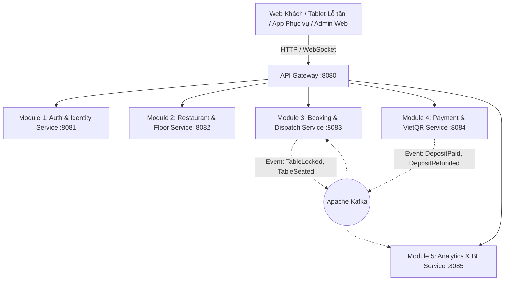

# BẢNG PHÂN BỔ TOÀN DIỆN USE CASES VÀO 5 MICROSERVICES
# DỰ ÁN HỆ THỐNG QUẢN LÝ ĐẶT BÀN & ĐIỀU PHỐI MẶT BẰNG (TABLEMASTER)

> **Mã tài liệu:** ARCH-UC-MAPPING-TABLEMASTER-01  
> **Phiên bản:** 1.0.0  
> **Kiến trúc:** Microservices Spring Boot 3.x, Eureka, API Gateway, Kafka, Redis, PostgreSQL 16 (JSONB)  
> **Quy chuẩn:** Phân bổ cho 5 thành viên nhóm phát triển  

---

## 1. TỔNG QUAN HỆ THỐNG 5 MICROSERVICES & PHÂN CHIA THÀNH VIÊN

Dựa trên quy chuẩn kiến trúc phân rã theo Domain-Driven Design (DDD), toàn bộ **36 Use Cases** (33 UC nghiệp vụ + 3 UC tiến trình tự động nền) của hệ thống **TableMaster** được phân chia cho 5 thành viên theo 5 Microservices độc lập:

### Bảng Tóm Tắt Quy Chuẩn 5 Module:

| STT | Phân hệ (Module) | Tên Microservice | Cổng (Port) | Thành viên phụ trách | Trách nhiệm cốt lõi | Số lượng UC |
| :---: | :--- | :--- | :---: | :---: | :--- | :---: |
| **4.1** | **Module 1** | **Auth & Identity Service** | `8081` | **Thành viên 1** | Xác thực RSA256, Quản lý tài khoản, Hồ sơ thực khách, Hạng VIP & Đánh giá CSAT. | **4 UC** |
| **4.2** | **Module 2** | **Restaurant & Floor Service** | `8082` | **Thành viên 2** | Sơ đồ tầng 2D, Canvas Builder, Menu món ăn, Cấu hình ca giờ & Khóa bàn bảo trì. | **6 UC** |
| **4.3** | **Module 3** | **Booking & Dispatch Service** | `8083` | **Thành viên 3** | Vòng đời đơn đặt bàn, Khóa Redis Redlock 5p, Tablet Lễ tân Live, Bếp KDS, App Waitstaff & Workers ngầm. | **19 UC** |
| **4.4** | **Module 4** | **Payment & VietQR Service** | `8084` | **Thành viên 4** | Sinh mã VietQR EMVCo, Webhook HMAC-SHA256, Quản lý Escrow, Ma trận hoàn cọc & Đối soát ca. | **6 UC** |
| **4.5** | **Module 5** | **Analytics & BI Service** | `8085` | **Thành viên 5** | Phân tích RevPASH, Tỷ lệ No-Show, Xoay vòng bàn và Bản đồ nhiệt (Heatmap) trên sơ đồ. | **2 UC** |

---

## 2. PHÂN TÍCH CHI TIẾT TỪNG MODULE & DANH SÁCH USE CASE

---

### 4.1. Module 1 (Thành viên 1): Auth & Identity Service (Port: 8081)

* **Công nghệ & Trách nhiệm:** Spring Boot, Spring Security 6, JWT RSA256, Redis Token Cache.
* **Mục tiêu:** Cung cấp dịch vụ đăng nhập, quản lý định danh người dùng trên toàn hệ thống (Customer, Host, Waitstaff, Chef, Admin), lưu trữ sở thích ẩm thực và điểm thưởng thành viên VIP.

| Mã UC | Tên Use Case | Độ ưu tiên | Vai trò trong Service |
| :---: | :--- | :---: | :--- |
| **UC-01** | **Đăng ký & Đăng nhập Đa kênh (Multi-channel Authentication)** | High | Cấp phát RSA256 Access Token (TTL 15p), Refresh Token (Redis TTL 7 ngày), xác thực Email, Google One-tap, SMS OTP. |
| **UC-02** | **Quản lý Hồ sơ & Sở thích Ẩm thực (Diner Profile & Preferences)** | Medium | Lưu hồ sơ cá nhân, ghi chú dị ứng (hải sản, đậu phộng...), chế độ ăn (chay, không cay), vị trí ngồi ưa thích và ngày sinh nhật/kỷ niệm. |
| **UC-09** | **Áp dụng Mã giảm giá & Điểm thưởng VIP (Loyalty & VIP Points)** | Medium | Quản lý ví điểm thành viên VIP, hạng thẻ (Đồng, Bạc, Vàng, Kim Cương), trừ điểm thưởng khi khách yêu cầu khấu trừ tiền cọc. |
| **UC-14** | **Đánh giá Chất lượng Phục vụ & Món ăn (Post-dining Review & Rating)** | Medium | Tiếp nhận khảo sát CSAT (1-5 sao, nhận xét thái độ và không gian), cộng 50 điểm thưởng thành viên vào tài khoản sau khi đánh giá. |

---

### 4.2. Module 2 (Thành viên 2): Restaurant & Floor Service (Port: 8082)

* **Công nghệ & Trách nhiệm:** Spring Boot, PostgreSQL 16 (JSONB), React Konva.js, REST API.
* **Mục tiêu:** Quản trị cấu hình không gian vật lý của nhà hàng, cấu trúc đa tầng, danh mục món ăn (Menu), khung giờ hoạt động và quy tắc công suất trần.

| Mã UC | Tên Use Case | Độ ưu tiên | Vai trò trong Service |
| :---: | :--- | :---: | :--- |
| **UC-05** | **Tương tác Sơ đồ 2D Mặt bằng (Interactive Canvas Floor Map)** | High | Cung cấp cấu trúc dữ liệu tọa độ bàn, hình dạng, góc view để Client render trên Canvas React-Konva (Zoom, Pan, Tooltip chi tiết). |
| **UC-23** | **Khóa bàn Khẩn cấp do Bảo trì (Emergency Table Maintenance Lock)** | Medium | Quản lý trạng thái hạ tầng vật lý bàn; cho phép Quản lý ca chuyển bàn sang `MAINTENANCE` khi bị hỏng hóc, khóa cứng trên Web đặt bàn. |
| **UC-27** | **Trình vẽ Mặt bằng Kéo-thả (Konva.js Floor Plan Builder)** | High | Công cụ Admin thiết kế không gian: kéo-thả bàn tròn, bàn vuông, quầy bar, vách tường, bắt dính lưới 20px, xoay $0-360^\circ$, lưu JSONB đa tầng. |
| **UC-28** | **Cấu hình Khung giờ & Công suất Tối đa Ca (Shift & Capacity Setup)** | High | Thiết lập ca trưa/tối, thời lượng ca và giới hạn công suất tối đa của ca (BR-06: Max Capacity Ceiling) để chống quá tải phục vụ. |
| **UC-29** | **Quản lý Thực đơn, Món Đặt trước & Biểu phí Cọc (Menu & Deposit Setup)** | High | CRUD danh mục món ăn, giá bán, cờ cho phép đặt trước (`is_preorder`), cấu hình mức cọc tiêu chuẩn của quán hoặc cọc riêng từng bàn VIP. |
| **UC-30** | **Cấu hình Ngày lễ & Blackout Dates (Special Events & Holiday Pricing)** | Medium | Cấu hình chính sách cọc tăng cường ngày lễ (Valentine, Noel, Tết) hoặc khóa chặn ngày (`Blackout Date`) khi nhà hàng có sự kiện riêng. |

---

### 4.3. Module 3 (Thành viên 3): Booking & Dispatch Service (Port: 8083)

* **Công nghệ & Trách nhiệm:** Spring Boot, Redis Redlock, WebSocket STOMP, Apache Kafka, Quartz Scheduler.
* **Mục tiêu:** Trọng tâm vận hành (Core Engine): quản lý toàn bộ vòng đời đặt bàn, chống race-condition giữ bàn, điều phối sảnh trực tiếp trên Tablet Lễ tân, tích hợp KDS Bếp, Mobile Waitstaff và các Background Workers.

| Mã UC | Tên Use Case | Độ ưu tiên | Vai trò trong Service |
| :---: | :--- | :---: | :--- |
| **UC-03** | **Xem Lịch sử & Hóa đơn Cọc Điện tử (Booking History & Invoices)** | High | Tra cứu danh sách đơn đặt quá khứ/hiện tại, lấy lại mã QR vé check-in, tính năng Đặt lại bàn cũ 1-chạm (Re-book). |
| **UC-04** | **Tra cứu Bàn trống theo Ca giờ & Số người (Availability Search Engine)** | High | Thuật toán quét bàn trống theo ngày, ca giờ, số khách (Min/Max Capacity - BR-01) và loại trừ các bàn đã được đặt/giữ chỗ. |
| **UC-06** | **Khóa Giữ bàn 5 phút & Xử lý Tranh chấp (Redlock Concurrency Hold)** | High | Kích hoạt Redis Redlock khóa bàn trong 300 giây khi khách chọn (BR-02), bắn WebSocket STOMP đổi màu vàng nhấp nháy, hiển thị đồng hồ 05:00. |
| **UC-07** | **Chọn Món ăn Signature Đặt trước (Pre-order Signature Menu)** | Medium | Tiếp nhận danh sách món đặc biệt (Bò Wagyu A5, Rượu decant...) gắn liền vào dữ liệu đơn đặt bàn. |
| **UC-08** | **Ghi chú Nhu cầu Đặc biệt & Dị ứng (Special Requests & Dietary Notes)** | High | Lưu thông tin yêu cầu tiệc, chuẩn bị ghế trẻ em high-chair, nến thơm, không cay; đồng bộ dữ liệu sang Tablet Lễ tân và KDS Bếp. |
| **UC-10** | **Đặt tiệc Sinh nhật / Sự kiện Bao trọn tầng (Private Banquet Booking)** | Medium | Tiếp nhận đơn đặt tiệc đoàn đông / bao trọn tầng (`EVENT_INQUIRY`), kích hoạt thông báo chuông tới Quản lý ca để gọi tư vấn trực tiếp. |
| **UC-12** | **Nhận Vé điện tử QR Check-in (E-Ticket with Dynamic QR Code)** | High | Cấp phát vé điện tử chứa mã QR động bảo mật (Token 64 ký tự chống giả mạo) gắn với mã đơn đặt bàn. |
| **UC-15** | **Xem Sơ đồ Sàn Live Đa tầng trên Tablet (Host Floor Live View)** | High | Đẩy dữ liệu thời gian thực qua WebSocket STOMP (<300ms) lên Tablet Lễ tân: bàn trống, bàn đã cọc, bàn có khách ăn, đồng hồ thời gian ngồi. |
| **UC-16** | **Quét Camera nhận diện Vé QR Check-in (Host Camera QR Scanner)** | High | Tiếp nhận chuỗi mã QR quét từ Camera Tablet Lễ tân, đối soát hợp lệ và chuyển trạng thái bàn sang `SEATED`. |
| **UC-17** | **Đổi trạng thái bàn 1 chạm trên Tablet (One-touch Table Status)** | High | API chuyển nhanh trạng thái bàn tại sảnh: `SEATED` $\rightarrow$ `CALL_BILL` $\rightarrow$ `CLEANING` $\rightarrow$ `AVAILABLE`. |
| **UC-18** | **Xếp chỗ Cấp tốc cho Khách vãng lai (Walk-in Fast Allocation)** | High | Lễ tân chạm bàn trống trên sơ đồ, nhập số khách, tạo đơn `OCCUPIED` lập tức cho khách vãng lai mà không qua bước cọc tiền. |
| **UC-19** | **Chuyển đổi Vị trí Bàn giữa chừng (Table Re-assignment)** | Medium | Chuyển đổi bàn theo yêu cầu của khách (BR-10): chuyển toàn bộ cọc và món sang bàn mới, trả bàn cũ về trạng thái dọn dẹp. |
| **UC-20** | **Gợi ý & Thực hiện Ghép bàn Thông minh (Smart Table Merging)** | Low | Thuật toán Euclidean (BR-05) quét gợi ý ghép 2 bàn gần nhau ($\le$ 120px, không vách ngăn) và liên kết thành 1 đơn phục vụ chung. |
| **UC-21** | **Ghi chú Nội bộ Chăm sóc Khách Bàn (Internal Host VIP Notes)** | Medium | Ghi chú nội bộ nhạy cảm ca trực (khách thân quen của chủ, khách phàn nàn điều hòa, bàn VIP) hiển thị riêng trên Tablet. |
| **UC-25** | **Tiếp nhận Danh sách Món Đặt trước trên KDS (Kitchen Pre-order Board)** | Medium | Màn hình KDS Bếp hiển thị danh sách các bàn sắp đến trong 30 phút có món đặt trước để Bếp trưởng chủ động tẩm ướp, rã đông. |
| **UC-26** | **Cập nhật Trạng thái Chế biến Món ăn (Food Preparation Status)** | Medium | Bếp chạm nút cập nhật tiến độ: `Đang chế biến` $\rightarrow$ `Sẵn sàng lên món`, đồng bộ sang Lễ tân để phục vụ ngay khi khách ngồi. |
| **UC-33** | **App Phục Vụ Tại Bàn Di Động (Mobile Waitstaff Ordering & Actions)** | High | Mobile app cho nhân viên phục vụ: gọi món tại bàn, nhập món riêng ngoài menu, bắn order tức thì về KDS bếp, thao tác đổi/ghép bàn. |
| **UC-A1** | **Tiến trình Tự động Giải phóng Bàn quá hạn 5 phút (Auto-Release Worker)** | High | Worker ngầm tự động kích hoạt sau 300s nếu khách không thanh toán cọc: nhả khóa Redlock (BR-02), bắn Kafka đổi màu bàn về Xanh lá. |
| **UC-A3** | **Tiến trình Gửi Email & SMS Nhắc hẹn trước 2 giờ (Reminder Worker)** | Medium | Scheduler ngầm quét gửi Email/Zalo ZNS nhắc giờ hẹn trước 120 phút kèm mã QR check-in và hướng dẫn đỗ xe cho khách. |

---

### 4.4. Module 4 (Thành viên 4): Payment & VietQR Service (Port: 8084)

* **Công nghệ & Trách nhiệm:** Spring Boot, VietQR SDK (EMVCo), HMAC-SHA256 Security, PayOS/Ngân hàng API, Kafka.
* **Mục tiêu:** Quản trị toàn bộ các luồng giao dịch tài chính: sinh mã VietQR động, tiếp nhận Webhook ngân hàng, giữ tiền cọc tạm (Escrow), xử lý ma trận hoàn hủy (BR-04) và đối soát tài chính ca trực.

| Mã UC | Tên Use Case | Độ ưu tiên | Vai trò trong Service |
| :---: | :--- | :---: | :--- |
| **UC-09** | **Áp dụng Mã giảm giá & Voucher (Promo Code Deduction)** | Medium | Kiểm tra tính hợp lệ của mã voucher (`WELCOME20`, `VIPDINER`), tính toán trừ tiền cọc trực tiếp trên hóa đơn thanh toán. |
| **UC-11** | **Quét mã VietQR Thanh toán cọc Tự động (Dynamic VietQR Auto-Deposit)** | High | Sinh ảnh mã VietQR động chuẩn EMVCo chứa đúng số tiền và cú pháp định danh; tiếp nhận Webhook ngân hàng tự động (HMAC-SHA256, BR-07) trong 1-3s. |
| **UC-13** | **Tự hủy Đặt bàn & Yêu cầu Hoàn cọc (Self-cancellation & Refund)** | Medium | Áp dụng Ma trận hoàn cọc tự động (BR-04: $\ge$ 24h hoàn 100%, 6-24h hoàn 50%, < 6h hoàn 0%); kích hoạt hoàn tiền về tài khoản ngân hàng. |
| **UC-22** | **Xử lý Hủy cọc & Hoàn tiền theo Chính sách (Refund Approval Workflow)** | Medium | Giao diện cho Quản lý ca duyệt lệnh hoàn tiền trong các trường hợp sự cố bất khả kháng, gọi API cổng thanh toán hoàn tiền tự động trong 24h. |
| **UC-24** | **Bàn giao Ca trực & Đối soát Tiền cọc Ca (Shift Handover & Reconciliation)** | Medium | Xuất báo cáo tài chính cuối ca: tổng cọc VietQR thu được, tổng tiền hoàn trả, tổng doanh thu phạt No-Show để ký bàn giao giữa các ca. |
| **UC-A2** | **Tiến trình Tự động Phạt No-Show sau 15 phút (Auto No-Show Penalty Worker)** | High | Phối hợp với Booking Service: Sau 15 phút giờ hẹn (BR-03), tịch thu tiền cọc (BR-04) từ tài khoản tạm giữ kết chuyển vào doanh thu phạt của quán. |

---

### 4.5. Module 5 (Thành viên 5): Analytics & BI Service (Port: 8085)

* **Công nghệ & Trách nhiệm:** Spring Boot, PostgreSQL OLAP, Chart.js / Recharts, Heatmap Generator.
* **Mục tiêu:** Xử lý và trực quan hóa dữ liệu kinh doanh, tính toán các chỉ số quản trị nhà hàng cao cấp (RevPASH, No-show, Turnover rate) và sinh bản đồ nhiệt độ vị trí bàn ăn.

| Mã UC | Tên Use Case | Độ ưu tiên | Vai trò trong Service |
| :---: | :--- | :---: | :--- |
| **UC-31** | **Báo cáo Doanh thu, RevPASH & Tỷ lệ No-Show (Revenue & RevPASH Analytics)** | High | Phân tích tài chính & vận hành: • **RevPASH:** Doanh thu trên mỗi ghế khả dụng theo giờ. • **Tỷ lệ xoay vòng bàn:** Số lượt khách ngồi trên mỗi bàn trong ca. • **Tỷ lệ No-Show:** Đo lường xu hướng khách bùng hẹn theo ngày trong tuần. |
| **UC-32** | **Bản đồ Nhiệt Vị trí Bàn ăn (Table Popularity Heatmap)** | Low | Trực quan hóa tần suất đặt bàn trên sơ đồ 2D: tô màu **Đỏ cam** cho các bàn hot (view cửa sổ kính, góc sofa) và **Xanh nhạt** cho các bàn vắng khách để tối ưu sắp xếp không gian. |

---

## 3. BẢNG MA TRẬN ÁNH XẠ TOÀN DIỆN 36/36 USE CASES (FULL MAPPING MATRIX)

| STT | Mã UC | Tên Use Case / Chức năng chi tiết | Module Phụ Trách | Service Phụ Trách | Port | Thành viên | Độ ưu tiên |
| :---: | :---: | :--- | :---: | :--- | :---: | :---: | :---: |
| 1 | **UC-01** | Đăng ký & Đăng nhập Đa kênh | Module 1 | Auth & Identity Service | 8081 | Thành viên 1 | High |
| 2 | **UC-02** | Quản lý Hồ sơ & Sở thích Ẩm thực | Module 1 | Auth & Identity Service | 8081 | Thành viên 1 | Medium |
| 3 | **UC-03** | Xem Lịch sử & Hóa đơn Cọc Điện tử | Module 3 | Booking & Dispatch Service | 8083 | Thành viên 3 | High |
| 4 | **UC-04** | Tra cứu Bàn trống theo Ca giờ & Số người | Module 3 | Booking & Dispatch Service | 8083 | Thành viên 3 | High |
| 5 | **UC-05** | Tương tác Sơ đồ 2D Mặt bằng | Module 2 | Restaurant & Floor Service | 8082 | Thành viên 2 | High |
| 6 | **UC-06** | Khóa Giữ bàn 5 phút & Xử lý Tranh chấp | Module 3 | Booking & Dispatch Service | 8083 | Thành viên 3 | High |
| 7 | **UC-07** | Chọn Món ăn Signature Đặt trước | Module 3 | Booking & Dispatch Service | 8083 | Thành viên 3 | Medium |
| 8 | **UC-08** | Ghi chú Nhu cầu Đặc biệt & Dị ứng | Module 3 | Booking & Dispatch Service | 8083 | Thành viên 3 | High |
| 9 | **UC-09** | Áp dụng Mã giảm giá & Điểm thưởng VIP | Module 1 & 4 | Auth (Loyalty) / Payment (Promo) | 8081 / 8084 | TV 1 & TV 4 | Medium |
| 10 | **UC-10** | Đặt tiệc Sinh nhật / Sự kiện Bao trọn tầng | Module 3 | Booking & Dispatch Service | 8083 | Thành viên 3 | Medium |
| 11 | **UC-11** | Quét mã VietQR Thanh toán cọc Tự động | Module 4 | Payment & VietQR Service | 8084 | Thành viên 4 | High |
| 12 | **UC-12** | Nhận Vé điện tử QR Check-in | Module 3 | Booking & Dispatch Service | 8083 | Thành viên 3 | High |
| 13 | **UC-13** | Tự hủy Đặt bàn & Yêu cầu Hoàn cọc | Module 4 | Payment & VietQR Service | 8084 | Thành viên 4 | Medium |
| 14 | **UC-14** | Đánh giá Chất lượng Phục vụ & Món ăn | Module 1 | Auth & Identity Service | 8081 | Thành viên 1 | Medium |
| 15 | **UC-15** | Xem Sơ đồ Sàn Live Đa tầng trên Tablet | Module 3 | Booking & Dispatch Service | 8083 | Thành viên 3 | High |
| 16 | **UC-16** | Quét Camera nhận diện Vé QR Check-in | Module 3 | Booking & Dispatch Service | 8083 | Thành viên 3 | High |
| 17 | **UC-17** | Đổi trạng thái bàn 1 chạm trên Tablet | Module 3 | Booking & Dispatch Service | 8083 | Thành viên 3 | High |
| 18 | **UC-18** | Xếp chỗ Cấp tốc cho Khách vãng lai | Module 3 | Booking & Dispatch Service | 8083 | Thành viên 3 | High |
| 19 | **UC-19** | Chuyển đổi Vị trí Bàn giữa chừng | Module 3 | Booking & Dispatch Service | 8083 | Thành viên 3 | Medium |
| 20 | **UC-20** | Gợi ý & Thực hiện Ghép bàn Thông minh | Module 3 | Booking & Dispatch Service | 8083 | Thành viên 3 | Low |
| 21 | **UC-21** | Ghi chú Nội bộ Chăm sóc Khách Bàn | Module 3 | Booking & Dispatch Service | 8083 | Thành viên 3 | Medium |
| 22 | **UC-22** | Xử lý Hủy cọc & Hoàn tiền theo Chính sách | Module 4 | Payment & VietQR Service | 8084 | Thành viên 4 | Medium |
| 23 | **UC-23** | Khóa bàn Khẩn cấp do Bảo trì | Module 2 | Restaurant & Floor Service | 8082 | Thành viên 2 | Medium |
| 24 | **UC-24** | Bàn giao Ca trực & Đối soát Tiền cọc Ca | Module 4 | Payment & VietQR Service | 8084 | Thành viên 4 | Medium |
| 25 | **UC-25** | Tiếp nhận Danh sách Món Đặt trước trên KDS| Module 3 | Booking & Dispatch Service | 8083 | Thành viên 3 | Medium |
| 26 | **UC-26** | Cập nhật Trạng thái Chế biến Món ăn | Module 3 | Booking & Dispatch Service | 8083 | Thành viên 3 | Medium |
| 27 | **UC-27** | Trình vẽ Mặt bằng Kéo-thả (Konva Builder) | Module 2 | Restaurant & Floor Service | 8082 | Thành viên 2 | High |
| 28 | **UC-28** | Cấu hình Khung giờ & Công suất Tối đa Ca | Module 2 | Restaurant & Floor Service | 8082 | Thành viên 2 | High |
| 29 | **UC-29** | Quản lý Thực đơn, Món Đặt trước & Biểu cọc| Module 2 | Restaurant & Floor Service | 8082 | Thành viên 2 | High |
| 30 | **UC-30** | Cấu hình Ngày lễ & Blackout Dates | Module 2 | Restaurant & Floor Service | 8082 | Thành viên 2 | Medium |
| 31 | **UC-31** | Báo cáo Doanh thu, RevPASH & No-Show | Module 5 | Analytics & BI Service | 8085 | Thành viên 5 | High |
| 32 | **UC-32** | Bản đồ Nhiệt Vị trí Bàn ăn (Heatmap) | Module 5 | Analytics & BI Service | 8085 | Thành viên 5 | Low |
| 33 | **UC-33** | App Phục Vụ Tại Bàn Di Động | Module 3 | Booking & Dispatch Service | 8083 | Thành viên 3 | High |
| 34 | **UC-A1** | Worker Tự động Giải phóng Bàn quá hạn 5p | Module 3 | Booking & Dispatch Service | 8083 | Thành viên 3 | High |
| 35 | **UC-A2** | Worker Tự động Phạt No-Show sau 15p | Module 3 & 4 | Booking (Status) & Payment (Phạt cọc)| 8083 / 8084 | TV 3 & TV 4 | High |
| 36 | **UC-A3** | Worker Gửi Email & SMS Nhắc hẹn trước 2h | Module 3 | Booking & Dispatch Service | 8083 | Thành viên 3 | Medium |

---

## 4. QUY TRÌNH GIAO TIẾP LIÊN SERVICE (INTER-SERVICE FLOWS)

### 4.1. Luồng Khách Đặt Bàn & Thanh Toán Cọc VietQR
1. **Khách hàng** chọn bàn $\rightarrow$ **Module 3 (Port 8083)** kích hoạt Redis Redlock (`lock:table:{id}` TTL 300s).
2. **Module 3** gọi sang **Module 2 (Port 8082)** để lấy biểu phí cọc của bàn và giá món signature đặt trước.
3. **Module 3** gọi sang **Module 4 (Port 8084)** yêu cầu tạo giao dịch cọc $\rightarrow$ **Module 4** sinh mã VietQR EMVCo kèm nội dung định danh.
4. Khách quét mã chuyển tiền $\rightarrow$ Ngân hàng bắn Webhook về **Module 4** $\rightarrow$ **Module 4** xác thực chữ ký HMAC-SHA256, chuyển trạng thái tiền cọc sang `HELD_IN_ESCROW`.
5. **Module 4** phát sự kiện `DepositConfirmedEvent` lên Kafka topic `payment.events`.
6. **Module 3** lắng nghe topic, cập nhật trạng thái đơn sang `CONFIRMED`, nhả Redlock và sinh vé điện tử QR ([UC-12](file:///d:/File/KÌ%207/SBA301/UC/USE_CASES_AND_FEATURES_TABLEMASTER.md#L410-L417)), đồng thời đẩy WebSocket STOMP đổi màu bàn sang ĐỎ trên toàn hệ thống.

### 4.2. Luồng Lễ Tân Quét QR Check-in Đón Khách
1. Khách đến cửa xuất trình vé QR $\rightarrow$ Lễ tân dùng Tablet quét ([UC-16](file:///d:/File/KÌ%207/SBA301/UC/USE_CASES_AND_FEATURES_TABLEMASTER.md#L448-L458)).
2. **Module 3 (Port 8083)** xác thực mã vé 64 ký tự $\rightarrow$ đổi trạng thái bàn sang `SEATED`.
3. **Module 3** bắn thông báo WebSocket sang màn hình KDS của **Module 3 / Bếp** ([UC-25](file:///d:/File/KÌ%207/SBA301/UC/USE_CASES_AND_FEATURES_TABLEMASTER.md#L532-L539)) để bếp chuẩn bị mang các món đã đặt trước ra phục vụ.

---

## 5. ĐỀ XUẤT CÂN BẰNG TẢI TRONG NHÓM (WORKLOAD BALANCING)

* **Thành viên 3 (Booking & Dispatch):** Có số lượng Use Case nhiều nhất (19 UC) vì ôm trọn logic vận hành sảnh, máy tính bảng Lễ tân, Bếp KDS và App Waitstaff.
  * **Hỗ trợ từ Thành viên 1:** Thành viên 1 có thể hỗ trợ đảm nhận toàn bộ việc viết Mail/SMS Service cho tiến trình [UC-A3](file:///d:/File/KÌ%207/SBA301/UC/USE_CASES_AND_FEATURES_TABLEMASTER.md#L635-L641).
  * **Hỗ trợ từ Thành viên 4:** Thành viên 4 đảm nhận toàn bộ luồng xử lý tài chính phạt tiền No-show của [UC-A2](file:///d:/File/KÌ%207/SBA301/UC/USE_CASES_AND_FEATURES_TABLEMASTER.md#L624-L633).
* **Thành viên 2 (Restaurant & Floor):** Chịu trách nhiệm module kỹ thuật rất khó là **Trình vẽ Canvas React-Konva** ([UC-27](file:///d:/File/KÌ%207/SBA301/UC/USE_CASES_AND_FEATURES_TABLEMASTER.md#L547-L555) và [UC-05](file:///d:/File/KÌ%207/SBA301/UC/USE_CASES_AND_FEATURES_TABLEMASTER.md#L332-L341)) - kéo thả tọa độ, xoay góc bàn và lưu JSONB.
* **Thành viên 4 (Payment):** Trọng tâm là độ tin cậy và bảo mật giao dịch (chống giả mạo chữ ký webhook ngân hàng, xử lý tranh chấp hoàn tiền theo thời gian hủy bàn).
* **Thành viên 5 (Analytics):** Trọng tâm là các câu lệnh SQL thống kê OLAP, tính toán thuật toán công thức RevPASH và thuật toán tạo ma trận Heatmap hiển thị màu trên sơ đồ tầng.
