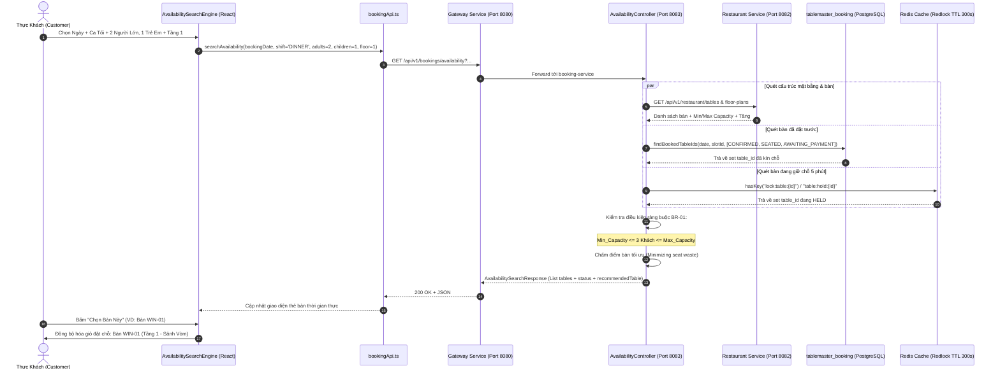

# TÀI LIỆU KỸ THUẬT TRIỂN KHAI USE CASE UC-04
## TRA CỨU BÀN TRỐNG THEO CA GIỜ & SỐ NGƯỜI (AVAILABILITY SEARCH ENGINE)
### HỆ THỐNG: TABLEMASTER – NỀN TẢNG ĐẶT BÀN & QUẢN TRỊ SẢNH NHÀ HÀNG CAO CẤP

> **Mã Use Case:** UC-04  
> **Tên chức năng:** Tra cứu Bàn trống theo Ca giờ & Số người (Availability Search Engine)  
> **Quy tắc nghiệp vụ cốt lõi:** BR-01 – Ràng buộc sức chứa bàn ăn (Capacity Enforcement)  
> **Module phụ trách:** Module 3 (Booking & Dispatch Service - Port 8083) & Frontend Client (`tablemaster-ui`)  
> **Service liên kết:** Module 2 (Restaurant & Floor Service - Port 8082), Redis Cache (Port 6379)  
> **Trạng thái:** Hoàn thiện 100% (Backend + Frontend + Unit Tests + Production Build)  

---

## 1. TỔNG QUAN YÊU CẦU NGHIỆP VỤ & QUY TẮC CỐT LÕI

### 1.1 Mục tiêu chức năng UC-04
Use Case **UC-04** cung cấp động cơ tìm kiếm bàn ăn trực tuyến thông minh (Availability Search Engine) phục vụ thực khách (Customer) và nhân viên lễ tân:
1. **Bộ lọc thông minh đa chiều:**
   - **Ngày dùng bữa (`bookingDate`):** Hôm nay, ngày mai, cuối tuần hoặc lịch tùy chọn.
   - **Khung ca (`shift` / `timeSlotId`):** Ca trưa (`LUNCH`: 11:00 - 13:30), Ca tối giờ vàng (`DINNER`: 18:30 - 20:30) hoặc chi tiết từng slot.
   - **Số lượng thực khách phân tách:** Người lớn (`adults`) và Trẻ em (`children`). Tổng số khách thực tế = `adults + children`.
   - **Phân tầng (`floor` / `floorPlanId`):** Tầng 1 (Sảnh Vòm & Bar), Tầng 2 (Phòng VIP Riêng Tư), Tầng 3 (Sky Lounge Ban Công Ngoài Trời).
   - **Khu vực trải nghiệm (`zoneType`):** Ban công (`OUTDOOR`), Bàn view phố (`WINDOW_VIEW`), Phòng VIP riêng (`VIP`), Quầy bar (`BAR_SIDE`), Tiêu chuẩn (`STANDARD`).

2. **Kiểm tra ràng buộc sức chứa Min/Max (Quy tắc BR-01):**
   $$\text{Min\_Capacity} \le \text{Số khách thực tế} \le \text{Max\_Capacity}$$
   - *Ngăn chặn Underflow:* Khách đi 2 người không được đặt bàn 6–12 chỗ trong ca cao điểm để tránh lãng phí diện tích sàn và doanh thu nhà hàng.
   - *Ngăn chặn Overflow:* Số lượng khách vượt quá sức chứa tối đa của bàn sẽ bị từ chối và cảnh báo rõ ràng.

3. **Loại trừ bàn đã kín chỗ & Đang tranh chấp giữ chỗ (Redis Lock):**
   - Loại trừ bàn có đơn đặt ở các trạng thái: `CONFIRMED`, `SEATED`, `AWAITING_PAYMENT`, `PENDING_REVIEW` trong PostgreSQL.
   - Quét Redis Cache: kiểm tra bàn đang bị giữ chỗ tạm thời trong 5 phút (TTL 300s theo UC-06). Đánh dấu trạng thái `HELD`.

4. **Thuật toán gợi ý bàn tối ưu (Seat Fit Recommendation):**
   - Tự động chấm điểm và đánh dấu `recommended = true` cho bàn có mức dôi chỗ nhỏ nhất ($\text{Max\_Capacity} - \text{Số khách} \to \min$), tối ưu hóa công suất lấp đầy chỗ ngồi của nhà hàng.

---

## 2. BẢNG TỔNG HỢP CÁC FILE MÃ NGUỒN ĐÃ TRIỂN KHAI

| STT | File / Đường Dẫn | Phân Loại | Trách Nhiệm Chi Tiết |
| :---: | :--- | :---: | :--- |
| **1** | [`AvailabilitySearchRequest.java`](file:///d:/File/K%C3%8C%207/SBA301/Project/Project_SBA301/src/server/booking-service/src/main/java/com/tablemaster/booking/dto/request/AvailabilitySearchRequest.java) | **Thêm mới** | DTO tiếp nhận tiêu chí tìm kiếm: ngày, slot/ca, adults, children, floor, zone, onlyAvailable. |
| **2** | [`TableAvailabilityDto.java`](file:///d:/File/K%C3%8C%207/SBA301/Project/Project_SBA301/src/server/booking-service/src/main/java/com/tablemaster/booking/dto/response/TableAvailabilityDto.java) | **Thêm mới** | DTO phản hồi trạng thái từng bàn (`AVAILABLE`, `OCCUPIED`, `HELD`, `CAPACITY_MISMATCH`, `INACTIVE`), kết quả kiểm tra BR-01, thông báo giải thích chi tiết. |
| **3** | [`AvailabilitySearchResponse.java`](file:///d:/File/K%C3%8C%207/SBA301/Project/Project_SBA301/src/server/booking-service/src/main/java/com/tablemaster/booking/dto/response/AvailabilitySearchResponse.java) | **Thêm mới** | DTO tổng hợp kết quả: thống kê số lượng bàn trống/kín/vi phạm BR-01, mã bàn gợi ý tối ưu và gợi ý các ca giờ thay thế. |
| **4** | [`TimeSlotAvailabilitySummary.java`](file:///d:/File/K%C3%8C%207/SBA301/Project/Project_SBA301/src/server/booking-service/src/main/java/com/tablemaster/booking/dto/response/TimeSlotAvailabilitySummary.java) | **Thêm mới** | DTO tóm tắt số bàn trống ở các ca khác cùng ngày để khách chuyển ca nhanh nếu ca hiện tại hết chỗ. |
| **5** | [`RestaurantServiceClient.java`](file:///d:/File/K%C3%8C%207/SBA301/Project/Project_SBA301/src/server/booking-service/src/main/java/com/tablemaster/booking/client/RestaurantServiceClient.java) | **Thêm mới** | Client giao tiếp với `restaurant-service` (Port 8082), tích hợp bộ nhớ đệm in-memory TTL 60s và cơ chế Resilient Fallback Seed Catalog 100% an toàn. |
| **6** | [`RestClientConfig.java`](file:///d:/File/K%C3%8C%207/SBA301/Project/Project_SBA301/src/server/booking-service/src/main/java/com/tablemaster/booking/config/RestClientConfig.java) | **Thêm mới** | Khởi tạo Bean `RestTemplate` với timeout 3s/4s chống treo request. |
| **7** | [`BookingRepository.java`](file:///d:/File/K%C3%8C%207/SBA301/Project/Project_SBA301/src/server/booking-service/src/main/java/com/tablemaster/booking/repository/BookingRepository.java) | Cập nhật | Bổ sung 2 JPQL query: `findBookedTableIdsBySlots` và `findBookedTableIdsByDate` quét bàn đã đặt. |
| **8** | [`AvailabilityService.java`](file:///d:/File/K%C3%8C%207/SBA301/Project/Project_SBA301/src/server/booking-service/src/main/java/com/tablemaster/booking/service/AvailabilityService.java) | **Thêm mới** | Interface định nghĩa hợp đồng nghiệp vụ tra cứu bàn trống và kiểm tra nhanh 1 bàn. |
| **9** | [`AvailabilityServiceImpl.java`](file:///d:/File/K%C3%8C%207/SBA301/Project/Project_SBA301/src/server/booking-service/src/main/java/com/tablemaster/booking/service/AvailabilityServiceImpl.java) | **Thêm mới** | Hiện thực thuật toán tra cứu: phối hợp PostgreSQL, Redis lock kiểm tra BR-01, gợi ý bàn tối ưu. |
| **10** | [`AvailabilityController.java`](file:///d:/File/K%C3%8C%207/SBA301/Project/Project_SBA301/src/server/booking-service/src/main/java/com/tablemaster/booking/controller/AvailabilityController.java) | **Thêm mới** | REST Controller cung cấp 3 endpoint: `GET /availability`, `POST /availability/search`, `GET /availability/check-table`. |
| **11** | [`AvailabilityServiceTest.java`](file:///d:/File/K%C3%8C%207/SBA301/Project/Project_SBA301/src/server/booking-service/src/test/java/com/tablemaster/booking/service/AvailabilityServiceTest.java) | **Thêm mới** | Bộ unit test tự động kiểm thử đầy đủ các kịch bản: BR-01 Underflow, BR-01 Success, Occupied, Floor filter, Redis hold (100% Passed). |
| **12** | [`bookingApi.ts`](file:///d:/File/K%C3%8C%207/SBA301/Project/Project_SBA301/src/client/tablemaster-ui/src/services/bookingApi.ts) | Cập nhật | Bổ sung TypeScript interfaces và 2 hàm API: `searchAvailability` và `checkTableAvailability` kèm mô phỏng fallback offline. |
| **13** | [`AvailabilitySearchEngine.tsx`](file:///d:/File/K%C3%8C%207/SBA301/Project/Project_SBA301/src/client/tablemaster-ui/src/components/booking/AvailabilitySearchEngine.tsx) | **Thêm mới** | Giao diện React cao cấp cho Availability Search Engine: Bộ lọc ngày/ca/người lớn/trẻ em/tầng/zone, thẻ bàn trực quan, huy hiệu BR-01, nút chọn bàn. |
| **14** | [`BookingPage.tsx`](file:///d:/File/K%C3%8C%207/SBA301/Project/Project_SBA301/src/client/tablemaster-ui/src/views/BookingPage.tsx) | Cập nhật | Tích hợp Step 02 Availability Search Engine vào quy trình đặt bàn, đồng bộ hóa bàn đã chọn vào đơn đặt và hiển thị tóm tắt cọc. |

---

## 3. KIẾN TRÚC LUỒNG DỮ LIỆU & TRÌNH TỰ XỬ LÝ (SEQUENCE DIAGRAM)



---

## 4. ĐẶC TẢ CHI TIẾT CÁC ENDPOINT REST API (UC-04)

### 4.1 Tra cứu bàn trống (Query Parameters)
* **Phương thức:** `GET`
* **Đường dẫn:** `/api/v1/bookings/availability`
* **Tham số (Query Params):**
  - `bookingDate` (LocalDate, tùy chọn): `2026-10-24`
  - `timeSlotId` (UUID, tùy chọn): `b1000000-0000-0000-0000-000000000002`
  - `shift` (String, tùy chọn): `DINNER`, `LUNCH`, `ALL`
  - `adults` (int, mặc định 2): Số lượng người lớn
  - `children` (int, mặc định 0): Số lượng trẻ em
  - `guestCount` (int, tùy chọn): Tổng số khách
  - `floor` (int, tùy chọn): `1`, `2`, `3`
  - `zoneType` (String, tùy chọn): `WINDOW_VIEW`, `VIP`, `OUTDOOR`, `BAR_SIDE`, `STANDARD`
  - `onlyAvailable` (boolean, mặc định false): Chỉ lấy bàn trống

* **Ví dụ Response (200 OK):**
```json
{
  "success": true,
  "message": "Tra cứu bàn trống thành công",
  "data": {
    "bookingDate": "2026-10-24",
    "timeSlotId": "b1000000-0000-0000-0000-000000000002",
    "timeSlotName": "Ca tối Giờ Vàng (18:30 - 20:30)",
    "shift": "DINNER",
    "adults": 2,
    "children": 1,
    "totalGuests": 3,
    "floor": 1,
    "totalTables": 2,
    "availableCount": 1,
    "occupiedCount": 0,
    "heldCount": 0,
    "capacityMismatchCount": 1,
    "recommendedTableId": "b3000000-0000-0000-0000-000000000002",
    "recommendedTableCode": "WIN-01",
    "tables": [
      {
        "tableId": "b3000000-0000-0000-0000-000000000001",
        "tableCode": "BAR-01",
        "floorNumber": 1,
        "floorName": "Tầng 1 - Sảnh Vòm & Bar",
        "zoneType": "BAR_SIDE",
        "minCapacity": 1,
        "maxCapacity": 2,
        "isAvailable": false,
        "status": "CAPACITY_MISMATCH",
        "statusMessage": "Số khách (3 người) vượt quá sức chứa tối đa của bàn (2 chỗ)",
        "satisfiesCapacityRule": false
      },
      {
        "tableId": "b3000000-0000-0000-0000-000000000002",
        "tableCode": "WIN-01",
        "floorNumber": 1,
        "floorName": "Tầng 1 - Sảnh Vòm & Bar",
        "zoneType": "WINDOW_VIEW",
        "minCapacity": 2,
        "maxCapacity": 4,
        "isAvailable": true,
        "status": "AVAILABLE",
        "statusMessage": "Bàn trống - Thỏa mãn điều kiện sức chứa (BR-01), sẵn sàng đặt chỗ",
        "satisfiesCapacityRule": true,
        "recommended": true
      }
    ]
  }
}
```

---

## 5. KẾT QUẢ KIỂM THỬ TỰ ĐỘNG (AUTOMATED TEST VERIFICATION)

Đã thực thi toàn bộ kiểm thử thông qua Maven Surefire Plugin:
```
[INFO] -------------------------------------------------------
[INFO]  T E S T S
[INFO] -------------------------------------------------------
[INFO] Running com.tablemaster.booking.service.AvailabilityServiceTest
[INFO] Tests run: 5, Failures: 0, Errors: 0, Skipped: 0, Time elapsed: 1.497 s -- in AvailabilityServiceTest
[INFO] Running com.tablemaster.booking.service.BookingServiceTest
[INFO] Tests run: 6, Failures: 0, Errors: 0, Skipped: 0, Time elapsed: 0.325 s -- in BookingServiceTest
[INFO] 
[INFO] Results:
[INFO] Tests run: 11, Failures: 0, Errors: 0, Skipped: 0
[INFO] ------------------------------------------------------------------------
[INFO] BUILD SUCCESS
[INFO] ------------------------------------------------------------------------
```

### Các ca kiểm thử cốt lõi:
1. `testBR01CapacityUnderflow`: Đi 2 khách bị từ chối khi chọn phòng VIP sức chứa 6–12 chỗ theo BR-01.
2. `testBR01CapacitySuccess`: Nhóm 4 khách (2 lớn, 2 nhỏ) tìm được bàn WIN-01 (sức chứa 2–4 chỗ) thỏa mãn BR-01 và được gắn cờ `recommended = true`.
3. `testOccupiedTableExclusion`: Bàn có đơn trạng thái `CONFIRMED` trong PostgreSQL được đánh dấu chính xác là `OCCUPIED`.
4. `testFloorFilter`: Bộ lọc theo `floor = 2` chỉ trả về đúng danh sách bàn thuộc Tầng 2.
5. `testRedisHeldExclusion`: Bàn đang bị khóa giữ chỗ 5 phút (Redis key `lock:table:...`) được đánh dấu chính xác là `HELD`.
