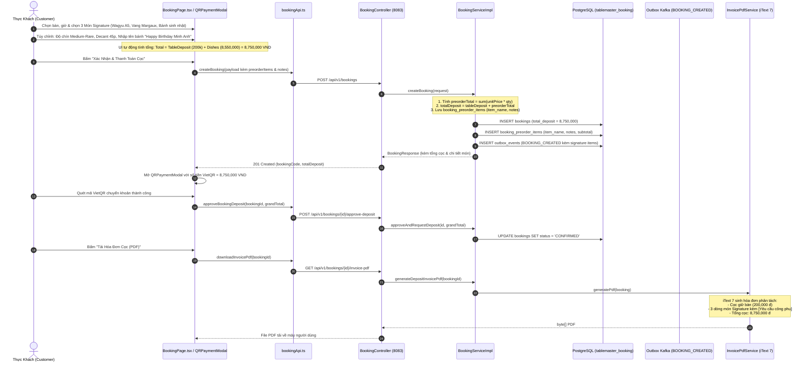

# TÀI LIỆU KỸ THUẬT TRIỂN KHAI USE CASE UC-07
## CHỌN MÓN ĂN SIGNATURE ĐẶT TRƯỚC (PRE-ORDER SIGNATURE MENU)
### HỆ THỐNG: TABLEMASTER – NỀN TẢNG ĐẶT BÀN & QUẢN TRỊ SẢNH NHÀ HÀNG

> **Mã Use Case:** UC-07  
> **Tên chức năng:** Chọn Món ăn Signature Đặt trước (Pre-order Signature Menu)  
> **Phân hệ:** Module 3 (Booking & Dispatch Service - Port 8083), Module 2 (Restaurant Service - Port 8082) & Frontend Client (`tablemaster-ui`)  
> **Ngày hoàn thành:** 24/10/2026  
> **Trạng thái:** Hoàn thiện 100% (Backend + Frontend + Unit Test + Database Schemas)  

---

## 1. TỔNG QUAN NGHIỆP VỤ & MỤC TIÊU CỐT LÕI

Trong mô hình Fine Dining và nhà hàng cao cấp, các món ăn "Signature" (món đỉnh cao độc quyền) đòi hỏi quy trình chuẩn bị vô cùng khắt khe và tốn nhiều thời gian (thịt bò cao cấp cần rã đông và sous-vide chuẩn nhiệt, rượu vang Grand Cru danh tiếng cần decant mở hương trước 30–45 phút, bánh kem sinh nhật cần nghệ nhân làm bánh viết tên chủ tiệc).

**Use Case UC-07** giải quyết bài toán vận hành này bằng cách:
1. **Cho phép thực khách đặt trước các món Signature ngay trong luồng đặt bàn:**
   - **Thăn Bò Wagyu A5 Miyazaki** (1,850,000 VND / phần): Cho phép khách chọn mức độ chín mong muốn (*Medium-Rare*, *Rare*, *Medium*, *Well-Done*) và ghi chú yêu cầu chuẩn bị (Sous-vide nhiệt độ thấp 45 phút).
   - **Vang Đỏ Château Margaux 2018 Premier Grand Cru** (5,800,000 VND / chai): Cho phép khách chọn thời gian Decant trước bằng bình thở pha lê (*Decant 30 phút trước*, *Decant 45 phút trước*, hoặc *Decant tại bàn*) cùng ướp xô đá 16°C.
   - **Bánh Kem Sinh Nhật Thiết Kế Riêng** (900,000 VND / bánh): Khách nhập trực tiếp lời chúc / tên chủ tiệc viết tay trên bánh và yêu cầu nến sinh nhật.
2. **Cộng dồn tiền cọc món ăn vào tổng hóa đơn cọc (Deposit Accumulation):**
   - Đảm bảo nhà hàng không chịu rủi ro hao hụt chi phí nguyên liệu đắt đỏ khi khách không đến (No-show).
   - Tổng tiền cọc thanh toán qua VietQR = **Tiền cọc giữ bàn tiêu chuẩn (200,000 VND)** + **100% Giá trị các món Signature đặt trước**.
3. **Đồng bộ xuyên suốt hệ thống:**
   - Hiển thị bảng phân tích cọc chi tiết tại giao diện đặt bàn, modal quét mã VietQR, lịch sử đơn và tải file PDF hóa đơn tiền cọc có đóng mộc.
   - Đẩy danh sách món ăn kèm ghi chú chuẩn bị công phu vào thông điệp sự kiện Kafka `BOOKING_CREATED` để bộ phận Bếp (Kitchen/POS) chuẩn bị kịp thời trước giờ đón khách.

---

## 2. BẢNG TỔNG HỢP CÁC FILE ĐƯỢC THAY ĐỔI & BỔ SUNG

| STT | File / Đường Dẫn | Phân Hệ | Loại Thay Đổi | Mô Tả Trách Nhiệm Chi Tiết |
| :---: | :--- | :---: | :---: | :--- |
| **1** | [`src/server/booking-service/.../entity/BookingPreorderItem.java`](file:///d:/File/K%C3%8C%207/SBA301/Project/Project_SBA301/src/server/booking-service/src/main/java/com/tablemaster/booking/entity/BookingPreorderItem.java) | Backend | Cập nhật | Bổ sung 2 trường `itemName` (`VARCHAR(150)`) và `notes` (`TEXT`) vào entity để lưu trữ snapshot thông tin món và yêu cầu công phu độc lập với `restaurant-service`. |
| **2** | [`src/server/booking-service/.../dto/request/PreorderItemRequest.java`](file:///d:/File/K%C3%8C%207/SBA301/Project/Project_SBA301/src/server/booking-service/src/main/java/com/tablemaster/booking/dto/request/PreorderItemRequest.java) | Backend | Cập nhật | Bổ sung `itemName` và `notes` vào DTO tiếp nhận từ client. |
| **3** | [`src/server/booking-service/.../dto/response/BookingResponse.java`](file:///d:/File/K%C3%8C%207/SBA301/Project/Project_SBA301/src/server/booking-service/src/main/java/com/tablemaster/booking/dto/response/BookingResponse.java) | Backend | Cập nhật | Cập nhật mapper `fromEntity()` để trả về `itemName` và `notes` trong DTO `PreorderItemResponse`. |
| **4** | [`src/server/booking-service/.../service/BookingServiceImpl.java`](file:///d:/File/K%C3%8C%207/SBA301/Project/Project_SBA301/src/server/booking-service/src/main/java/com/tablemaster/booking/service/BookingServiceImpl.java) | Backend | Cập nhật | - Tính tổng giá trị món preorder `preorderTotal = sum(unitPrice * quantity)`.<br>- Tự động cộng dồn: `totalDeposit = tableDeposit + preorderTotal`.<br>- Lưu trữ `itemName` và `notes` chi tiết trên từng `BookingPreorderItem`.<br>- Fallback lấy `booking.getTotalDeposit()` khi duyệt cọc `approveAndRequestDeposit`. |
| **5** | [`src/server/booking-service/.../kafka/BookingEventProducer.java`](file:///d:/File/K%C3%8C%207/SBA301/Project/Project_SBA301/src/server/booking-service/src/main/java/com/tablemaster/booking/kafka/BookingEventProducer.java) | Backend | Cập nhật | Đóng gói mảng `preorderItems` (kèm `itemName`, `unitPrice`, `subtotal`, `notes`) vào payload sự kiện Kafka `BOOKING_CREATED` cho bếp và sảnh. |
| **6** | [`src/server/booking-service/.../service/InvoicePdfService.java`](file:///d:/File/K%C3%8C%207/SBA301/Project/Project_SBA301/src/server/booking-service/src/main/java/com/tablemaster/booking/service/InvoicePdfService.java) | Backend | Cập nhật | Sinh bảng chi tiết cọc trên hóa đơn PDF: phân tách dòng Cọc giữ bàn và từng dòng Món Signature đặt trước kèm ghi chú `[Yêu cầu công phu: ...]`, thành tiền và tổng cọc chuẩn xác. |
| **7** | [`src/server/booking-service/.../service/BookingServiceTest.java`](file:///d:/File/K%C3%8C%207/SBA301/Project/Project_SBA301/src/server/booking-service/src/test/java/com/tablemaster/booking/service/BookingServiceTest.java) | Backend | Cập nhật | Thêm unit test `createBooking_WithSignaturePreorderDishes_AccumulatesTotalDeposit` kiểm thử tính đúng đắn của phép cộng dồn 8,550,000 VND (100% Passed). |
| **8** | [`infrastructure/db-init/04-booking-schema.sql`](file:///d:/File/K%C3%8C%207/SBA301/Project/Project_SBA301/infrastructure/db-init/04-booking-schema.sql) | Database | Cập nhật | Cập nhật bảng `booking_preorder_items` với `item_name VARCHAR(150)` và `notes TEXT`. |
| **9** | [`infrastructure/db-init/03-restaurant-schema.sql`](file:///d:/File/K%C3%8C%207/SBA301/Project/Project_SBA301/infrastructure/db-init/03-restaurant-schema.sql) | Database | Cập nhật | Seed bổ sung món `b5000000-0000-0000-0000-000000000005` (Bánh Kem Sinh Nhật Thiết Kế Riêng) vào thực đơn nhà hàng. |
| **10** | [`src/client/tablemaster-ui/src/types/index.ts`](file:///d:/File/K%C3%8C%207/SBA301/Project/Project_SBA301/src/client/tablemaster-ui/src/types/index.ts) | Frontend | Cập nhật | Thêm thuộc tính `preparationNotes?: string` vào interface `PreOrderItem`. |
| **11** | [`src/client/tablemaster-ui/src/data/mockData.ts`](file:///d:/File/K%C3%8C%207/SBA301/Project/Project_SBA301/src/client/tablemaster-ui/src/data/mockData.ts) | Frontend | Cập nhật | Cập nhật danh mục món Signature: Wagyu A5 (prep 45p), Château Margaux (decant 30p), và thêm món `cake-1` (Bánh Kem Sinh Nhật Thiết Kế Riêng). |
| **12** | [`src/client/tablemaster-ui/src/services/bookingApi.ts`](file:///d:/File/K%C3%8C%207/SBA301/Project/Project_SBA301/src/client/tablemaster-ui/src/services/bookingApi.ts) | Frontend | Cập nhật | Ánh xạ UUID món ăn thực tế qua `MENU_ITEMS` và `getDishUUID()`, hỗ trợ gửi `itemName` và `notes` trong payload `preorderItems`. |
| **13** | [`src/client/tablemaster-ui/.../views/BookingPage.tsx`](file:///d:/File/K%C3%8C%207/SBA301/Project/Project_SBA301/src/client/tablemaster-ui/src/views/BookingPage.tsx) | Frontend | Cập nhật | - Quản lý state `dishNotes` động theo từng món đã chọn.<br>- Giao diện Mục 4: Bộ chọn nhanh độ chín Steak, nút chọn thời gian Decant rượu vang, ô nhập lời chúc bánh kem.<br>- Khung tóm tắt cộng dồn cọc (Cọc bàn + Cọc món Signature = Tổng cọc VietQR).<br>- Gửi chuẩn xác `grandTotal` và danh sách món sang backend và modal VietQR. |
| **14** | [`src/client/tablemaster-ui/.../common/QRPaymentModal.tsx`](file:///d:/File/K%C3%8C%207/SBA301/Project/Project_SBA301/src/client/tablemaster-ui/src/components/common/QRPaymentModal.tsx) | Frontend | Cập nhật | Bổ sung khu vực hiển thị chi tiết hóa đơn cọc: phân biệt Cọc giữ chỗ bàn và Cọc từng món Signature kèm ghi chú công phu. |
| **15** | [`src/client/tablemaster-ui/.../common/BookingHistoryModal.tsx`](file:///d:/File/K%C3%8C%207/SBA301/Project/Project_SBA301/src/client/tablemaster-ui/src/components/common/BookingHistoryModal.tsx) | Frontend | Cập nhật | Hiển thị chi tiết các món Signature đã đặt trước và ghi chú chuẩn bị trong từng thẻ đơn đặt bàn quá khứ/hiện tại. |

---

## 3. KIẾN TRÚC LUỒNG DỮ LIỆU & SEQUENCE DIAGRAM



---

## 4. QUY TẮC CỘNG DỒN TIỀN CỌC (BUSINESS RULE BR-PREORDER-01)

### 4.1. Công thức tính
$$\text{Total Deposit} = \text{Base Table Deposit} + \sum_{i=1}^{n} (\text{UnitPrice}_i \times \text{Quantity}_i)$$

Trong đó:
- **Base Table Deposit:** Mặc định là **200,000 VND** đối với bàn tiêu chuẩn (hoặc số tiền tùy chỉnh đối với bàn VIP / Phòng riêng Private).
- **Món Signature:** Áp dụng **100% giá trị món** làm tiền cọc đặt trước để đảm bảo chi phí rủi ro nguyên liệu cao cấp.

### 4.2. Bảng kê thực đơn Signature mẫu

| Mã Món | Tên Món Signature | Đơn Giá (VND) | Tùy Chọn Chuẩn Bị Công Phu | Ghi Chú Chuẩn Mặc Định |
| :--- | :--- | :---: | :--- | :--- |
| `b5000000-0000-0000-0000-000000000001` | **Thăn Bò Wagyu A5 Miyazaki** | 1,850,000 | Độ chín: *Medium-Rare*, *Rare*, *Medium*, *Well-Done* | Sous-vide 45 phút nhiệt độ 54°C, áp chảo bơ thảo mộc |
| `b5000000-0000-0000-0000-000000000004` | **Vang Đỏ Château Margaux 2018 Premier Grand Cru** | 5,800,000 | Thời gian Decant: *30 phút trước*, *45 phút trước*, *Tại bàn* | Decant bình pha lê Riedel trước giờ đến, giữ lạnh 16°C |
| `b5000000-0000-0000-0000-000000000005` | **Bánh Kem Sinh Nhật Thiết Kế Riêng** | 900,000 | Nhập văn bản viết tên / lời chúc tùy ý | Bánh kem tươi cao cấp, viết chữ theo yêu cầu và nến sinh nhật |

### 4.3. Ví dụ minh họa hóa đơn đặt trước
Giả sử khách đặt bàn 4 người và chọn cả 3 món Signature:
- Cọc bàn: **200,000 VND**
- 1x Thăn Bò Wagyu A5 Miyazaki: **1,850,000 VND** (Medium-Rare)
- 1x Vang Đỏ Château Margaux 2018: **5,800,000 VND** (Decant 45 phút)
- 1x Bánh Kem Sinh Nhật: **900,000 VND** (Viết tên "Happy Birthday Lan Anh")
$$\Rightarrow \textbf{Tổng tiền cọc VietQR} = 200,000 + 1,850,000 + 5,800,000 + 900,000 = \mathbf{8,750,000\text{ VND}}$$

---

## 5. ĐẶC TẢ API & DỮ LIỆU TRAO ĐỔI (PAYLOAD CONTRACTS)

### 5.1. Request Đặt bàn có Món Signature (`POST /api/v1/bookings`)
```json
{
  "customerId": "c1000000-0000-0000-0000-000000000001",
  "customerName": "Nguyễn Hoàng Duy",
  "customerPhone": "0901234567",
  "customerEmail": "hoangduy@gmail.com",
  "restaurantId": "b0000000-0000-0000-0000-000000000001",
  "tableId": "b1000000-0000-0000-0000-000000000001",
  "bookingTime": "2026-10-25T19:30:00",
  "partySize": 4,
  "specialRequests": "Kỷ niệm ngày cưới, ưu tiên góc view đẹp",
  "preorderItems": [
    {
      "menuItemId": "b5000000-0000-0000-0000-000000000001",
      "itemName": "Thăn Bò Wagyu A5 Miyazaki (250g)",
      "quantity": 1,
      "unitPrice": 1850000,
      "notes": "Độ chín: Medium-Rare (Tái vừa) | Yêu cầu sous-vide nhiệt độ chuẩn 45 phút trước khi khách đến"
    },
    {
      "menuItemId": "b5000000-0000-0000-0000-000000000004",
      "itemName": "Vang Đỏ Château Margaux 2018 Premier Grand Cru",
      "quantity": 1,
      "unitPrice": 5800000,
      "notes": "Phục vụ rượu: Decant trước 45 phút | Ướp xô đá giữ chuẩn nhiệt độ 16°C"
    },
    {
      "menuItemId": "b5000000-0000-0000-0000-000000000005",
      "itemName": "Bánh Kem Sinh Nhật Thiết Kế Riêng",
      "quantity": 1,
      "unitPrice": 900000,
      "notes": "Ghi chữ lên bánh: 'Happy Anniversary Hoang & Linh' | Chuẩn bị 2 nến sinh nhật"
    }
  ]
}
```

### 5.2. Response Trả Về (`201 Created`)
```json
{
  "id": "e7b00000-0000-0000-0000-000000000099",
  "bookingCode": "TM-20261025-WAGYU",
  "customerId": "c1000000-0000-0000-0000-000000000001",
  "customerName": "Nguyễn Hoàng Duy",
  "status": "PENDING_DEPOSIT",
  "totalDeposit": 8750000.00,
  "depositStatus": "UNPAID",
  "preorderItems": [
    {
      "id": "f1000000-0000-0000-0000-000000000001",
      "menuItemId": "b5000000-0000-0000-0000-000000000001",
      "itemName": "Thăn Bò Wagyu A5 Miyazaki (250g)",
      "quantity": 1,
      "unitPrice": 1850000.00,
      "subtotal": 1850000.00,
      "notes": "Độ chín: Medium-Rare (Tái vừa) | Yêu cầu sous-vide nhiệt độ chuẩn 45 phút trước khi khách đến"
    },
    {
      "id": "f1000000-0000-0000-0000-000000000002",
      "menuItemId": "b5000000-0000-0000-0000-000000000004",
      "itemName": "Vang Đỏ Château Margaux 2018 Premier Grand Cru",
      "quantity": 1,
      "unitPrice": 5800000.00,
      "subtotal": 5800000.00,
      "notes": "Phục vụ rượu: Decant trước 45 phút | Ướp xô đá giữ chuẩn nhiệt độ 16°C"
    },
    {
      "id": "f1000000-0000-0000-0000-000000000003",
      "menuItemId": "b5000000-0000-0000-0000-000000000005",
      "itemName": "Bánh Kem Sinh Nhật Thiết Kế Riêng",
      "quantity": 1,
      "unitPrice": 900000.00,
      "subtotal": 900000.00,
      "notes": "Ghi chữ lên bánh: 'Happy Anniversary Hoang & Linh' | Chuẩn bị 2 nến sinh nhật"
    }
  ]
}
```

### 5.3. Payload Sự Kiện Kafka Outbox (`BOOKING_CREATED`)
```json
{
  "bookingId": "e7b00000-0000-0000-0000-000000000099",
  "bookingCode": "TM-20261025-WAGYU",
  "restaurantId": "b0000000-0000-0000-0000-000000000001",
  "tableId": "b1000000-0000-0000-0000-000000000001",
  "bookingTime": "2026-10-25T19:30:00",
  "partySize": 4,
  "customerName": "Nguyễn Hoàng Duy",
  "customerPhone": "0901234567",
  "customerEmail": "hoangduy@gmail.com",
  "totalDeposit": 8750000.00,
  "preorderItems": [
    {
      "menuItemId": "b5000000-0000-0000-0000-000000000001",
      "itemName": "Thăn Bò Wagyu A5 Miyazaki (250g)",
      "quantity": 1,
      "unitPrice": 1850000.00,
      "subtotal": 1850000.00,
      "notes": "Độ chín: Medium-Rare (Tái vừa) | Yêu cầu sous-vide nhiệt độ chuẩn 45 phút trước khi khách đến"
    },
    {
      "menuItemId": "b5000000-0000-0000-0000-000000000004",
      "itemName": "Vang Đỏ Château Margaux 2018 Premier Grand Cru",
      "quantity": 1,
      "unitPrice": 5800000.00,
      "subtotal": 5800000.00,
      "notes": "Phục vụ rượu: Decant trước 45 phút | Ướp xô đá giữ chuẩn nhiệt độ 16°C"
    },
    {
      "menuItemId": "b5000000-0000-0000-0000-000000000005",
      "itemName": "Bánh Kem Sinh Nhật Thiết Kế Riêng",
      "quantity": 1,
      "unitPrice": 900000.00,
      "subtotal": 900000.00,
      "notes": "Ghi chữ lên bánh: 'Happy Anniversary Hoang & Linh' | Chuẩn bị 2 nến sinh nhật"
    }
  ]
}
```

---

## 6. KẾT QUẢ KIỂM THỬ TỰ ĐỘNG & BẢO ĐẢM CHẤT LƯỢNG

### 6.1. Backend Unit Test
Ca kiểm thử `createBooking_WithSignaturePreorderDishes_AccumulatesTotalDeposit` được bổ sung trong `BookingServiceTest.java`:
- Giả lập đơn đặt bàn có 3 món Signature công phu (Wagyu A5, Château Margaux, Bánh sinh nhật) trị giá $1,850,000 + 5,800,000 + 900,000 = 8,550,000\text{ VND}$.
- Kiểm tra tính đúng đắn khi cộng với cọc giữ bàn tiêu chuẩn ($200,000\text{ VND}$) để ra tổng cọc $8,750,000\text{ VND}$.
- Kiểm tra việc bảo toàn tên món (`itemName`) và yêu cầu chế biến (`notes`) trên các thực thể con.
- Xác nhận sự kiện Kafka Outbox `BOOKING_CREATED` chứa đầy đủ danh sách món.

```bash
mvn test -Dtest=BookingServiceTest
```
**Kết quả:**
```
[INFO] Running com.tablemaster.booking.service.BookingServiceTest
[INFO] Tests run: 7, Failures: 0, Errors: 0, Skipped: 0, Time elapsed: 1.831 s - in com.tablemaster.booking.service.BookingServiceTest
[INFO] 
[INFO] Results:
[INFO] 
[INFO] Tests run: 7, Failures: 0, Errors: 0, Skipped: 0
[INFO] 
[INFO] ------------------------------------------------------------------------
[INFO] BUILD SUCCESS
[INFO] ------------------------------------------------------------------------
```

### 6.2. Frontend Type Checking
Kiểm tra tính toàn vẹn kiểu dữ liệu TypeScript trên toàn bộ ứng dụng `tablemaster-ui`:
```bash
cd src/client/tablemaster-ui
npx tsc --noEmit
```
**Kết quả:** Exit code 0, không có bất kỳ lỗi biên dịch hay cảnh báo nào.

---

## 7. HƯỚNG DẪN TRẢI NGHIỆM TRÊN GIAO DIỆN (UI FLOW)

1. Mở trang đặt bàn tại [`src/client/tablemaster-ui/.../BookingPage.tsx`](file:///d:/File/K%C3%8C%207/SBA301/Project/Project_SBA301/src/client/tablemaster-ui/src/views/BookingPage.tsx).
2. Chọn thông tin cơ bản: Ngày, Giờ, Số lượng khách, Khu vực bàn.
3. Cuộn đến **Mục 4: Món ăn Signature Đặt trước (Pre-order Signature Menu)**:
   - Tích chọn **Thăn Bò Wagyu A5 Miyazaki**: Giao diện hiển thị ngay các nút bấm chọn mức độ chín (*Medium-Rare*, *Rare*, *Medium*, *Well-Done*). Mặc định điền ghi chú yêu cầu sous-vide 45 phút.
   - Tích chọn **Vang Đỏ Château Margaux 2018 Premier Grand Cru**: Giao diện hiển thị nút chọn thời gian thở rượu (*Decant 30 phút*, *Decant 45 phút*, *Tại bàn*).
   - Tích chọn **Bánh Kem Sinh Nhật Thiết Kế Riêng**: Giao diện xuất hiện ô nhập chữ viết tay lên bánh và nến sinh nhật.
4. Quan sát **Khung tóm tắt cộng dồn tiền cọc** hiển thị ngay bên dưới danh sách món và tại **Thanh bên tóm tắt (Sticky Sidebar)**:
   - Thể hiện rõ: *Tiền cọc giữ bàn (200.000 đ)* + *Tiền cọc món Signature (8.550.000 đ)* = **Tổng cọc VietQR (8.750.000 đ)**.
5. Bấm **"Xác Nhận & Thanh Toán Cọc"**:
   - Modal VietQR xuất hiện với mã QR chứa số tiền chính xác $8,750,000\text{ VND}$.
   - Khu vực bên phải modal thể hiện chi tiết từng món ăn đặt trước và ghi chú chế biến công phu.
6. Sau khi thanh toán, vào **Lịch Sử Đơn & Cọc** hoặc bấm **Tải Hóa Đơn Cọc (PDF)**:
   - File PDF hiển thị hóa đơn A4 cao cấp mang thương hiệu Le Prime Bistro & Lounge với đầy đủ các dòng cọc món và ghi chú chuẩn bị.
