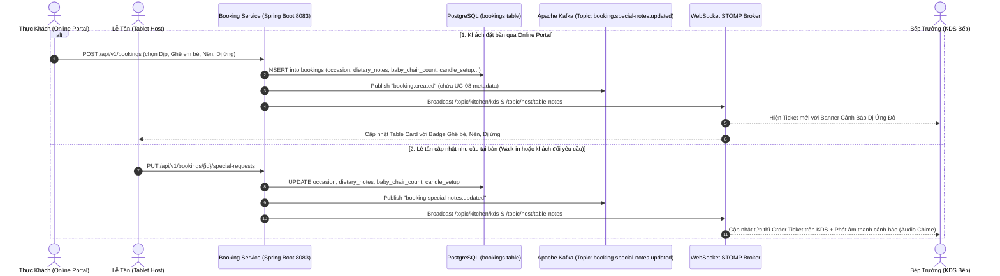

# UC-08: Ghi chú Nhu cầu Đặc biệt & Dị ứng (Special Requests & Dietary Notes)

> **Dự án**: TableMaster - Hệ Thống Đặt Bàn Thông Minh & Quản Lý Nhà Hàng Cao Cấp  
> **Microservice**: `booking-service` (Port: 8083)  
> **Cơ sở dữ liệu**: PostgreSQL `tablemaster_booking` (`bookings` table)  
> **Đồng bộ thời gian thực**: Apache Kafka & WebSocket STOMP  
> **Giao diện người dùng**: Client Booking Portal, Tablet Lễ Tân (Host Tablet), Màn hình Bếp (Kitchen Display System - KDS)

---

## 1. Giới Thiệu & Mục Tiêu Nghiệp Vụ (Business Objectives)

Trong nhà hàng Fine Dining / Casual Dining cao cấp như **Le Prime Bistro**, việc tiếp nhận và xử lý chính xác nhu cầu đặc biệt và cảnh báo dị ứng của thực khách là yếu tố sống còn:
1. **An toàn tính mạng & sức khỏe thực khách**: Phát hiện và cảnh báo dị ứng thực phẩm nghiêm trọng (dị ứng hải sản có vỏ, dị ứng đậu phộng, kiêng cay, không hành tỏi, không mì chính/bột ngọt). Đặc biệt khi có trẻ nhỏ đi kèm, hệ thống tự động cảnh báo **"Không rắc tiêu vào thức ăn vì có trẻ nhỏ"**.
2. **Cá nhân hóa trải nghiệm ẩm thực**:
   - Ghi nhận mục đích bữa tiệc: Sinh nhật, Hẹn hò lãng mạn, Tiếp đối tác kinh doanh, Tụ họp gia đình, Kỷ niệm ngày cưới.
   - Chuẩn bị cơ sở vật chất trước giờ đón khách: Số lượng **ghế ăn trẻ em (baby high-chair)** để nhân viên sảnh setup sẵn vào bàn; **setup nến thơm lãng mạn**; chuẩn bị bánh kem chúc mừng viết tên chủ tiệc.
3. **Đồng bộ thời gian thực (Zero-latency Real-time Sync)**:
   - Dữ liệu từ khách đặt bàn Online đồng bộ tức thì sang **Tablet Lễ tân (Host Tablet)** để nhân viên sảnh chuẩn bị bàn và đón khách.
   - Dữ liệu đồng bộ trực tiếp sang **Màn hình Bếp (Kitchen Display System - KDS)** để Bếp trưởng (Head Chef) và các đầu bếp phân line (Sauté, Grill, Garde Manger) thấy ngay cảnh báo dị ứng nổi bật trước khi nấu.
   - Nhân viên Lễ tân hoặc phục vụ có thể **chỉnh sửa / bổ sung nhu cầu đặc biệt** tại quầy POS, hệ thống lập tức bắn thông báo WebSocket và Kafka sang màn hình Bếp KDS.

---

## 2. Kiến Trúc Đồng Bộ & Luồng Dữ Liệu (Architecture & Data Flow)



---

## 3. Cập Nhật Database Schema

File: `infrastructure/db-init/04-booking-schema.sql`

```sql
-- Cập nhật bảng bookings bổ sung các cột phục vụ UC-08
ALTER TABLE bookings 
    ADD COLUMN IF NOT EXISTS occasion VARCHAR(50),
    ADD COLUMN IF NOT EXISTS dietary_notes TEXT,
    ADD COLUMN IF NOT EXISTS baby_chair_count INT DEFAULT 0,
    ADD COLUMN IF NOT EXISTS candle_setup BOOLEAN DEFAULT FALSE;

-- Index hỗ trợ truy vấn lọc đơn tiệc & nhu cầu đặc biệt
CREATE INDEX IF NOT EXISTS idx_bookings_occasion ON bookings(occasion);
```

### Giải thích các trường:
- `occasion`: Mục đích bữa tiệc (`BIRTHDAY`, `ANNIVERSARY`, `BUSINESS`, `ROMANTIC_DATE`, `FAMILY`, `FRIENDS`, `CASUAL`).
- `dietary_notes`: Ghi chú lưu ý ăn uống & dị ứng (VD: *"Không rắc tiêu vào thức ăn vì có trẻ nhỏ; Dị ứng hải sản có vỏ; Không ăn cay"*).
- `baby_chair_count`: Số lượng ghế ăn dặm em bé cần xếp vào bàn (0 - 5).
- `candle_setup`: Cờ kích hoạt setup nến thơm lãng mạn trên bàn (`TRUE` / `FALSE`).
- `special_notes`: Ghi chú tổng hợp hoặc văn bản chi tiết nội bộ cho nhà hàng.

---

## 4. Chi Tiết Backend (`booking-service`)

### 4.1. Entity Mapping (`Booking.java`)
```java
@Column(name = "occasion", length = 50)
private String occasion;

@Column(name = "dietary_notes", columnDefinition = "TEXT")
private String dietaryNotes;

@Column(name = "baby_chair_count")
private Integer babyChairCount = 0;

@Column(name = "candle_setup")
private Boolean candleSetup = false;
```

### 4.2. Request DTOs
- `CreateBookingRequest.java`: Bổ sung `occasion`, `dietaryNotes`, `babyChairCount`, `candleSetup`.
- `UpdateSpecialRequestsRequest.java`: DTO phục vụ endpoint cập nhật từ Tablet Lễ tân:
```java
public class UpdateSpecialRequestsRequest {
    private String occasion;
    private String dietaryNotes;
    private Integer babyChairCount;
    private Boolean candleSetup;
    private String specialNotes;
}
```

### 4.3. REST Controller Endpoints (`BookingController.java`)
| Phương Thức | Endpoint | Mô Tả |
| :--- | :--- | :--- |
| `POST` | `/api/v1/bookings` | Tạo đặt bàn mới kèm mục đích tiệc, ghế em bé, nến và cảnh báo dị ứng. |
| `PUT` | `/api/v1/bookings/{id}/special-requests` | Lễ tân/Thu ngân cập nhật nhanh nhu cầu đặc biệt & đồng bộ KDS Bếp. |
| `GET` | `/api/v1/bookings/{id}` | Lấy chi tiết đơn đặt bàn gồm đầy đủ thông tin UC-08. |

### 4.4. Real-time Event Streaming (`BookingEventProducer.java`)
1. **Kafka Outbox Event**:
   - Topic: `booking.special-notes.updated`
   - Topic: `booking.created`
   - Payload: Gồm `bookingId`, `bookingCode`, `occasion`, `dietaryNotes`, `babyChairCount`, `candleSetup`, `specialNotes`.
2. **Spring WebSocket STOMP Broker**:
   - Destination 1: `/topic/kitchen/kds` (Bắn trực tiếp vào Board Bếp KDS).
   - Destination 2: `/topic/host/table-notes` (Bắn vào Tablet Lễ tân).
   - Destination 3: `/topic/bookings` (Đồng bộ dashboard chung).

---

## 5. Chi Tiết Frontend (`tablemaster-ui`)

### 5.1. Customer Online Booking (`BookingPage.tsx`)
Tại **Bước 3: Nhu Cầu Tiệc, Ghế Em Bé & Dị Ứng (UC-08)**:
- **Lựa chọn dịp tiệc (Occasion Grid)**: Sinh nhật 🎂, Kỷ niệm 🥂, Hẹn hò ❤️, Tiếp đối tác 💼, Gia đình 👨‍👩‍👧‍👦.
- **Ghế ăn em bé (Baby High-chair Stepper)**: Tăng/giảm số lượng ghế bé (0 - 5 ghế). Tự động kích hoạt gợi ý an toàn cho trẻ nhỏ.
- **Setup nến thơm (Candle Setup Toggle)**: Switch bật/tắt nến thơm lãng mạn.
- **Tên viết lên bánh kem (Birthday Cake Name)**: Xuất hiện tự động khi chọn dịp Sinh nhật.
- **Ma trận lựa chọn dị ứng & chế biến (Dietary Tags Matrix)**:
  - 🚨 **Không rắc tiêu vào thức ăn vì có trẻ nhỏ** (Banner cảnh báo đỏ ưu tiên).
  - 🦞 Dị ứng hải sản có vỏ (Tôm, Cua, Sò...).
  - 🥜 Dị ứng đậu phộng & các loại hạt.
  - 🌶️ Không ăn cay.
  - 🥗 Ăn chay (Vegetarian).
  - 🧄 Không hành tỏi.
  - 🚫 Không mì chính / bột ngọt (No MSG).
- **Ô nhập tự do (Custom Notes)**: Cho phép thực khách gõ chi tiết yêu cầu khác.

### 5.2. Tablet Lễ Tân & Thu Ngân POS (`HostTabletPage.tsx`)
1. **Table Box Card**:
   - Trực quan hóa ngay trên sơ đồ bàn:
     - Badge Dịp tiệc (🎂 Sinh nhật / 💼 Đối tác / 🥂 Kỷ niệm).
     - Badge Ghế em bé (👶 1 Ghế bé).
     - Badge Nến thơm (🕯️ Nến).
     - Banner cảnh báo dị ứng màu hồng/đỏ nổi bật (🚨 Không rắc tiêu / Dị ứng...).
2. **Bên trong POS Drawer Bàn**:
   - Card **"Nhu Cầu Đặc Biệt & Dị Ứng"**: Hiển thị rõ danh sách yêu cầu.
   - Nút **"Chỉnh Sửa / Đồng Bộ KDS"**: Mở modal cho phép Lễ tân cập nhật ngay khi khách yêu cầu tại chỗ.
3. **Modal "Nhu Cầu Đặc Biệt & Dị Ứng (UC-08)"**:
   - Điều chỉnh nhanh số lượng ghế trẻ em, bật/tắt nến thơm, click chip dị ứng.
   - Bấm **"Lưu & Đồng Bộ Sang KDS Bếp"** gọi API `bookingApi.updateSpecialRequests()` và phát tín hiệu sang KDS.
4. **Header Navigation**:
   - Nút **"Màn Hình Bếp (KDS)"** với icon ChefHat cho phép chuyển nhanh sang giao diện Bếp.

### 5.3. Màn Hình Bếp Trưởng KDS (`KitchenKdsPage.tsx`)
1. **Ticket Board Bếp (Kitchen Display System)**:
   - Các Order được sắp xếp theo thẻ phiếu bếp (Thermal Ticket Style).
   - **CẢNH BÁO DỊ ỨNG & CHẾ BIẾN (UC-08)**: Hiển thị trên đầu mỗi ticket với khung viền đỏ nổi bật (`border-rose-500 bg-rose-950/90 text-rose-200`) kèm icon `ShieldAlert` hiệu ứng nhấp nháy.
   - Hiển thị cảnh báo ghế em bé: **"👶 Cần chuẩn bị X ghế ăn trẻ em - Chú ý an toàn bàn ăn"**.
2. **Quy Trình Chế Biến Món**:
   - Click từng món để chuyển trạng thái: `ĐANG NẤU (PREPARING)` ➔ `ĐÃ XONG / LÊN BÀN (SERVED)`.
   - Nút **"Hoàn Tất Toàn Bộ Ticket"** khi tất cả món đã ra bàn.
3. **Mô Phỏng In Phiếu Bếp (Thermal Kitchen Printer Simulation)**:
   - Modal hiển thị hóa đơn in nhiệt thực tế 80mm của Bếp.
   - Đậm nét các dòng cảnh báo dị ứng và lưu ý không rắc tiêu để đầu bếp dán lên khay đồ ăn.
4. **Âm Thanh Cảnh Báo (Audio Chime Simulator)**:
   - Web Audio API phát tiếng "Beep" âm sắc cao mỗi khi có đơn mới hoặc cập nhật trạng thái món.

---

## 6. Hướng Dẫn Kiểm Thử & Xác Minh (Verification Guide)

### 6.1. Kiểm Thử Tự Động Backend (Unit Tests)
Chạy lệnh kiểm thử Spring Boot trong `src/server/booking-service`:
```bash
mvn test
```
**Kết quả**: `19/19 tests passed (0 failures, 0 errors, BUILD SUCCESS)`.
Các ca kiểm thử UC-08 trong `BookingServiceTest.java`:
- `createBooking_WithSpecialRequestsAndDietaryNotes_Success()`: Xác minh lưu đúng dịp tiệc, dị ứng, số ghế em bé, nến thơm và phát sinh event Kafka.
- `updateSpecialRequests_Success()`: Xác minh endpoint cập nhật nhu cầu từ Tablet Lễ tân và kích hoạt WebSocket STOMP broadcasting.

### 6.2. Kiểm Thử Frontend Build
Chạy lệnh kiểm thử build Vite & TypeScript trong `src/client/tablemaster-ui`:
```bash
npm run build
```
**Kết quả**: `tsc -b && vite build` hoàn thành với `exit code 0`, không có lỗi cú pháp hoặc Type mismatch.

### 6.3. Kịch Bản Kiểm Thử Giao Diện Thực Tế (Walkthrough)
1. **Khách Đặt Bàn Có Bé Nhỏ & Sinh Nhật**:
   - Mở giao diện Đặt Bàn (`/booking`).
   - Chọn ngày giờ, bàn tiệc, số lượng khách: 4 khách.
   - Tại Bước 3: Chọn dịp **"Sinh nhật"**, nhập tên bánh kem: **"Bé Cà Rốt tròn 3 tuổi"**.
   - Tăng Ghế ăn em bé lên **1 ghế**.
   - Bật nút **Setup nến thơm**.
   - Trong danh sách dị ứng: Chọn **"Không rắc tiêu vào thức ăn vì có trẻ nhỏ"** và **"Dị ứng hải sản có vỏ"**.
   - Đặt cọc qua VietQR và hoàn tất đặt bàn.
2. **Kiểm Tra Trên Tablet Lễ Tân (`HostTabletPage`)**:
   - Chuyển sang tab **Thu Ngân (Staff)**.
   - Thấy Bàn đặt online có các huy hiệu: `🎂 Sinh nhật`, `👶 1 Ghế bé`, `🕯️ Nến`.
   - Banner cảnh báo đỏ: `🚨 Không rắc tiêu vào thức ăn vì có trẻ nhỏ, Dị ứng hải sản có vỏ`.
   - Mở chi tiết POS hoặc bấm `Nhu Cầu Đặc Biệt & Dị Ứng (KDS)` để kiểm tra hoặc chỉnh sửa.
3. **Kiểm Tra Trên Màn Hình Bếp (`KitchenKdsPage`)**:
   - Chuyển sang tab **Bếp (KDS)** trên thanh Navbar hoặc bấm nút từ Host Tablet.
   - Quan sát Ticket của bàn:
     - Banner đỏ nổi bật: `CẢNH BÁO DỊ ỨNG & CHẾ BIẾN (UC-08)`.
     - Dòng chữ: `Không rắc tiêu vào thức ăn vì có trẻ nhỏ, Dị ứng hải sản có vỏ`.
     - Huy hiệu `👶 1 Ghế bé` và `🎂 Sinh nhật`.
   - Bấm **"In Phiếu Bếp"** để xem phiếu in nhiệt giả lập.
   - Bấm đổi trạng thái món ăn để kiểm tra âm thanh và cập nhật thời gian thực.
