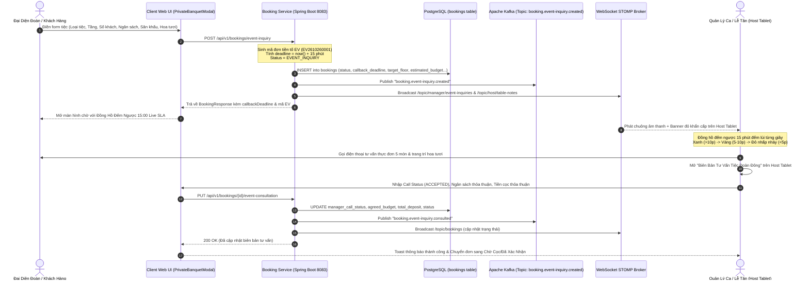

# UC-10: Đặt Tiệc Sinh Nhật / Sự Kiện Bao Trọn Tầng (Private Banquet Booking)

> **Dự án**: TableMaster - Hệ Thống Đặt Bàn Thông Minh & Quản Lý Nhà Hàng Cao Cấp  
> **Microservice**: `booking-service` (Port: 8083)  
> **Cơ sở dữ liệu**: PostgreSQL `tablemaster_booking` (bảng `bookings`)  
> **Đồng bộ sự kiện thời gian thực**: Apache Kafka & WebSocket STOMP  
> **Cam kết dịch vụ (SLA)**: Quản lý ca gọi tư vấn trực tiếp trong 15 phút (`callback_deadline`)  
> **Giao diện người dùng**: Client Booking Portal, Private Banquet Modal, Tablet Lễ Tân & Quản Lý Ca (Host Tablet)

---

## 1. Giới Thiệu & Mục Tiêu Nghiệp Vụ (Business Objectives)

Đối với các nhà hàng ẩm thực cao cấp (Fine Dining / Haute Gastronomy) như **Le Prime Bistro & Lounge**, phân khúc khách hàng đoàn đông và sự kiện doanh nghiệp là nguồn doanh thu chủ lực:
1. **Tiếp nhận nhu cầu tiệc quy mô lớn (20 - 100+ khách)**:
   - Đặt tiệc sinh nhật VIP, tiệc kỷ niệm, tiệc cưới thân mật (Intimate Wedding).
   - Sự kiện doanh nghiệp: Year-End Party, Gala Dinner, Workshop & Networking, tiếp đãi đối tác chiến lược.
2. **Gói bao trọn tầng độc quyền (Floor Buyout)**:
   - **Tầng 3 (Sky Lounge Rooftop)**: Ban công ngắm hoàng hôn và view 360° phố đi bộ Nguyễn Huệ, sức chứa 40 - 70 khách.
   - **Tầng 2 (VIP Salon Cellar)**: Không gian kín đáo cách âm, liền kề hầm rượu vang Bordeaux Grand Cru, sức chứa 20 - 40 khách.
   - **Tầng 1 (Grand Bistro Hall)**: Sảnh vòm kiến trúc Pháp tân cổ điển, sức chứa 60 - 100+ khách.
3. **Quy trình đơn `EVENT_INQUIRY` & Cam kết SLA 15 Phút**:
   - Khi khách hàng gửi form, hệ thống không bắt khách phải thanh toán cọc tức thì mà chuyển đơn sang trạng thái `EVENT_INQUIRY`.
   - Hệ thống tự động thiết lập thời hạn cam kết phản hồi: `callback_deadline = now + 15 phút`.
   - Kích hoạt chuông thông báo âm thanh (Audio Chime) và đẩy thông báo qua WebSocket sang **Tablet Quản lý ca / Lễ tân**.
   - Màn hình Quản lý ca hiển thị đồng hồ đếm ngược 15 phút (Live SLA Countdown). Quản lý ca gọi điện tư vấn trực tiếp thực đơn, điều phối âm thanh / hoa tươi, thống nhất tiền cọc và chuyển trạng thái sang `AWAITING_PAYMENT` hoặc `CONFIRMED`.

---

## 2. Kiến Trúc Đồng Bộ & Luồng Dữ Liệu (Architecture & Sequence Flow)



---

## 3. Cập Nhật Cơ Sở Dữ Liệu (Database Schema)

File cập nhật: `infrastructure/db-init/04-booking-schema.sql`

### 3.1. Thêm các trường dữ liệu UC-10 vào bảng `bookings`
```sql
ALTER TABLE bookings
  ADD COLUMN IF NOT EXISTS event_type VARCHAR(50),
  ADD COLUMN IF NOT EXISTS target_floor INT,
  ADD COLUMN IF NOT EXISTS company_name VARCHAR(150),
  ADD COLUMN IF NOT EXISTS estimated_budget DECIMAL(14,2),
  ADD COLUMN IF NOT EXISTS stage_audio_required BOOLEAN DEFAULT FALSE,
  ADD COLUMN IF NOT EXISTS decoration_required BOOLEAN DEFAULT FALSE,
  ADD COLUMN IF NOT EXISTS callback_deadline TIMESTAMP WITH TIME ZONE,
  ADD COLUMN IF NOT EXISTS manager_call_status VARCHAR(30) DEFAULT 'PENDING_CALL',
  ADD COLUMN IF NOT EXISTS consultation_notes TEXT;
```

### 3.2. Partial Index tối ưu hóa truy vấn đơn tiệc cần gọi gấp
```sql
CREATE INDEX IF NOT EXISTS idx_bookings_event_inquiry 
ON bookings(status, callback_deadline) 
WHERE status = 'EVENT_INQUIRY';
```

### 3.3. Dữ liệu mẫu (Seed Data)
Đơn tiệc đoàn công ty mẫu sẵn sàng để kiểm thử:
```sql
INSERT INTO bookings (
    id, booking_code, guest_id, guest_name, guest_phone, guest_email,
    booking_date, time_slot_id, guest_count, status,
    event_type, target_floor, company_name, estimated_budget,
    stage_audio_required, decoration_required, callback_deadline,
    manager_call_status, consultation_notes
) VALUES (
    'b2000000-0000-0000-0000-000000000010', 'EV2610260001',
    'a1000000-0000-0000-0000-000000000001', 'Nguyễn Minh Trí', '0918889999', 'tri.nguyen@techcorp.vn',
    CURRENT_DATE + INTERVAL '10 day', 'b1000000-0000-0000-0000-000000000002',
    50, 'EVENT_INQUIRY',
    'ROOFTOP_BUYOUT', 3, 'TechCorp Vietnam JSC', 65000000.00,
    TRUE, TRUE, CURRENT_TIMESTAMP + INTERVAL '12 minute',
    'PENDING_CALL', 'Khách yêu cầu bao trọn Tầng 3 Rooftop, tiệc sinh nhật 5 năm thành lập công ty.'
) ON CONFLICT (booking_code) DO NOTHING;
```

---

## 4. Chi Tiết Triển Khai Backend (`booking-service`)

### 4.1. Enum Trạng Thái & JPA Entity
- `BookingStatus.java`: Bổ sung giá trị `EVENT_INQUIRY`.
- `Booking.java`:
  ```java
  @Column(name = "event_type", length = 50)
  private String eventType;

  @Column(name = "target_floor")
  private Integer targetFloor;

  @Column(name = "company_name", length = 150)
  private String companyName;

  @Column(name = "estimated_budget", precision = 14, scale = 2)
  private BigDecimal estimatedBudget;

  @Column(name = "stage_audio_required")
  private Boolean stageAudioRequired = false;

  @Column(name = "decoration_required")
  private Boolean decorationRequired = false;

  @Column(name = "callback_deadline")
  private LocalDateTime callbackDeadline;

  @Column(name = "manager_call_status", length = 30)
  private String managerCallStatus = "PENDING_CALL";

  @Column(name = "consultation_notes", columnDefinition = "TEXT")
  private String consultationNotes;
  ```

### 4.2. DTO Request & Response
1. `CreateEventInquiryRequest.java`:
   - `@NotBlank guestName`, `@NotBlank guestPhone`, `@Email guestEmail`.
   - `@NotNull bookingDate`.
   - `@NotNull @Min(15) @Max(200) guestCount`: Giới hạn đoàn từ 15 đến 200 khách.
   - `eventType`: `COMPANY_PARTY`, `ROOFTOP_BUYOUT`, `BIRTHDAY_GALA`, `WORKSHOP_NETWORKING`, `WEDDING_ENGAGEMENT`.
   - `targetFloor`: 1 (Grand Bistro), 2 (VIP Salon), 3 (Sky Lounge Rooftop).
   - `estimatedBudget`, `stageAudioRequired`, `decorationRequired`, `menuPreference`.
2. `UpdateEventConsultationRequest.java`:
   - `managerCallStatus`: `CALLED`, `PROPOSAL_SENT`, `ACCEPTED`, `REJECTED`.
   - `consultationNotes`, `agreedDeposit`, `agreedBudget`, `targetBookingStatus`.
3. `BookingResponse.java`: Bổ sung toàn bộ các trường UC-10 trong phương thức `fromEntity()`.

### 4.3. Kafka & WebSocket STOMP
- `KafkaConfig.java`:
  - `TOPIC_EVENT_INQUIRY_CREATED = "booking.event-inquiry.created"`
  - `TOPIC_EVENT_INQUIRY_CONSULTED = "booking.event-inquiry.consulted"`
- `BookingEventProducer.java`:
  - `publishEventInquiryCreated()`: Bắn Kafka topic và broadcast WebSocket tới:
    - `/topic/manager/event-inquiries`
    - `/topic/host/table-notes`
    - `/topic/bookings`
  - `publishEventInquiryConsulted()`: Thông báo cập nhật kết quả tư vấn của Quản lý ca.

### 4.4. Service Implementation (`BookingServiceImpl.java`)
- **`createEventInquiry()`**:
  - Tạo mã đặt bàn tiền tố `EV` (VD: `EV2610260002`).
  - Tự động gán `status = BookingStatus.EVENT_INQUIRY`.
  - Thiết lập `callbackDeadline = LocalDateTime.now().plusMinutes(15)`.
  - Khởi tạo `managerCallStatus = "PENDING_CALL"`.
  - Lưu vào CSDL và phát sự kiện Kafka + WebSocket.
- **`updateEventConsultation()`**:
  - Tìm đơn theo ID hoặc mã `bookingCode`.
  - Ghi nhận `managerCallStatus`, `consultationNotes`.
  - Cập nhật số tiền cọc đã thỏa thuận (`totalDeposit`) và ngân sách (`estimatedBudget`).
  - Chuyển `status` theo thỏa thuận (VD: `AWAITING_PAYMENT` hoặc `CONFIRMED`).
  - Phát sự kiện `publishEventInquiryConsulted()`.

### 4.5. REST API Endpoints (`BookingController.java`)
| Method | Endpoint | Quyền | Mô tả |
| :--- | :--- | :--- | :--- |
| `POST` | `/api/v1/bookings/event-inquiry` | Public | Đăng ký tiệc đoàn đông / bao trọn tầng (HTTP 201 Created) |
| `GET` | `/api/v1/bookings/event-inquiries` | Manager/Staff | Lấy danh sách các đơn tiệc sự kiện |
| `PUT` | `/api/v1/bookings/{id}/event-consultation` | Manager | Cập nhật biên bản tư vấn & trạng thái đơn hàng |

---

## 5. Chi Tiết Triển Khai Giao Diện Người Dùng (Frontend)

### 5.1. Modal Đặt Tiệc Sang Trọng (`PrivateBanquetModal.tsx`)
- Thiết kế chuẩn mỹ thuật Haute Gastronomy (Nền đen huyền bí `#0F0B09`, viền chỉ vàng gold `amber-500/40`, typography Serif).
- **Bộ chọn 6 hình thức tiệc**:
  1. `Tiệc Doanh Nghiệp / Gala Dinner` (15 - 100 khách)
  2. `Bao Trọn Tầng 3 Sky Lounge Rooftop` (40 - 70 khách)
  3. `Tiệc Sinh Nhật VIP & Bánh Kem Thiết Kế` (15 - 50 khách)
  4. `Workshop & Networking Doanh Nhân` (20 - 60 khách)
  5. `Tiệc Đính Hôn & Tiệc Cưới Thân Mật` (30 - 80 khách)
  6. `Dạ Tiệc Độc Bản Thiết Kế Riêng` (15 - 100 khách)
- **Bộ chọn Bao trọn tầng (Floor Buyout)**:
  - Tầng 3: Sky Lounge Rooftop Ngoài Trời (Ngắm phố đi bộ Nguyễn Huệ 360°)
  - Tầng 2: Phòng Tiệc VIP Cellar & Hầm Rượu Vang
  - Tầng 1: Đại Sảnh Vòm Grand Bistro
- **Bộ chọn quy mô khách & ngân sách**:
  - Stepper và thanh trượt trực quan từ 15 đến 120+ khách.
  - Các mốc ngân sách gợi ý: 25 triệu, 45 triệu, 75 triệu, 120 triệu+.
- **Tùy chọn trang thiết bị sự kiện (AV & Production)**:
  - Checkbox: Sân khấu & 2 Micro không dây cao cấp.
  - Checkbox: Hoa tươi nhập khẩu & Backdrop thiết kế theo yêu cầu.
- **Màn hình hoàn tất kèm Live SLA Countdown**:
  - Khi gửi form thành công, hiển thị đồng hồ đếm ngược `15:00` chạy từng giây với cam kết: *"Quản lý ca đang xem xét thực đơn và sẽ gọi trực tiếp cho Quý khách trước khi đồng hồ điểm 00:00"*.

### 5.2. Tích hợp trên Trang Chủ & Trang Đặt Bàn
- **`LandingPage.tsx`**:
  - Nút Hero phụ sang trọng: `"Đặt Tiệc Sự Kiện (20 - 100 Khách)"` kích hoạt mở `PrivateBanquetModal`.
- **`BookingPage.tsx`**:
  - Banner CTA nổi bật ngay dưới Hero: `"Đặt Tiệc Đoàn Đông (20 - 100 Khách) hoặc Bao Trọn Tầng Rooftop • Cam kết gọi tư vấn trong 15 phút"`.
  - Khi người dùng chọn số lượng khách $\ge 12$ người, hệ thống hiển thị ngay gợi ý thông minh chuyển sang gói Private Banquet.

### 5.3. Màn Hình Quản Lý Ca / Lễ Tân (`HostTabletPage.tsx`)
- **Nút Fast Action & Huy hiệu cảnh báo**:
  - Nút `"Tiệc Sự Kiện & Rooftop (UC-10)"` kèm badge số lượng đơn cần gọi gấp nhấp nháy đỏ.
  - Nếu có đơn đang chờ, hiển thị **Banner Báo Động Khẩn Cấp** đầu màn hình: *"🚨 Có X đơn tiệc sự kiện cần Quản lý ca gọi tư vấn trực tiếp trong 15 phút (SLA)!"*.
- **Drawer Quản Lý Đơn Tiệc Sự Kiện**:
  - Bộ lọc: `Tất Cả`, `🚨 Cần Gọi Ngay`, `✅ Đã Tư Vấn`.
  - Thẻ đơn tiệc chi tiết: Hiển thị đầy đủ Tên khách, Công ty, Số điện thoại, Số khách, Tầng bao trọn, Ngân sách, Yêu cầu âm thanh/hoa tươi.
  - **Đồng hồ đếm ngược SLA thời gian thực**:
    - $\ge 10$ phút: Huy hiệu xanh lá `⏱️ SLA Còn 14:20`.
    - 5 - 10 phút: Huy hiệu vàng cảnh báo.
    - $< 5$ phút: Huy hiệu đỏ nhấp nháy `🚨 Khẩn Cấp! Còn 02:45`.
    - Hết hạn: Huy hiệu đỏ cảnh báo vi phạm SLA.
  - Nút **"Gọi Tư Vấn"** mô phỏng kết nối cuộc gọi.
  - Nút **"Ghi Nhận Tư Vấn & Chốt Cọc"** mở modal biên bản.
- **Biên Bản Tư Vấn Tiệc Đoàn Đông (Modal)**:
  - Chọn trạng thái cuộc gọi: `CALLED` (Đã gọi), `PROPOSAL_SENT` (Đã gửi báo giá), `ACCEPTED` (Khách chốt tiệc), `REJECTED` (Khách từ chối).
  - Nhập ngân sách thống nhất và số tiền cọc thỏa thuận.
  - Chọn chuyển trạng thái booking: `AWAITING_PAYMENT` hoặc `CONFIRMED`.
  - Nhập ghi chú chi tiết buổi tư vấn và đồng bộ tức thì sang hệ thống.

---

## 6. Kết Quả Kiểm Thử & Xác Nhận (Verification Evidence)

### 6.1. Backend Unit Tests (`mvn test`)
Tất cả 21/21 Unit Tests thuộc `booking-service` đều vượt qua thành công:
```
[INFO] Running com.tablemaster.booking.service.BookingServiceTest
12:58:31.085 [main] INFO com.tablemaster.booking.service.BookingServiceImpl -- Creating private banquet / event inquiry for: Nguyễn Văn Doanh Nghiệp, company: Công Ty Cổ Phần Sài Gòn Mới, guests: 45, eventType: ROOFTOP_BUYOUT
12:58:31.089 [main] INFO com.tablemaster.booking.service.BookingServiceImpl -- Saved EVENT_INQUIRY EV2611060003: deadline=2026-10-26T13:13:31.086438900+07:00[Asia/Saigon]
12:58:31.179 [main] INFO com.tablemaster.booking.service.BookingServiceImpl -- Updated event consultation for EV2610260001: callStatus=CALLED, status=AWAITING_PAYMENT
[INFO] Tests run: 11, Failures: 0, Errors: 0, Skipped: 0, Time elapsed: 0.412 s -- in com.tablemaster.booking.service.BookingServiceTest
[INFO] 
[INFO] Results:
[INFO] 
[INFO] Tests run: 21, Failures: 0, Errors: 0, Skipped: 0
[INFO] ------------------------------------------------------------------------
[INFO] BUILD SUCCESS
[INFO] ------------------------------------------------------------------------
```

### 6.2. Frontend Production Build (`npm run build`)
Toàn bộ TypeScript và Vite bundle biên dịch sạch sẽ không có lỗi:
```
> tablemaster-ui@0.0.0 build
> tsc -b && vite build

vite v8.3.1 building client environment for production...
✓ 2312 modules transformed.
rendering chunks...
dist/index.html                   1.68 kB │ gzip:   0.97 kB
dist/assets/index-CvOZtzjY.css  156.81 kB │ gzip:  21.53 kB
dist/assets/index-BD1PNqMX.js   935.13 kB │ gzip: 239.31 kB
✓ built in 540ms
```

---

## 7. Kết Luận

Chức năng **UC-10: Đặt tiệc Sinh nhật / Sự kiện Bao trọn tầng (Private Banquet Booking)** đã được hiện thực hóa trọn vẹn cả 3 lớp:
1. **Database & Backend**: Lưu trữ đầy đủ thông tin tổ chức tiệc, tính toán chính xác deadline 15 phút, phát sự kiện Kafka và WebSocket đa kênh.
2. **Frontend Khách Hàng**: Trải nghiệm đặt tiệc xa hoa, hiển thị đồng hồ đếm ngược 15 phút chuyên nghiệp củng cố niềm tin về dịch vụ Michelin.
3. **Frontend Quản Lý Ca**: Giúp Quản lý không bao giờ bỏ lỡ đơn tiệc lớn, theo dõi SLA đếm ngược trực quan và ghi nhận biên bản tư vấn nhanh chóng, liền mạch.
