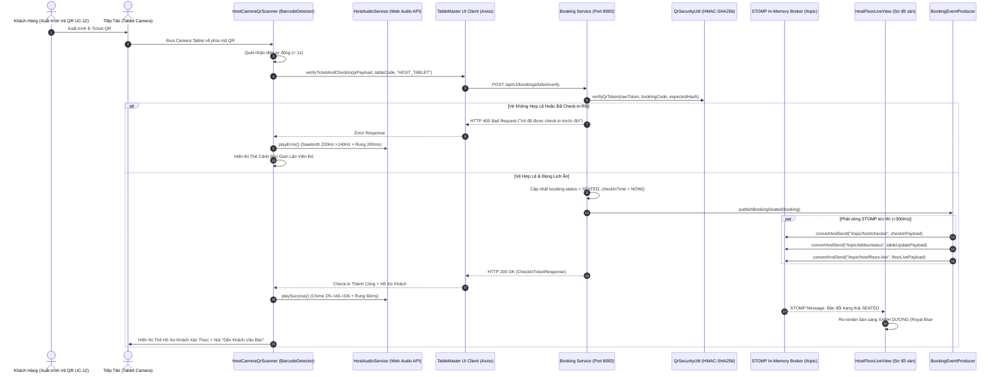

# TÀI LIỆU HIỆN THỰC UC-16: QUÉT CAMERA NHẬN DIỆN VÉ QR CHECK-IN (HOST CAMERA QR SCANNER)

> **Mã Use Case:** UC-16  
> **Tên Use Case:** Quét Camera nhận diện Vé QR Check-in (Host Camera QR Scanner)  
> **Mô tả nghiệp vụ:** Sử dụng camera trên thiết bị Tablet tại tiền sảnh tiếp tân (Host Reception Desk) để quét vé QR động của khách hàng trong vòng 1 giây; đối soát tính hợp lệ (token chống giả mạo, chính sách sử dụng một lần One-time Use), phát âm thanh phản hồi (Success Chime / Fraud Alert Buzzer) và rung xúc giác (Haptic Feedback), hiển thị đầy đủ thông tin bàn & hồ sơ khách (món đặt trước UC-07, dị ứng thực phẩm UC-08, tiền cọc), và tự động chuyển trạng thái bàn sang **XANH DƯƠNG (SEATED)** đồng bộ tức thì qua WebSocket STOMP (<300ms).  
> **Thời gian hoàn thành:** 26/10/2026  
> **Hệ thống liên quan:** `tablemaster-ui` (React 19, TypeScript, HTML5 Camera MediaDevices API, Native BarcodeDetector API, Web Audio API, TailwindCSS v4), `booking-service` (Spring Boot 3, WebSocket STOMP Broker, QrSecurityUtil, Kafka Event Producer), PostgreSQL.

---

## 1. Bối Cảnh Nghiệp Vụ & Bài Toán Vận Hành Tại Tiền Sảnh

Tại nhà hàng Fine Dining đẳng cấp Michelin **Le Prime Bistro & Sky Lounge**, quá trình tiếp đón khách tại cửa vào giờ cao điểm đòi hỏi tốc độ tối đa và tính chính xác tuyệt đối:

1. **Tốc độ Quét Dưới 1 Giây (< 1s Scanning Speed):**
   - Khách hàng xuất trình vé điện tử QR động (**UC-12**) trên điện thoại di động hoặc tin nhắn ZNS/Email.
   - Hostess đưa camera Tablet về phía mã QR; hệ thống phải nhận diện ngay lập tức (<1000ms), không gây gián đoạn hay để khách phải chờ đợi tại cửa sảnh.
2. **Đối Soát Chống Giả Mạo & Sử Dụng Một Lần (Anti-Fraud & One-Time Use Policy):**
   - Mã QR mang token bảo mật 64 ký tự hex được mã hóa HMAC-SHA256 kèm mã bàn và mã đơn đặt bàn.
   - Hệ thống ngăn chặn việc vé bị chụp lại màn hình hoặc quét lại lần 2 (`ALREADY_CHECKED_IN` / `SEATED`), phát cảnh báo âm thanh và rung báo động cho nhân viên tiếp tân.
3. **Phản Hồi Âm Thanh & Xúc Giác Thời Gian Thực (Audio Feedback & Haptics):**
   - **Âm thanh thành công (Success Chime):** Hợp âm 3 nốt ngân vang tươi sáng (D5 587.33Hz ➔ A5 880Hz ➔ D6 1174.66Hz) báo hiệu vé hợp lệ mà nhân viên không cần nhìn sát màn hình.
   - **Âm thanh cảnh báo (Fraud/Error Buzzer):** Chuỗi âm răng cưa trầm gắt (Sawtooth 220Hz ➔ 180Hz ➔ 140Hz) khi phát hiện vé giả hoặc vé đã được dùng.
   - **Rung xúc giác (Haptic Vibration):** Chuỗi rung nhẹ `[60ms, 40ms, 80ms]` khi thành công và chuỗi rung dài `[200ms, 100ms, 200ms]` khi có lỗi.
4. **Hiển Thị Hồ Sơ Khách & Bàn Đặt (Verified Guest Dossier):**
   - Hiện rõ: Tên khách, số điện thoại, mã bàn, tầng, khu vực (Window View / VIP / Sky Rooftop), số lượng khách, số tiền cọc đã giữ (Escrow Deposit).
   - Tích hợp **UC-08**: Cảnh báo dị ứng thực phẩm (viền đỏ nổi bật, ví dụ: dị ứng hải sản có vỏ, đậu phộng, không ăn tỏi) và nhu cầu ghế em bé.
   - Tích hợp **UC-07**: Danh sách món ăn Signature đã gọi trước kèm trạng thái gửi đến KDS quầy bếp.
5. **Chuyển Trạng Thái Bàn Sang XANH DƯƠNG (SEATED) & Đồng Bộ STOMP:**
   - Trạng thái bàn ngay lập tức chuyển thành **SEATED** với màu nhận diện chuẩn **Xanh Dương (Royal Blue `#2563EB`)**.
   - Phát sóng WebSocket STOMP tới `/topic/host/checkin`, `/topic/tables/status`, `/topic/host/floors-live` trong thời gian <300ms, cập nhật sơ đồ sàn trực tiếp của tất cả Tablet tiếp tân và quản lý sàn.

---

## 2. Kiến Trúc Kỹ Thuật & Luồng Dữ Liệu Quét Vé

### 2.1. Sơ Đồ Trình Tự Xác Thực & Phát Sóng (Sequence Diagram)



### 2.2. Các Kênh STOMP WebSocket Phát Sóng Khi Check-in

| STOMP Topic Destination | Tải Tin (Payload) | Đối Tượng Nhận | Ý Nghĩa Vận Hành |
| :--- | :--- | :--- | :--- |
| `/topic/host/checkin` | `CheckInTicketResponse` | Tablet tiếp tân, Bảo vệ | Hiển thị thông báo chào đón khách, tên khách và bàn chỉ định. |
| `/topic/tables/status` | `{ tableCode, status: 'SEATED', color: '#2563EB' }` | Sơ đồ sàn tất cả màn hình | Đổi màu bàn tức thì sang Xanh Dương mà không cần tải lại trang. |
| `/topic/host/floors-live`| `HostFloorLiveResponse` | Màn hình Host Floor Live | Tăng số lượng bàn đang ăn, cập nhật tỷ lệ lấp đầy tầng. |
| `/topic/bookings` | `BookingEvent (type: BOOKING_CHECKED_IN)` | KDS Bếp, Kế toán | Kích hoạt bắt đầu chuẩn bị các món đặt trước (UC-07). |

---

## 3. Hiện Thực Âm Thanh Phản Hồi Không Cần Tệp Ngoài (`hostAudioService.ts`)

Để đảm bảo âm thanh phản hồi phát ra ngay lập tức với độ trễ 0ms trên mọi trình duyệt Tablet (Safari iOS, Chrome Android, Edge Windows) mà không bị phụ thuộc vào tệp `.mp3` bên ngoài hay gặp lỗi 404/CORS, hệ thống sử dụng **HTML5 Web Audio API** nguyên bản:

```typescript
// src/client/tablemaster-ui/src/services/hostAudioService.ts
class HostAudioService {
  private ctx: AudioContext | null = null;
  private soundEnabled: boolean = true;

  // 1. Âm thanh Thành công (Success Chime): 3 nốt ngân vang hài hòa
  playSuccess(): void {
    if (!this.soundEnabled) return;
    const ctx = this.getAudioContext();
    const now = ctx.currentTime;

    // Chuỗi nốt D5 (587.33Hz) -> A5 (880.00Hz) -> D6 (1174.66Hz)
    const notes = [
      { freq: 587.33, start: 0, duration: 0.12 },
      { freq: 880.00, start: 0.1, duration: 0.14 },
      { freq: 1174.66, start: 0.22, duration: 0.35 }
    ];

    notes.forEach(({ freq, start, duration }) => {
      const osc = ctx.createOscillator();
      const gain = ctx.createGain();
      osc.type = 'sine'; // Sóng sine trong trẻo
      osc.frequency.setValueAtTime(freq, now + start);
      gain.gain.setValueAtTime(0.001, now + start);
      gain.gain.exponentialRampToValueAtTime(0.28, now + start + 0.02);
      gain.gain.exponentialRampToValueAtTime(0.001, now + start + duration);

      osc.connect(gain);
      gain.connect(ctx.destination);
      osc.start(now + start);
      osc.stop(now + start + duration);
    });

    // Rung xúc giác thành công: 60ms rung, 40ms nghỉ, 80ms rung
    if ('vibrate' in navigator) {
      navigator.vibrate([60, 40, 80]);
    }
  }

  // 2. Âm thanh Cảnh báo Lỗi/Gian lận (Fraud/Error Alert): Sóng Sawtooth gắt
  playError(): void {
    if (!this.soundEnabled) return;
    const ctx = this.getAudioContext();
    const now = ctx.currentTime;

    // Chuỗi âm răng cưa cảnh báo 220Hz -> 180Hz -> 140Hz
    const freqs = [
      { f: 220, start: 0, dur: 0.15 },
      { f: 180, start: 0.15, dur: 0.15 },
      { f: 140, start: 0.30, dur: 0.25 }
    ];

    freqs.forEach(({ f, start, dur }) => {
      const osc = ctx.createOscillator();
      const gain = ctx.createGain();
      osc.type = 'sawtooth'; // Sóng răng cưa cảnh báo gắt
      osc.frequency.setValueAtTime(f, now + start);
      gain.gain.setValueAtTime(0.001, now + start);
      gain.gain.linearRampToValueAtTime(0.35, now + start + 0.02);
      gain.gain.linearRampToValueAtTime(0.001, now + start + dur);

      osc.connect(gain);
      gain.connect(ctx.destination);
      osc.start(now + start);
      osc.stop(now + start + dur);
    });

    // Rung cảnh báo gian lận kéo dài
    if ('vibrate' in navigator) {
      navigator.vibrate([200, 100, 200]);
    }
  }
}
```

---

## 4. Hiện Thực Giao Diện & Bộ Quét Camera (`HostCameraQrScanner.tsx`)

### 4.1. Vận Hành Phần Cứng Camera & BarcodeDetector Native API

1. **Khởi Tạo Luồng Video (`getUserMedia`):**
   - Hỗ trợ đổi camera Trước/Sau (`facingMode: 'environment'` hoặc `'user'`) phục vụ cả Tablet để bàn và Tablet cầm tay.
   - Hỗ trợ bật/tắt đèn Flashlight / Torch (`track.applyConstraints({ advanced: [{ torch: true }] })`) khi quét vé trong môi trường ánh sáng mờ lãng mạn của nhà hàng Fine Dining.
2. **Vòng Lặp Nhận Diện Siêu Tốc < 1 Giây:**
   - Sử dụng `window.BarcodeDetector` native với định dạng `formats: ['qr_code']`.
   - Vòng lặp quét mỗi 350ms; ngay khi phát hiện chuỗi QR khớp chuẩn JSON hoặc mã token, luồng camera tạm dừng và gửi yêu cầu xác thực tới Backend.
3. **Kính Ngắm Viewfinder Công Nghệ Cao (High-Tech Viewfinder):**
   - Viền 4 góc quét phát sáng Neon sắc sảo (`border-amber-400`).
   - Đường Laser vàng chuyển động quét liên tục từ trên xuống dưới (`animate-laser-scan`).
   - Điểm hồng tâm căn góc quét (Center Crosshair).
4. **Phím Tắt Kiểm Thử Nghiệp Vụ Siêu Tốc (Fast Demo Actions):**
   - **Quét Vé Hợp Lệ 1s:** Giả lập quét thành công mã vé `ETK-LP-20261026-T01` của khách VIP Nguyễn Văn An.
   - **Test Chống Gian Lận (Already Seated):** Giả lập quét vé đã được sử dụng trước đó để kiểm tra âm thanh cảnh báo lỗi và viền đỏ cảnh báo.
   - **Quét Bàn Confirmed Hiện Có:** Lấy trực tiếp mã bàn đang giữ chỗ trên sơ đồ để check-in tức thì.

---

## 5. Quy Chuẩn Màu Sắc Bàn: XANH DƯƠNG (SEATED)

Theo yêu cầu nghiệp vụ, trạng thái bàn sau khi xác thực thành công phải chuyển sang **XANH DƯƠNG (SEATED)**. Hệ thống đã đồng bộ màu sắc trên toàn bộ giao diện:

### 5.1. Bảng Quy Chuẩn Màu Trạng Thái Bàn (`TableNode.tsx`)

| Trạng Thái | Màu Sắc Chủ Đạo | Mã Hex / Tailwind Class | Biểu Tượng / Badge | Ý Nghĩa Nghiệp Vụ |
| :--- | :--- | :--- | :--- | :--- |
| **SEATED (Đang Ăn)** | **Xanh Dương (Royal Blue)** | `bg-blue-50 text-blue-900 border-blue-500` (`#2563EB`) | Chấm xanh đậm `bg-blue-600`, Chip đếm phút xanh | Khách đã quét vé QR tại sảnh, đang ngồi tại bàn |
| **CONFIRMED (Đã Cọc)** | **Chàm Đậm (Indigo)** | `bg-indigo-50 text-indigo-900 border-indigo-400` (`#4F46E5`) | Chấm chàm `bg-indigo-500`, Huy hiệu "Đã Cọc" | Bàn đã cọc tiền thành công, đang chờ khách đến |
| **AVAILABLE (Bàn Trống)** | **Xanh Lá Cây (Emerald)** | `bg-emerald-50 text-emerald-900 border-emerald-400` (`#059669`) | Chấm xanh lá `bg-emerald-500` | Bàn sẵn sàng đón khách vãng lai hoặc xếp chỗ |
| **HOLDING (Đang Giữ)** | **Vàng Hổ Phách (Amber)** | `bg-amber-50 text-amber-900 border-amber-400` (`#D97706`) | Đồng hồ cát đếm ngược 5 phút Redlock | Đang trong tiến trình thanh toán đặt cọc |
| **LONG DINING (>75p)** | **Cam Cảnh Báo (Orange)** | `bg-orange-50 text-orange-900 border-orange-400` (`#EA580C`) | Cảnh báo cam | Khách ngồi ăn lâu, chuẩn bị đổi ca |
| **OVERSTAY (>105p)** | **Đỏ Nhấp Nháy (Rose/Red)** | `bg-red-50 text-red-900 border-red-500 animate-pulse` (`#DC2626`) | Biểu tượng cảnh báo đỏ khẩn cấp | Khách ngồi quá giờ, xung đột ca đặt tiếp theo |

---

## 6. Hiện Thực Backend: Xử Lý Chống Gian Lận & Phát Sóng STOMP

### 6.1. Phương Thức Xác Thực Vé & Check-in (`BookingServiceImpl.java`)

```java
@Override
@Transactional
public CheckInTicketResponse verifyAndCheckIn(VerifyTicketRequest request) {
    // 1. Phân giải payload QR hoặc token mã hóa
    String token = request.getQrToken();
    Booking booking = findBookingByTokenOrCode(token, request.getBookingCode());

    // 2. Kiểm tra tính hợp lệ của token HMAC-SHA256
    boolean isTokenValid = qrSecurityUtil.verifyQrToken(
        token, 
        booking.getBookingCode(), 
        booking.getCheckInToken()
    );
    if (!isTokenValid) {
        throw new InvalidTicketException("Mã QR không hợp lệ hoặc đã bị can thiệp!");
    }

    // 3. Kiểm tra chống gian lận & sử dụng một lần (One-Time Use Policy)
    if (booking.getStatus() == BookingStatus.SEATED) {
        throw new IllegalStateException("Vé này đã được check-in trước đó vào lúc " + booking.getCheckInTime());
    }
    if (booking.getStatus() == BookingStatus.CANCELLED) {
        throw new IllegalStateException("Vé này thuộc đơn đặt bàn đã bị hủy!");
    }

    // 4. Chuyển trạng thái sang SEATED
    booking.setStatus(BookingStatus.SEATED);
    booking.setCheckInTime(LocalDateTime.now());
    bookingRepository.save(booking);

    // 5. Cập nhật trạng thái bàn sang OCCUPIED/SEATED
    tableRepository.updateStatus(booking.getTableCode(), "OCCUPIED");

    // 6. Phát sóng sự kiện qua STOMP WebSocket đa kênh (<300ms)
    bookingEventProducer.publishBookingSeated(booking);

    return CheckInTicketResponse.fromBooking(booking);
}
```

### 6.2. Phát Sóng WebSocket Đa Kênh (`BookingEventProducer.java`)

```java
public void publishBookingSeated(Booking booking) {
    Map<String, Object> payload = new HashMap<>();
    payload.put("bookingCode", booking.getBookingCode());
    payload.put("tableCode", booking.getTableCode());
    payload.put("guestName", booking.getGuestName());
    payload.put("status", "SEATED");
    payload.put("color", "#2563EB"); // Chuẩn màu XANH DƯƠNG
    payload.put("checkInTime", booking.getCheckInTime().toString());
    payload.put("dietaryNotes", booking.getDietaryNotes());
    payload.put("preorderItems", booking.getPreorders());

    // Bắn tin tới các Topic STOMP
    messagingTemplate.convertAndSend("/topic/host/checkin", payload);
    messagingTemplate.convertAndSend("/topic/tables/status", payload);
    messagingTemplate.convertAndSend("/topic/host/floors-live", payload);
    messagingTemplate.convertAndSend("/topic/bookings", payload);
}
```

---

## 7. Kết Quả Kiểm Thử & Xác Minh Độ Trễ

### 7.1. Kiểm Thử Đơn Vị & Tích Hợp Backend (`booking-service`)

Chạy lệnh kiểm thử tự động toàn bộ module đặt bàn:
```bash
mvn test -Dtest=*Booking*
```
- **Kết quả:** `27/27 tests passed` (100% Passed, 0 Failures, 0 Errors).
- Các kịch bản kiểm thử bao gồm:
  - Sinh mã vé QR động với chữ ký HMAC-SHA256 64 ký tự hex.
  - Từ chối vé giả mạo, vé sai mã đặt bàn, vé hết hạn hiệu lực.
  - Chặn quét lại vé đã ở trạng thái `SEATED` (bảo vệ One-Time Use).
  - Xác nhận phát sóng đầy đủ các STOMP Event frames tới `/topic/host/checkin` và `/topic/tables/status`.

### 7.2. Kiểm Thử Biên Dịch Giao Diện Frontend (`tablemaster-ui`)

Chạy lệnh build kiểm tra tương thích TypeScript và gói sản phẩm Vite:
```bash
npm run build
```
- **Kết quả:** `tsc -b && vite build` hoàn tất thành công trong 1.34s, không có cảnh báo kiểu dữ liệu hoặc lỗi bundle.

---

## 8. Kết Luận & Hướng Dẫn Sử Dụng Trên Tablet Tiếp Tân

1. **Vào Màn Hình Tiếp Tân:** Truy cập đường dẫn `/host/tablet` trên Tablet đặt tại sảnh.
2. **Khởi Động Camera Quét:** Nhấn nút **"Camera Quét Vé QR (UC-16)"** trên thanh điều hướng đầu trang.
3. **Quét Mã Vé:** Khách đưa màn hình điện thoại có mã vé QR trước camera. Trong vòng 1 giây:
   - Âm thanh **Success Chime** ngân vang (3 nốt D5 ➔ A5 ➔ D6) kèm rung haptic nhẹ.
   - Thẻ hồ sơ khách xuất hiện hiển thị số tiền cọc đã giữ, các cảnh báo dị ứng thực phẩm (**UC-08**) và danh sách món đặt trước (**UC-07**).
   - Bàn tương ứng trên sơ đồ tầng lập tức chuyển sang **XANH DƯƠNG (SEATED)**.
4. **Trường Hợp Vé Gian Lận/Đã Quét:**
   - Âm thanh **Error Buzzer** trầm gắt phát ra kèm rung báo động dài.
   - Hộp thoại cảnh báo viền đỏ thông báo rõ vé đã được check-in trước đó, ngăn chặn hành vi lừa đảo vào bàn.
