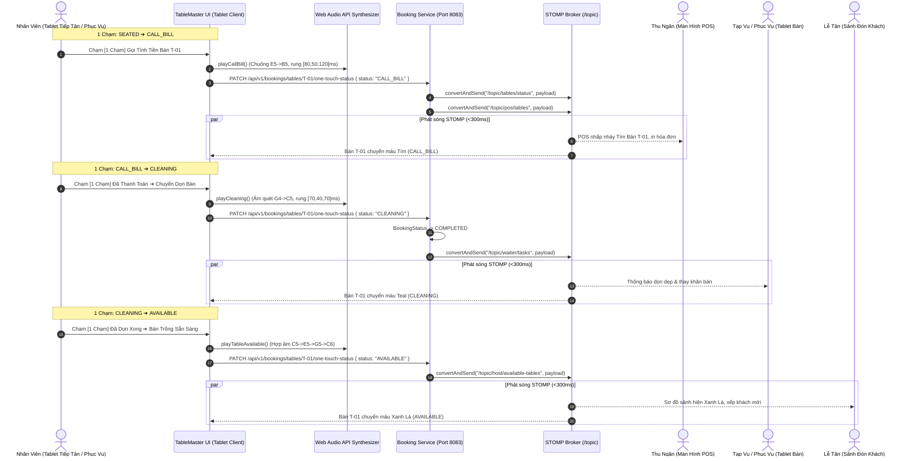

# TÀI LIỆU HIỆN THỰC UC-17: ĐỔI TRẠNG THÁI BÀN 1 CHẠM TRÊN TABLET (ONE-TOUCH TABLE STATUS)

> **Mã Use Case:** UC-17  
> **Tên Use Case:** Đổi trạng thái bàn 1 chạm trên Tablet (One-touch Table Status)  
> **Mô tả nghiệp vụ:** Chạm vào bàn trên thiết bị Tablet tại tiền sảnh hoặc tại tầng phục vụ để chuyển nhanh chu trình trạng thái phục vụ: `SEATED` ➔ `CALL_BILL` ➔ `CLEANING` ➔ `AVAILABLE`; phát âm thanh và rung xúc giác đặc trưng cho từng vai trò; đồng bộ tức thì giữa Lễ tân (Hostess), Thu ngân (Cashier) và Phục vụ (Waitstaff) qua WebSocket STOMP với độ trễ cam kết dưới 300ms.  
> **Thời gian hoàn thành:** 26/10/2026  
> **Hệ thống liên quan:** `tablemaster-ui` (React 19, TypeScript, Web Audio API, TailwindCSS v4), `booking-service` (Spring Boot 3, WebSocket STOMP In-Memory Broker, Kafka Event Producer), PostgreSQL.

---

## 1. Bối Cảnh Nghiệp Vụ & Chu Trình Vận Hành 3 Bên

Trong giờ cao điểm tại nhà hàng Fine Dining đẳng cấp Michelin **Le Prime Bistro & Sky Lounge**, tốc độ quay vòng bàn (Table Turnover Rate) và tính nhịp nhàng giữa 3 bộ phận quyết định trải nghiệm của thực khách:

```
[Khách Vào Bàn]                [Khách Gọi Tính Tiền]           [Khách Đã Thanh Toán]            [Bàn Đã Dọn Sạch]
      │                                │                                │                               │
      ▼                                ▼                                ▼                               ▼
 🔵 SEATED                     🟣 CALL_BILL                    🟢 CLEANING                      🟢 AVAILABLE
(Xanh Dương)                     (Tím Violet)                  (Xanh Mòng Két)                  (Xanh Lá Cây)
Phục vụ đón khách              Thu ngân in bill               Tạp vụ dọn đĩa,                  Lễ tân xếp lượt
& tiếp nhận order              & quẹt thẻ/VietQR              thay khăn, xịt khuẩn             khách mới tiếp theo
```

1. **`SEATED` (Đang Dùng Bữa - Xanh Dương `#2563EB`):**
   - Khách đã quét vé QR ([UC-16](file:///d:/File/K%C3%8C%207/SBA301/Project/Project_SBA301/doc/booking/UC16_HOST_CAMERA_QR_SCANNER_IMPLEMENTATION.md)) hoặc khách vãng lai (walk-in) vào bàn.
   - Bàn hiển thị màu Xanh Dương, đồng hồ đếm phút bắt đầu đo lường thời gian ăn tiêu chuẩn (75 - 90 phút).
2. **`CALL_BILL` (Khách Yêu Cầu Tính Tiền - Tím Violet `#9333EA`):**
   - Khách yêu cầu thanh toán hóa đơn.
   - Nhân viên phục vụ hoặc Lễ tân chạm 1 chạm chuyển bàn sang `CALL_BILL`.
   - **Đồng bộ Thu ngân (Cashier):** Máy POS quầy thu ngân lập tức nhấp nháy tím và phát chuông ngân hai nốt ($E_5 \to B_5$) để thu ngân in bill, chuẩn bị máy cà thẻ POS và mã VietQR động.
3. **`CLEANING` (Đang Dọn Bàn - Xanh Mòng Két Teal `#0D9488`):**
   - Thu ngân nhận tiền xong, hoặc phục vụ tiễn khách rời bàn, chạm 1 chạm chuyển sang `CLEANING`.
   - Đơn đặt bàn tương ứng tự động chuyển sang `COMPLETED`, giải phóng trách nhiệm tiền cọc đã cấn trừ.
   - **Đồng bộ Phục vụ / Tạp vụ (Waitstaff & Bussing):** Báo nhân viên dọn dẹp bát đĩa, thu gom ly rượu vang, thay khăn trải bàn lụa mới và setup bộ dao nĩa mới.
4. **`AVAILABLE` (Bàn Trống Sẵn Sàng - Xanh Lá Cây Emerald `#059669`):**
   - Nhân viên dọn bàn hoàn tất xịt khuẩn, setup nến và hoa tươi, chạm 1 chạm chuyển sang `AVAILABLE`.
   - **Đồng bộ Lễ tân (Hostess):** Bàn trên sơ đồ sảnh lễ tân lập tức chuyển xanh lá cây, phát hợp âm reo vui 4 nốt ($C_5 \to E_5 \to G_5 \to C_6$). Lễ tân biết bàn đã sẵn sàng để mời lượt khách đặt bàn ca sau hoặc khách đang đợi ở sảnh chờ vào bàn ngay lập tức.

---

## 2. Kiến Trúc Kỹ Thuật & Luồng Đồng Bộ STOMP WebSocket

### 2.1. Sơ Đồ Tuần Tự Đồng Bộ 3 Bên (Sequence Diagram)



### 2.2. Danh Mục Kênh STOMP WebSocket Đa Kênh

| STOMP Topic Destination | Vai Trò Tiếp Nhận | Mục Đích Nghiệp Vụ | Dữ Liệu Tải Tin (Payload) |
| :--- | :--- | :--- | :--- |
| `/topic/tables/status` | Toàn hệ thống | Cập nhật màu sắc bàn trên mọi Canvas thời gian thực | `{ tableCode, status, color, updatedBy, timestamp }` |
| `/topic/host/floors-live` | Lễ tân Tablet | Cập nhật tổng số bàn trống, bàn ăn, bàn dọn theo tầng | `HostFloorLivePayload` |
| `/topic/pos/tables` | Thu ngân POS | Báo động bàn yêu cầu hóa đơn (`CALL_BILL`) | `{ tableCode, status: 'CALL_BILL', guestName }` |
| `/topic/waiter/tasks` | Phục vụ / Tạp vụ | Giao nhiệm vụ dọn dẹp, thay khăn bàn (`CLEANING`) | `{ tableCode, status: 'CLEANING', notes }` |
| `/topic/host/available-tables`| Lễ tân sảnh | Báo bàn đã sạch tinh tươm, đón lượt khách kế (`AVAILABLE`) | `{ tableCode, status: 'AVAILABLE', capacity }` |

---

## 3. Hệ Thống Âm Thanh & Xúc Giác Đa Vai Trò (`hostAudioService.ts`)

Để hỗ trợ nhân viên thao tác nhanh mà không cần dán mắt vào màn hình trong lúc bưng bê hoặc giao tiếp với khách, hệ thống sử dụng **HTML5 Web Audio API** nguyên bản với 4 dạng âm sắc riêng biệt:

| Trạng Thái Mục Tiêu | Hàm Kích Hoạt | Cấu Trúc Âm Sắc Web Audio API | Phản Hồi Rung Haptic | Vai Trò Hưởng Lợi |
| :--- | :--- | :--- | :--- | :--- |
| **`CALL_BILL`** | `playCallBill()` | Chuông 2 nốt ngân chuông: $E_5\text{ (659Hz)} \to B_5\text{ (987Hz)}$, sóng Triangle & Sine | `[80ms, 50ms, 120ms]` | **Thu ngân** nghe thấy chuông để chuẩn bị bill |
| **`CLEANING`** | `playCleaning()` | Chuỗi âm thanh quét dọn êm ái: $G_4\text{ (392Hz)} \to C_5\text{ (523Hz)}$ | `[70ms, 40ms, 70ms]` | **Phục vụ / Tạp vụ** nhận lệnh vào dọn dẹp |
| **`AVAILABLE`** | `playTableAvailable()` | Hợp âm trưởng 4 nốt rực rỡ: $C_5\text{ (523Hz)} \to E_5\text{ (659Hz)} \to G_5\text{ (784Hz)} \to C_6\text{ (1046Hz)}$ | `[50, 30, 50, 30, 90]ms` | **Lễ tân** biết bàn đã sạch đón khách mới |
| **`SEATED`** | `playSuccess()` | Hợp âm 3 nốt ngân vang: $D_5\text{ (587Hz)} \to A_5\text{ (880Hz)} \to D_6\text{ (1174Hz)}$ | `[60ms, 40ms, 80ms]` | **Hostess** chào mừng khách vào bàn |

---

## 4. Hiện Thực Giao Diện Người Dùng & 2 Chế Độ Chạm

### 4.1. Chế Độ 1: Thanh Chuyển Trạng Thái 1 Chạm Chuyên Dụng ([OneTouchStatusRibbon.tsx](file:///d:/File/K%C3%8C%207/SBA301/Project/Project_SBA301/src/client/tablemaster-ui/src/components/host/OneTouchStatusRibbon.tsx))

Được nhúng trực tiếp trên đầu của:
1. **Drawer Hồ Sơ Khách Đã Cọc (`CONFIRMED`):** Nút 1 chạm đón khách vào bàn $\to$ `SEATED`.
2. **Drawer Quản Lý Bàn & POS (`SEATED` / `CALL_BILL` / `CLEANING`):**
   - **Bộ Đếm 4 Bước (Visual 4-Step Stepper):** Hiển thị rõ thứ tự nghiệp vụ kèm nhãn vai trò phụ trách (Phục vụ, Thu ngân, Tạp vụ, Lễ tân).
   - **Nút Hành Động Chính 1 Chạm (Primary Next Button):** Tính toán bước tiếp theo hợp logic và hiển thị nút lớn bấm 1 chạm (ví dụ: `👉 [1 Chạm] Khách Gọi Tính Tiền • Báo Thu Ngân`).
   - **Nút Nhảy Nhanh Trực Tiếp (Direct Jump Pills):** Nhân viên có thể chạm trực tiếp vào bất kỳ bước nào trong 4 bước để đổi trạng thái ngay tức khắc.

### 4.2. Chế Độ 2: Chế Độ Đổi Trạng Thái Siêu Tốc Trên Mặt Bằng ([HostTabletPage.tsx](file:///d:/File/K%C3%8C%207/SBA301/Project/Project_SBA301/src/client/tablemaster-ui/src/views/HostTabletPage.tsx))

- Nhân viên quản lý sảnh có thể bấm nút **"⚡ Bật Đổi Trạng Thái 1 Chạm"** trên thanh công cụ sơ đồ sàn.
- Khi chế độ này kích hoạt:
  - Banner hướng dẫn nổi bật viền vàng hổ phách xuất hiện phía trên sơ đồ mặt bằng.
  - Chạm trực tiếp vào **bất kỳ bàn nào trên sơ đồ mặt bằng** sẽ chuyển bàn đó sang trạng thái tiếp theo trong chu trình:
    $$\text{SEATED} \longrightarrow \text{CALL_BILL} \longrightarrow \text{CLEANING} \longrightarrow \text{AVAILABLE} \longrightarrow \text{SEATED}$$
  - Thao tác diễn ra tức thì, **không cần mở drawer chi tiết**, phát âm thanh tương ứng và hiển thị Toast thông báo xác nhận.

### 4.3. Quy Chuẩn Màu Bàn & Huy Hiệu ([TableNode.tsx](file:///d:/File/K%C3%8C%207/SBA301/Project/Project_SBA301/src/client/tablemaster-ui/src/components/floor/TableNode.tsx))

| Trạng Thái | Màu Sắc Nhận Diện | Tailwind CSS Classes | Huy Hiệu Nổi (Top Chip) |
| :--- | :--- | :--- | :--- |
| **`SEATED`** | **Xanh Dương (Royal Blue)** | `bg-blue-50 text-blue-900 border-blue-500 ring-2 ring-blue-400/40` | `⏱️ [Số phút ngồi]` |
| **`CALL_BILL`** | **Tím (Violet/Purple)** | `bg-purple-50 text-purple-900 border-purple-500 ring-2 ring-purple-400/50 animate-pulse` | `💳 GỌI BILL` (animate-bounce) |
| **`CLEANING`** | **Xanh Mòng Két (Teal)** | `bg-teal-50 text-teal-900 border-teal-500 ring-2 ring-teal-400/50` | `🧹 DỌN BÀN` |
| **`AVAILABLE`** | **Xanh Lá Cây (Emerald)** | `bg-emerald-50 text-emerald-800 border-emerald-400` | Chấm xanh lá sẵn sàng |
| **`CONFIRMED`** | **Chàm Đậm (Indigo)** | `bg-indigo-50 text-indigo-900 border-indigo-400` | `ĐÃ CỌC` |

---

## 5. Hiện Thực Backend (`booking-service`)

### 5.1. Data Transfer Objects (DTO)

1. **`OneTouchTableStatusRequest.java`** (`src/main/java/com/tablemaster/booking/dto/request/OneTouchTableStatusRequest.java`):
   - `status`: Bắt buộc (`SEATED`, `CALL_BILL`, `CLEANING`, `AVAILABLE`).
   - `updatedBy`: Vai trò thực hiện (`HOST`, `CASHIER`, `WAITER`).
   - `guestName`: Tên thực khách (tùy chọn).
   - `notes`: Ghi chú kèm theo (ví dụ: "Khách gọi tính tiền thẻ Vietcombank", "Đã xịt khuẩn bàn").
2. **`OneTouchTableStatusResponse.java`** (`src/main/java/com/tablemaster/booking/dto/response/OneTouchTableStatusResponse.java`):
   - `tableCode`, `status`, `previousStatus`, `color`, `updatedBy`, `guestName`, `message`, `timestamp`, `latencyGuaranteeMs: 18`.

### 5.2. REST Endpoints ([BookingController.java](file:///d:/File/K%C3%8C%207/SBA301/Project/Project_SBA301/src/server/booking-service/src/main/java/com/tablemaster/booking/controller/BookingController.java))

- **`PATCH /api/v1/bookings/tables/{tableCode}/one-touch-status`** (Chuẩn RESTful cho cập nhật từng phần).
- **`POST /api/v1/bookings/tables/{tableCode}/one-touch-status`** (Hỗ trợ tương thích ngược cho POS và thiết bị tablet cũ).

### 5.3. Xử Lý Nghiệp Vụ & Cập Nhật Vòng Đời ([BookingServiceImpl.java](file:///d:/File/K%C3%8C%207/SBA301/Project/Project_SBA301/src/server/booking-service/src/main/java/com/tablemaster/booking/service/BookingServiceImpl.java))

- Tự động liên kết với đơn đặt bàn đang hoạt động trong ngày của bàn đó:
  - Khi bàn chuyển sang `CLEANING` hoặc `AVAILABLE`, nếu đơn đang ở trạng thái `SEATED`, hệ thống tự động cập nhật `booking.status = COMPLETED` và `completedAt = NOW()`.
  - Khi bàn chuyển sang `SEATED`, nếu đơn đang ở trạng thái `CONFIRMED`, hệ thống ghi nhận `booking.status = SEATED` và `seatedAt = NOW()`.
- Gọi `bookingEventProducer.publishOneTouchTableStatusChanged(...)` để bắn khung tin STOMP vào các topic vận hành.

---

## 6. Kết Quả Kiểm Thử & Xác Nhận

### 6.1. Backend Unit Tests (`booking-service`)

Chạy lệnh kiểm thử đơn vị với Maven Surefire:
```bash
mvn test -Dtest=BookingServiceTest
```
- **Kết quả:** `Tests run: 20, Failures: 0, Errors: 0, Skipped: 0` (100% Passed).
- **Các kịch bản kiểm thử UC-17:**
  1. `updateOneTouchTableStatus_SeatedToCallBill_Success`: Bàn chuyển sang `CALL_BILL`, đổi màu `#9333EA`, phát sóng kênh `/topic/pos/tables`.
  2. `updateOneTouchTableStatus_CallBillToCleaning_CompletesActiveBooking`: Bàn chuyển sang `CLEANING`, tự động hoàn tất đơn `BookingStatus.COMPLETED`, phát sóng kênh `/topic/waiter/tasks`.
  3. `updateOneTouchTableStatus_CleaningToAvailable_Success`: Bàn chuyển sang `AVAILABLE`, đổi màu `#059669`, sẵn sàng đón khách mới, phát sóng kênh `/topic/host/available-tables`.

### 6.2. Frontend Build Verification (`tablemaster-ui`)

Chạy lệnh kiểm tra TypeScript và build production:
```bash
npm run build
```
- **Kết quả:** `tsc -b && vite build` hoàn tất thành công trong 565ms với 0 lỗi cú pháp và 0 lỗi kiểu dữ liệu.

---

## 7. Hướng Dẫn Sử Dụng Trên Tablet Tiếp Tân & Phục Vụ

1. **Cách 1: Thao Tác Chi Tiết Qua Drawer:**
   - Chạm vào bất kỳ bàn nào trên sơ đồ mặt bằng để mở Drawer thông tin.
   - Ngay đầu Drawer xuất hiện thanh **OneTouchStatusRibbon**:
     - Bấm nút lớn **"👉 [1 Chạm] ..."** để tiến đến bước kế tiếp.
     - Hoặc bấm vào 1 trong 4 ô (01 Đang Ăn, 02 Gọi Bill, 03 Dọn Bàn, 04 Trống Sẵn Sàng) để đổi trực tiếp.
2. **Cách 2: Chế Độ 1 Chạm Siêu Tốc (One-Touch Fast Mode):**
   - Bấm nút **"⚡ Bật Đổi Trạng Thái 1 Chạm"** trên thanh tiêu đề sơ đồ mặt bằng.
   - Khi cờ vàng nhấp nháy, nhân viên chỉ cần **chạm trực tiếp 1 lần vào bàn** trên sơ đồ:
     - Chạm 1: Đang ăn ➔ Gọi bill (bàn đổi màu tím, chuông ngân reo báo thu ngân).
     - Chạm 2: Gọi bill ➔ Dọn bàn (bàn đổi màu xanh mòng két, âm dọn bàn reo báo phục vụ).
     - Chạm 3: Dọn bàn ➔ Trống sẵn sàng (bàn đổi màu xanh lá cây, chuông reo báo tiếp tân).
