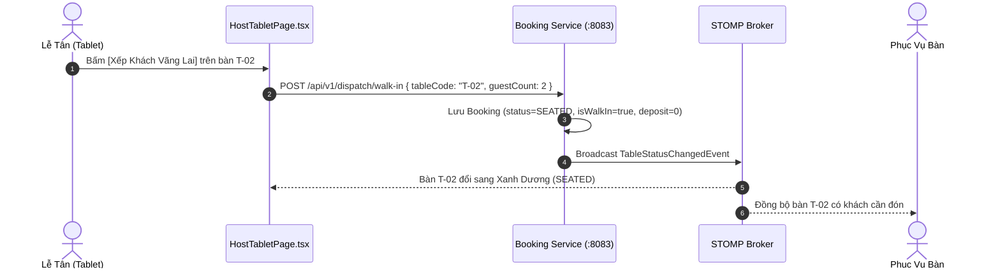

# TÀI LIỆU HIỆN THỰC UC-18: XẾP CHỖ CẤP TỐC CHO KHÁCH VÃNG LAI (WALK-IN FAST ALLOCATION)

> **Mã Use Case:** UC-18  
> **Tên Use Case:** Xếp chỗ Cấp tốc cho Khách vãng lai (Walk-in Fast Allocation)  
> **Phân hệ phụ trách:** Booking & Dispatch Service (:8083) & Host Tablet UI  
> **Thành viên thực hiện:** Duy Đào (Module 3)  
> **Hệ thống liên quan:** `booking-service` (Spring Boot 3, Redis, WebSocket STOMP), `tablemaster-ui` (HostTabletPage.tsx).

---

## 1. Nghiệp Vụ Xếp Chỗ Khách Vãng Lai

Tại quầy lễ tân (Front Desk), khi có khách vãng lai (Walk-in Guests) đến nhà hàng trực tiếp mà không đặt chỗ trước qua website:
1. Lễ tân quan sát màn hình **Host Tablet Live View** ([UC-15](file:///d:/SBA301/Projec_Cuoi_Ki/doc/booking/UC15_HOST_FLOOR_LIVE_VIEW_IMPLEMENTATION.md)) để tìm các bàn có trạng thái `AVAILABLE` (Xanh lá).
2. Lễ tân chạm vào bàn trống $\rightarrow$ Chọn **"Xếp Khách Vãng Lai"** $\rightarrow$ Nhập số lượng khách và ghi chú nhanh.
3. Hệ thống tạo lập tức một đơn đặt bàn với:
   - `status = SEATED`
   - `totalDeposit = 0` (Miễn phí cọc do khách đã có mặt trực tiếp tại cửa)
   - `isWalkIn = true`
4. WebSocket STOMP lập tức broadcast tín hiệu đổi màu bàn sang **Xanh Dương (`SEATED`)** trên toàn bộ hệ thống (Lễ tân, Phục vụ, Thu ngân).

---

## 2. Luồng Xử Lý Kỹ Thuật

---

## 3. Thành Phần Triển Khai Trong Mã Nguồn

- **Backend:** `BookingServiceImpl.java` xử lý tạo đơn vãng lai `createWalkInBooking`, kiểm tra sức chứa bàn và kích hoạt sự kiện Kafka/WebSocket.
- **Frontend:** Modal xếp khách vãng lai tích hợp trực tiếp trên [`HostTabletPage.tsx`](file:///d:/SBA301/Projec_Cuoi_Ki/src/client/tablemaster-ui/src/views/HostTabletPage.tsx) với bàn phím số cảm ứng tối ưu cho iPad.
