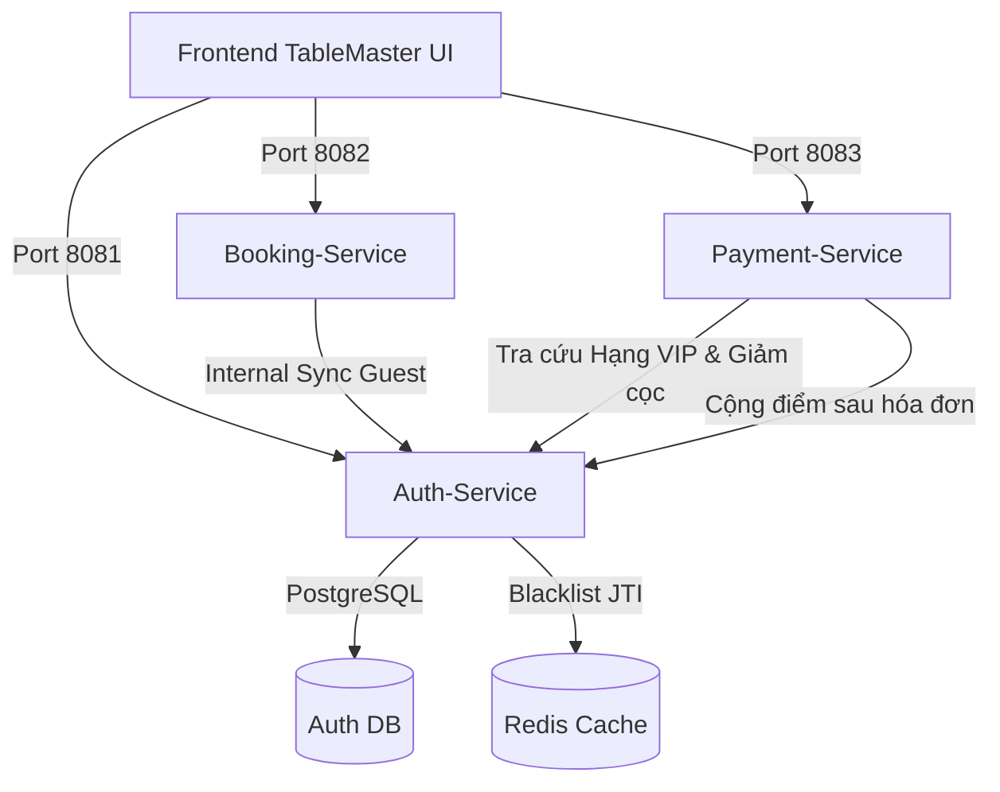

# TỔNG QUAN PHÂN HỆ AUTH & IDENTITY SERVICE (MODULE 1)
# BẢNG ĐẶC TẢ USE CASES & CƠ CHẾ BẢO MẬT TOÀN DIỆN

> **Dự án:** Hệ thống Quản trị Đặt bàn & Điều phối Bàn ăn Cao cấp (TableMaster)  
> **Cổng dịch vụ (Port):** `8081`  
> **Cơ sở dữ liệu:** PostgreSQL (`users`, `refresh_tokens`, `reviews`)  
> **Bộ nhớ đệm (Cache & Invalidation):** Redis (`blacklist:token:<jti>`)  
> **Trạng thái kiểm thử:**  **33/33 Unit & Integration Tests Passed (100%)**

---

## 1. DANH SÁCH USE CASES ĐƯỢC ĐẶC TẢ CHI TIẾT

| Mã UC | Tên Use Case | Tác nhân chính | Trạng thái Backend & Frontend | File Tài Liệu Đặc Tả Chi Tiết |
| :---: | :--- | :---: | :---: | :--- |
| **UC-01** | **Multi-Channel Authentication & Token Security** | Customer, Staff, Admin |  Đã hoàn thành | [UC-01-MULTI-CHANNEL-AUTHENTICATION.md](file:///d:/SBA301/Projec_Cuoi_Ki/doc/uc-spec/auth-service/UC-01-MULTI-CHANNEL-AUTHENTICATION.md) |
| **UC-02** | **Diner Profile & Dietary Preferences** | Customer, Waitstaff, Chef |  Đã hoàn thành | [UC-02-DINER-PROFILE-PREFERENCES.md](file:///d:/SBA301/Projec_Cuoi_Ki/doc/uc-spec/auth-service/UC-02-DINER-PROFILE-PREFERENCES.md) |
| **UC-09** | **Loyalty Wallet & VIP Points** | Customer, Payment-Service, Admin |  Đã hoàn thành | [UC-09-LOYALTY-VIP-POINTS.md](file:///d:/SBA301/Projec_Cuoi_Ki/doc/uc-spec/auth-service/UC-09-LOYALTY-VIP-POINTS.md) |
| **UC-14** | **Post-Dining Review & CSAT CSAT Feedback** | Customer, Manager |  Đã hoàn thành | [UC-14-POST-DINING-REVIEW.md](file:///d:/SBA301/Projec_Cuoi_Ki/doc/uc-spec/auth-service/UC-14-POST-DINING-REVIEW.md) |

---

## 2. CÁC CẢI TIẾN BẢO MẬT ĐÃ ĐƯỢC XÂY DỰNG & HOÀN THIỆN

### 2.1. Vòng đời Token trên Frontend (`sessionStorage`)
* **Vấn đề trước đây:** Sử dụng `localStorage` dẫn đến việc token lưu vĩnh viễn trên trình duyệt. Khi tắt tab, tắt máy hoặc khởi động lại Docker, tài khoản Admin/Staff vẫn tự động đăng nhập khi mở lại trang.
* **Giải pháp hiện tại:** Toàn bộ `accessToken`, `refreshToken`, và `currentUser` được chuyển dịch sang `sessionStorage` trong [authStorage.ts](file:///d:/SBA301/Projec_Cuoi_Ki/src/client/tablemaster-ui/src/services/authStorage.ts). Khi đóng tab hoặc tắt trình duyệt, toàn bộ phiên đăng nhập tự động hủy sạch sẽ.

### 2.2. Vô hiệu hóa Token khi Server khởi động lại (Server Boot Epoch Invalidation)
* **Vấn đề bảo mật:** Trường hợp hacker đã kịp copy chuỗi JWT ra ngoài trước khi Docker tắt; khi Docker bật lại, nếu token còn hạn 15 phút, hacker vẫn có thể giả mạo request.
* **Giải pháp backend:**
  - `JwtTokenProvider` ghi nhận mốc thời gian máy chủ khởi động: `serverStartTime = Instant.now()`.
  - Mọi request có `issuedAt < serverStartTime` đều bị `JwtAuthenticationFilter` từ chối `401 Unauthorized` ngay từ tầng Gateway/Filter.

### 2.3. Tự động làm mới phiên ngầm (Silent Refresh) cho nhân viên trực ca
* **Vấn đề thực tế:** Nhân viên lễ tân hoặc phục vụ làm việc ca dài 4 - 8 tiếng. Access Token 15 phút hết hạn sẽ khiến họ bị văng ra giữa chừng.
* **Giải pháp:** Cơ chế `authFetch` tự động bắt mã lỗi `401`, lấy Refresh Token gửi tới `/api/v1/auth/refresh` để nhận cặp Token mới và gửi lại request ban đầu một cách hoàn toàn trong suốt.

### 2.4. Thu hồi Token tức thì với Redis Blacklist (Instant Logout)
* Khi người dùng nhấn Đăng xuất:
  - Token `jti` (JWT ID) được đưa vào Redis Blacklist với TTL bằng đúng thời gian sống còn lại của Token.
  - Refresh Token trong DB bị đổi trạng thái `is_revoked = true`.
  - Bất kỳ cố gắng tái sử dụng token đã thu hồi sẽ bị từ chối truy cập ngay lập tức.

---

## 3. LIÊN KẾT LIÊN DỊCH VỤ (CROSS-SERVICE INTEGRATION)

---

## 4. TỔNG HỢP KIỂM THỬ (VERIFICATION SUMMARY)

* **Backend Test Suite:**
  - `mvn test -q` tại thư mục `src/server/auth-service`
  - Kết quả: **33/33 Tests Run, 0 Failures, 0 Errors, 0 Skipped**.
* **Frontend Build Suite:**
  - `npm run build` tại `src/client/tablemaster-ui`
  - Kết quả: **Built cleanly in 2.62s, 0 TypeScript / Lint Errors**.
