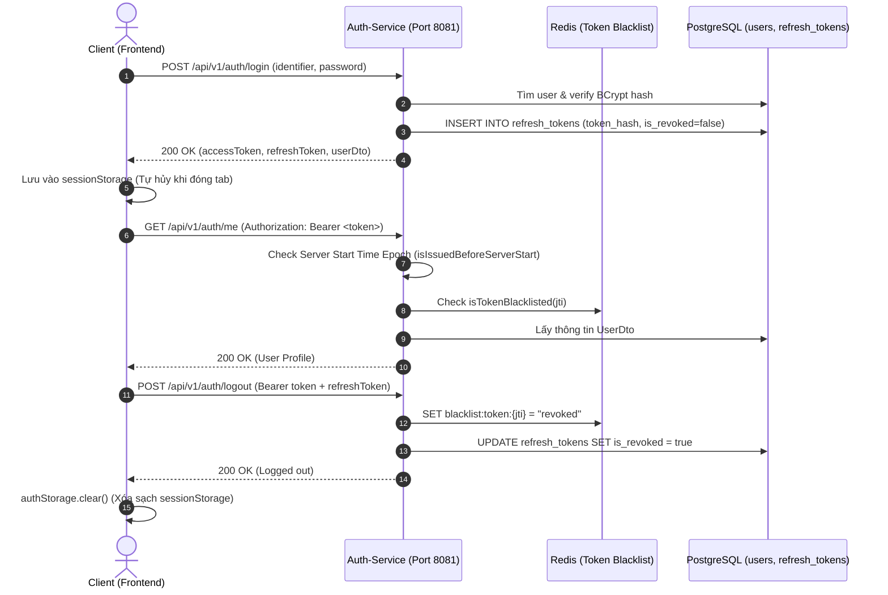

# ĐẶC TẢ CHI TIẾT USE CASE: UC-01
# ĐĂNG KÝ, ĐĂNG NHẬP ĐA KÊNH & QUẢN LÝ PHIÊN BẢO MẬT (MULTI-CHANNEL AUTH & TOKEN SECURITY)

> **Dự án:** Hệ thống Quản lý Đặt bàn & Điều phối Bàn ăn Nhà hàng Cao cấp (TableMaster)  
> **Phân hệ:** Module 1 - Auth & Identity Service (Port 8081)  
> **Mã Use Case:** `UC-01`  
> **Trạng thái:**  **Hoàn thành 100% & Đã kiểm thử thành công (Tested & Verified - 33/33 Tests Pass)**

---

## 1. TỔNG QUAN USE CASE (OVERVIEW)

### 1.1. Mục tiêu
Cung cấp dịch vụ quản lý định danh và xác thực tập trung cho toàn bộ hệ thống TableMaster:
1. **Đa kênh xác thực (Multi-Channel):** Hỗ trợ đăng ký và đăng nhập bằng Email/Mật khẩu hoặc Số điện thoại.
2. **Khách hàng đặt bàn trực tiếp (Seamless Phone Diners):** Cho phép thực khách đặt bàn không cần tài khoản (`password_hash IS NULL`), sau đó hỗ trợ nâng cấp lên thành viên VIP chính thức khi được cấp mật khẩu.
3. **Bảo mật phiên đăng nhập nâng cao:**
   - Cặp đôi Token: **Access Token JWT (15 phút)** + **Refresh Token (30 ngày)** có băm mã `SHA-256`.
   - **Token Rotation:** Thu hồi refresh token cũ (`is_revoked = TRUE`) và sinh refresh token mới mỗi lần làm mới.
   - **Tự động làm mới ngầm (Silent Refresh):** Nhân viên trực ca 4-8 tiếng không bị gián đoạn.
   - **Server Boot Epoch Invalidation:** Tắt/bật lại Docker là tự động vô hiệu hóa toàn bộ token cũ (`issuedAt < serverStartTime`).
   - **Thu hồi tức thì (Redis Token Blacklist):** Khi đăng xuất (Logout), token `jti` được lưu vào Redis với TTL tương ứng.
   - **Lưu trữ Session Storage trên Frontend:** Đóng tab hoặc tắt trình duyệt là tự hủy phiên sạch sẽ.

### 1.2. Hệ thống Tác nhân (Actors)
* **Khách hàng (Customer):** Đăng ký, đăng nhập tài khoản thành viên để tích điểm và đặt bàn.
* **Nhân viên nội bộ (Staff - Admin / Manager / Host / Waiter):** Đăng nhập vào các Portal chuyên biệt (Admin Studio, Host Tablet, Waitstaff Mobile).
* **Quản trị viên (Admin):** Quản lý trạng thái khóa/mở khóa tài khoản, cấp mật khẩu cho khách đặt trực tiếp.

---

## 2. KIẾN TRÚC & QUY TẮC NGHIỆP VỤ (BUSINESS RULES)

* **BR-AUTH-01 (Mật khẩu an toàn):** Mật khẩu người dùng được băm bằng thuật toán `BCrypt` với salt rounds chuẩn 10.
* **BR-AUTH-02 (Thời hạn Token):** Access Token có TTL 15 phút (900,000 ms). Refresh Token có TTL 30 ngày.
* **BR-AUTH-03 (Token Rotation & Chống tái sử dụng):** Khi client gọi `/api/v1/auth/refresh`, refresh token hiện tại bị đổi `is_revoked = true`. Nếu một refresh token đã hủy bị gửi lại, hệ thống phát hiện hành vi tấn công và từ chối `401 Unauthorized`.
* **BR-AUTH-04 (Redis Blacklist):** Khi gọi `/api/v1/auth/logout`, `jti` của access token được đưa vào Redis `blacklist:token:<jti>`. Mọi request dùng token này sẽ bị `JwtAuthenticationFilter` chặn `401`.
* **BR-AUTH-05 (Server Boot Invalidation):** Mọi token có thời gian phát hành trước mốc khởi động của server (`serverStartTime`) đều bị từ chối truy cập.

---

## 3. DANH SÁCH ENDPOINTS API (RESTFUL SPECIFICATION)

| STT | Phương thức | Đường dẫn Endpoint | Quyền hạn | Mô tả chức năng |
| :---: | :---: | :--- | :---: | :--- |
| 1 | `POST` | `/api/v1/auth/register` | Public | Đăng ký tài khoản khách hàng mới bằng SĐT/Email |
| 2 | `POST` | `/api/v1/auth/login` | Public | Đăng nhập bằng Email/SĐT + Mật khẩu, trả về cặp Token + UserDto |
| 3 | `POST` | `/api/v1/auth/refresh` | Public | Làm mới Access Token ngầm bằng Refresh Token |
| 4 | `POST` | `/api/v1/auth/logout` | Public/Auth | Thu hồi Access Token vào Redis Blacklist & hủy Refresh Token trong DB |
| 5 | `GET` | `/api/v1/auth/me` | Authenticated | Lấy thông tin user hiện tại (dùng để Auto-Verify session khi mở trang) |
| 6 | `GET` | `/api/v1/auth/admin/users` | `ROLE_ADMIN`, `ROLE_MANAGER` | Danh sách người dùng, lọc theo `GUEST`, `REGISTERED`, `STAFF` |
| 7 | `PUT` | `/api/v1/auth/admin/users/{id}/toggle-status` | `ROLE_ADMIN` | Khóa hoặc Mở khóa tài khoản người dùng |
| 8 | `POST` | `/api/v1/auth/admin/users/{id}/set-password` | `ROLE_ADMIN` | Cấp mật khẩu nâng cấp khách đặt trực tiếp thành thành viên VIP |
| 9 | `POST` | `/api/v1/auth/admin/users/sync-guest` | Public/Internal | Đồng bộ tự động khách đặt trực tiếp từ đơn bàn sang Auth DB |

---

## 4. LUỒNG HOẠT ĐỘNG CHI TIẾT (FLOW DIAGRAM)

