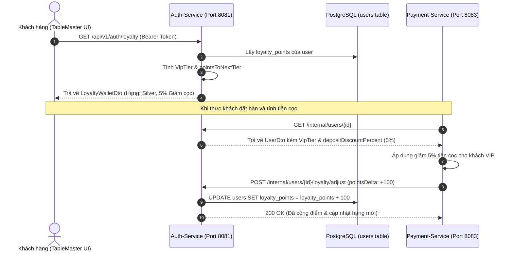

# ĐẶC TẢ CHI TIẾT USE CASE: UC-09
# HỆ THỐNG ĐIỂM THƯỞNG & HẠNG THÀNH VIÊN VIP (LOYALTY WALLET & VIP TIERS)

> **Dự án:** Hệ thống Quản lý Đặt bàn & Điều phối Bàn ăn Nhà hàng Cao cấp (TableMaster)  
> **Phân hệ:** Module 1 - Auth & Identity Service (Port 8081)  
> **Mã Use Case:** `UC-09`  
> **Trạng thái:**  **Hoàn thành 100% & Đã kiểm thử thành công (Tested & Verified - 33/33 Tests Pass)**

---

## 1. TỔNG QUAN USE CASE (OVERVIEW)

### 1.1. Mục tiêu
Cung cấp giải pháp gắn kết khách hàng thân thiết (Customer Retention & Loyalty Program) thông qua:
1. **Ví điểm thưởng số (Loyalty Wallet):** Tự động tích lũy điểm khi hoàn tất đặt bàn ăn, chi tiêu dịch vụ, hoặc gửi đánh giá trải nghiệm ẩm thực.
2. **Cơ chế phân hạng VIP tự động (Tier Elevation):** Tính toán hạng thành viên linh hoạt dựa trên điểm tích lũy: `Đồng (Bronze)`, `Bạc (Silver)`, `Vàng (Gold)`, `Kim Cương (Diamond)`.
3. **Đặc quyền giảm trừ tiền cọc bàn (Deposit Discount Benefit):** Hạng thành viên càng cao thì tỷ lệ giảm trừ tiền cọc khi đặt bàn tiệc/phòng VIP càng lớn, liên kết trực tiếp với Payment Service (`Module 3`).
4. **Điều chỉnh điểm linh hoạt (Audited Points Adjustment):** Hỗ trợ cộng/trừ điểm thủ công từ Admin Studio hoặc tự động qua Rest API nội bộ (Internal Service-to-Service).

### 1.2. Hệ thống Tác nhân (Actors)
* **Thực khách / Hội viên (Diner / VIP Member):** Xem số dư điểm, hạng thành viên hiện tại, tiến trình thăng hạng và đặc quyền giảm cọc.
* **Payment Service / Booking Service (Internal Client):** Truy vấn hạng thành viên và yêu cầu khấu trừ hoặc cộng điểm khi hoàn tất hóa đơn.
* **Quản trị viên / Quản lý nhà hàng (Admin / Manager):** Kiểm tra lịch sử, tặng điểm tri ân hoặc khấu trừ điểm khi có khiếu nại.

---

## 2. QUY TẮC PHÂN HẠNG VÀ TÍNH ĐIỂM (TIER CALCULATION & BUSINESS RULES)

### 2.1. Bảng quy đổi Hạng VIP & Quyền lợi Giảm cọc

| Hạng Thành Viên | Điểm tối thiểu (`minPoints`) | Tỷ lệ giảm cọc (`depositDiscountPercent`) | Đặc quyền dịch vụ |
| :--- | :---: | :---: | :--- |
| **BRONZE (Đồng)** | 0 | 0% | Hạng cơ bản khi đăng ký tài khoản mới hoặc khách vãng lai |
| **SILVER (Bạc)** | 500 | 5% | Giảm 5% tiền cọc bàn tiệc, ưu tiên xác nhận bàn trong giờ cao điểm |
| **GOLD (Vàng)** | 1,000 | 10% | Giảm 10% tiền cọc bàn tiệc, ưu tiên chọn bàn view đẹp / ban công |
| **DIAMOND (Kim Cương)** | 2,500 | 15% | Giảm 15% cọc, miễn phí giữ bàn VIP Lounge, ưu đãi món tráng miệng Signature |

### 2.2. Quy tắc nghiệp vụ chi tiết

* **BR-LOYALTY-01 (Tự động cập nhật hạng):** Điểm số luôn là số nguyên không âm (`loyaltyPoints >= 0`). Bất kỳ thay đổi nào về điểm số sẽ tự động kích hoạt hàm `VipTier.fromPoints(newPoints)` để cập nhật hạng ngay lập tức.
* **BR-LOYALTY-02 (Tính điểm thăng hạng tiếp theo):** Trường `pointsToNextTier` hiển thị số điểm cần đạt để lên hạng tiếp theo:
  - Nếu `< 500`: `pointsToNextTier = 500 - currentPoints` (Lên Silver).
  - Nếu `< 1000`: `pointsToNextTier = 1000 - currentPoints` (Lên Gold).
  - Nếu `< 2500`: `pointsToNextTier = 2500 - currentPoints` (Lên Diamond).
  - Nếu `>= 2500`: `pointsToNextTier = 0` (Đã đạt mức tối đa).
* **BR-LOYALTY-03 (Tích điểm từ Đánh giá):** Mỗi lượt gửi đánh giá ẩm thực thành công (UC-14) được tự động tặng ngay **+50 điểm thưởng**.
* **BR-LOYALTY-04 (Xử lý giao dịch nguyên khối):** Mọi thao tác điều chỉnh điểm đều chạy trong `@Transactional` để chống race-condition khi đồng thời cấn trừ điểm cọc và cộng điểm thưởng.

---

## 3. DANH SÁCH ENDPOINTS API (RESTFUL SPECIFICATION)

| STT | Phương thức | Endpoint URI | Quyền hạn | Mục đích sử dụng |
| :---: | :---: | :--- | :---: | :--- |
| 1 | `GET` | `/api/v1/auth/loyalty` | Authenticated | Thực khách tra cứu Ví điểm thưởng và Hạng VIP cá nhân |
| 2 | `POST` | `/api/v1/auth/loyalty/adjust` | Authenticated | Yêu cầu tích hoặc trừ điểm bản thân (cho các mini-event / voucher) |
| 3 | `POST` | `/api/v1/auth/admin/users/{id}/adjust-loyalty` | `ROLE_ADMIN` | Quản trị viên can thiệp điều chỉnh điểm của khách hàng |
| 4 | `POST` | `/internal/users/{id}/loyalty/adjust` | Internal Network | Microservice khác gọi trực tiếp không cần JWT để cộng/trừ điểm |

---

## 4. CHI TIẾT PAYLOAD & SCHEMA

### 4.1. Response Schema: `LoyaltyWalletDto`
```json
{
  "userId": "3fa85f64-5717-4562-b3fc-2c963f66afa6",
  "loyaltyPoints": 750,
  "vipTier": "SILVER",
  "vipTierName": "Bạc",
  "pointsToNextTier": 250,
  "depositDiscountPercent": 5
}
```

### 4.2. Request Schema: `LoyaltyAdjustRequest`
```json
{
  "pointsDelta": 50,
  "reason": "Hoàn tất đánh giá dịch vụ ẩm thực #BK-98214",
  "referenceId": "550e8400-e29b-41d4-a716-446655440000"
}
```

---

## 5. LUỒNG TƯƠNG TÁC HỆ THỐNG (SEQUENCE DIAGRAM)



---

## 6. GIAO DIỆN HIỂN THỊ TRÊN FRONTEND (UI MAPPING)

1. **Thanh Header & User Menu:** Huy hiệu hạng VIP (`Bronze`, `Silver`, `Gold`, `Diamond`) với màu sắc ánh kim sang trọng hiển thị cạnh tên tài khoản.
2. **Profile Modal (`ProfileModal.tsx`):**
   - Thẻ VIP Card hiển thị trực quan: Tên chủ thẻ, Hạng hội viên, Số điểm hiện có.
   - Thanh tiến trình (Progress Bar) sinh động hiển thị số điểm cần đạt để chạm mốc tiếp theo.
   - Thống kê tỷ lệ đặc quyền được chiết khấu trực tiếp trên tiền cọc bàn.
3. **Trang Quản Trị Khách Hàng (`AdminPortal`):**
   - Bảng danh sách hội viên hiển thị cột Hạng VIP, Điểm tích lũy.
   - Modal Điều Chỉnh Điểm: Cho phép Admin nhập số điểm cộng/trừ và lý do lưu vết kiểm toán.
