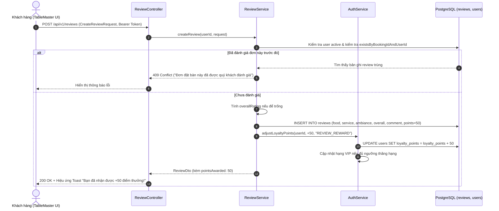

# ĐẶC TẢ CHI TIẾT USE CASE: UC-14
# ĐÁNH GIÁ TRẢI NGHIỆM ẨM THỰC & THƯỞNG ĐIỂM HỘI VIÊN (POST-DINING REVIEW & CSAT)

> **Dự án:** Hệ thống Quản lý Đặt bàn & Điều phối Bàn ăn Nhà hàng Cao cấp (TableMaster)  
> **Phân hệ:** Module 1 - Auth & Identity Service (Port 8081)  
> **Mã Use Case:** `UC-14`  
> **Trạng thái:**  **Hoàn thành 100% & Đã kiểm thử thành công (Tested & Verified - 33/33 Tests Pass)**

---

## 1. TỔNG QUAN USE CASE (OVERVIEW)

### 1.1. Mục tiêu
Nâng tầm trải nghiệm thực khách và kiểm soát chất lượng vận hành nhà hàng thông qua hệ thống phản hồi CSAT (Customer Satisfaction Score):
1. **Đánh giá đa chiều chuyên sâu:** Thu thập điểm chấm (1 - 5 sao) trên 3 tiêu chí cốt lõi của ẩm thực cao cấp:
   - **Món ăn (Food Quality):** Độ tươi ngon, hương vị, cách trình bày món.
   - **Phục vụ (Staff Service):** Tốc độ tiếp đón, thái độ và sự chu đáo của nhân viên.
   - **Không gian (Ambiance):** Âm nhạc, ánh sáng, nhiệt độ phòng và độ sạch sẽ.
2. **Tính điểm tổng thể tự động (Overall Rating):** Nếu khách không chỉ định, hệ thống tự tính điểm trung bình chuẩn hóa.
3. **Thưởng điểm tri ân tự động (Loyalty Incentive):** Tặng ngay **+50 điểm Loyalty Points** vào ví hội viên cho mỗi đánh giá hợp lệ nhằm kích thích phản hồi chân thực.
4. **Hiển thị minh bạch:** Cung cấp API đánh giá gần đây (`/api/v1/reviews/recent`) để trình diễn sự hài lòng của thực khách trên Landing Page và trang Giới thiệu.

### 1.2. Hệ thống Tác nhân (Actors)
* **Thực khách (Customer / Diner):** Gửi phản hồi, chấm điểm sau bữa ăn từ tài khoản cá nhân.
* **Hệ thống Auth / Loyalty:** Tiếp nhận đánh giá, lưu vết và tự động cộng điểm thưởng.
* **Quản lý nhà hàng (Manager / Admin):** Theo dõi các đánh giá mới để kịp thời ghi nhận nhân viên xuất sắc hoặc xử lý khiếu nại chất lượng.

---

## 2. QUY TẮC NGHIỆP VỤ (BUSINESS RULES)

* **BR-REV-01 (Xác thực thực khách):** Khách hàng phải đăng nhập (`Bearer Token`) mới có thể gửi đánh giá. Tài khoản bị vô hiệu hóa (`isActive = false`) sẽ bị từ chối `403 Forbidden`.
* **BR-REV-02 (Chống Spam / Đánh giá trùng lặp):** Mỗi đơn đặt bàn (`bookingId`) chỉ được phép đánh giá duy nhất **1 lần**. Nếu gửi lại cùng một `bookingId`, hệ thống trả về lỗi `409 Conflict`.
* **BR-REV-03 (Quy chuẩn thang điểm):** Các trường `foodRating`, `serviceRating`, `ambianceRating` là bắt buộc, giá trị nằm trong khoảng từ 1 đến 5 sao.
* **BR-REV-04 (Điểm tổng thể):** Nếu `overallRating` không được gửi lên, backend tự động tính:
  $$\text{overallRating} = \text{round}\left(\frac{\text{foodRating} + \text{serviceRating} + \text{ambianceRating}}{3.0}\right)$$
* **BR-REV-05 (Thưởng điểm thành viên):** Sau khi lưu đánh giá thành công vào bảng `reviews`, hệ thống lập tức gọi `authService.adjustLoyaltyPoints(userId, +50, "REVIEW_REWARD", reviewId)` trong cùng transaction để đảm bảo toàn vẹn dữ liệu.

---

## 3. DANH SÁCH ENDPOINTS API (RESTFUL SPECIFICATION)

| STT | Phương thức | Endpoint URI | Quyền hạn | Mục đích sử dụng |
| :---: | :---: | :--- | :---: | :--- |
| 1 | `POST` | `/api/v1/reviews` | Authenticated | Gửi đánh giá trải nghiệm và nhận ngay +50 điểm thưởng |
| 2 | `GET` | `/api/v1/reviews/my` | Authenticated | Lấy danh sách lịch sử tất cả đánh giá của chính người dùng |
| 3 | `GET` | `/api/v1/reviews/recent` | Public | Lấy danh sách đánh giá mới nhất (mặc định limit = 10, tối đa 50) |

---

## 4. CHI TIẾT PAYLOAD & SCHEMA

### 4.1. Request Schema: `CreateReviewRequest`
```json
{
  "bookingId": "c9a41926-2ec7-40c2-901b-c74ad3d9c792",
  "foodRating": 5,
  "serviceRating": 4,
  "ambianceRating": 5,
  "overallRating": 5,
  "comment": "Không gian vô cùng lãng mạn, món Bò Wagyu A5 mềm tan mọng nước. Nhân viên phục vụ rất tinh tế!"
}
```

### 4.2. Response Schema: `ReviewDto`
```json
{
  "id": "1b9d6bcd-bbfd-4b2d-9b5d-ab8dfbbd4bed",
  "userId": "3fa85f64-5717-4562-b3fc-2c963f66afa6",
  "customerName": "Nguyễn Hoàng Nam",
  "customerAvatar": "https://api.dicebear.com/7.x/avataaars/svg?seed=Nam",
  "bookingId": "c9a41926-2ec7-40c2-901b-c74ad3d9c792",
  "foodRating": 5,
  "serviceRating": 4,
  "ambianceRating": 5,
  "overallRating": 5,
  "comment": "Không gian vô cùng lãng mạn, món Bò Wagyu A5 mềm tan mọng nước. Nhân viên phục vụ rất tinh tế!",
  "pointsAwarded": 50,
  "createdAt": "2026-10-24T00:30:00Z"
}
```

---

## 5. LUỒNG TƯƠNG TÁC HỆ THỐNG (SEQUENCE DIAGRAM)



---

## 6. GIAO DIỆN HIỂN THỊ TRÊN FRONTEND (UI MAPPING)

1. **Modal Đánh Giá Trải Nghiệm (`ReviewModal.tsx`):**
   - Thiết kế giao diện sang trọng chuẩn Fine Dining.
   - 3 hàng chọn sao vàng trực quan cho: **Ẩm thực**, **Phục vụ**, **Không gian**.
   - Khung nhập nhận xét (Textarea) với bộ đếm ký tự (tối đa 1000 ký tự).
   - Banner nổi bật: *"Gửi đánh giá để nhận ngay 50 điểm thưởng thành viên"*.
2. **Thông Báo & Cập Nhật Realtime:**
   - Sau khi gửi thành công, ví điểm cá nhân tại Header & Profile tự động cập nhật ngay lập tức không cần F5 trang.
3. **Landing Page Testimonials:**
   - Carousel các lời khen ngợi từ khách hàng được tải động từ `/api/v1/reviews/recent`.
