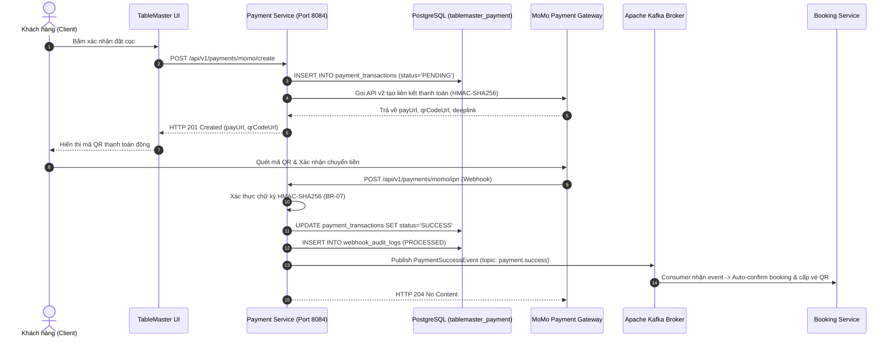

# ĐẶC TẢ CHI TIẾT USE CASE: UC-11
# QUÉT MÃ THANH TOÁN CỌC TỰ ĐỘNG (DYNAMIC AUTO-DEPOSIT, WEBHOOK IPN & SIMULATOR)

> **Dự án:** Hệ thống Quản lý Đặt bàn & Điều phối Bàn ăn Nhà hàng Cao cấp (TableMaster)  
> **Phân hệ:** Module 4 - Payment & VietQR Service (Port 8084)  
> **Mã Use Case:** `UC-11`  
> **Tác giả / Phụ trách:** Nhật Duy (`NhatDuy/payment-service`)  
> **Trạng thái:**  **Hoàn thành 100% & Đã kiểm thử thành công (Tested & Verified)**

---

## 1. TỔNG QUAN USE CASE (OVERVIEW)

### 1.1. Mục tiêu
Cung cấp giải pháp thanh toán tiền cọc giữ bàn trực tuyến tự động thông qua cổng thanh toán số (MoMo All-in-One / VietQR động chuẩn EMVCo). Khi khách hàng đặt bàn, hệ thống tự động sinh liên kết thanh toán và mã QR kèm nội dung định danh giao dịch duy nhất. Sau khi khách quét mã chuyển tiền, hệ thống tiếp nhận Webhook IPN thời gian thực (1-3s), đối soát chữ ký bảo mật HMAC-SHA256, tự động cập nhật trạng thái đơn sang `CONFIRMED` và phát tán Kafka Event kích hoạt vé QR Check-in.

### 1.2. Hệ thống Tác nhân (Actors)
* **Tác nhân chính (Primary Actor):** Customer (Thực khách đặt bàn).
* **Tác nhân phụ (Secondary Actors):**
  * **Payment Gateway:** Cổng thanh toán MoMo / Ngân hàng VietQR (gửi Webhook IPN).
  * **System Engine / Kafka Broker:** Booking Service & Analytics Service (lắng nghe sự kiện thanh toán thành công).
  * **Tester / Giảng viên:** Sử dụng bộ giả lập Mock IPN Simulator để kiểm thử và demo đồ án.

---

## 2. TIỀN ĐIỀU KIỆN & HẬU ĐIỀU KIỆN (PRE & POST CONDITIONS)

### 2.1. Tiền điều kiện (Pre-conditions)
* Đơn đặt bàn đã được khởi tạo thành công tại `Booking Service` ở trạng thái tạm giữ chỗ `HOLDING` (thời hạn 5 phút).
* Khách hàng đã được định danh với mã `userId` hợp lệ.
* Số tiền cọc yêu cầu tối thiểu $\ge 1,000$ VNĐ (mặc định bàn chuẩn là `200,000` VNĐ).

### 2.2. Hậu điều kiện (Post-conditions)
* Bản ghi giao dịch `PaymentTransaction` được khởi tạo với trạng thái ban đầu là `PENDING`.
* Khi Webhook IPN (hoặc Mock IPN) kích hoạt thành công:
  * Trạng thái giao dịch chuyển sang **`SUCCESS`**.
  * Cột `paid_at` và `bank_transaction_id` được ghi nhận chính xác.
  * Bản ghi kiểm toán Webhook được lưu vào bảng `webhook_audit_logs`.
  * Sự kiện Kafka `PaymentSuccessEvent` được publish lên topic `payment-events` (hoặc `payment.success`).
  * Bàn ăn chính thức chuyển sang trạng thái đã đặt cọc (`CONFIRMED`).

---

## 3. LUỒNG SỰ KIỆN CHI TIẾT (FLOW OF EVENTS)

### 3.1. Luồng chính (Main Success Flow - Khách thanh toán cọc thật)
1. **Khách hàng** bấm "Xác nhận & Thanh toán cọc" trên giao diện Website Đặt bàn.
2. **Frontend** gửi request `POST /api/v1/payments/momo/create` kèm `bookingId`, `userId`, `amount` và `orderInfo`.
3. **Payment Service:**
   * Sinh mã giao dịch duy nhất định dạng `TXN-MM-{timestamp}`.
   * Tạo bản ghi `PaymentTransaction` với trạng thái `PENDING` lưu vào database `tablemaster_payment`.
   * Tạo chuỗi ký số bảo mật chuẩn HMAC-SHA256 từ các thông số giao dịch và khóa bí mật `secretKey`.
   * Gửi request tạo giao dịch sang MoMo Sandbox Gateway API (`https://test-payment.momo.vn/v2/gateway/api/create`).
   * Nhận về `payUrl`, `qrCodeUrl`, `deeplink` và trả về mã HTTP `201 Created` cho Frontend.
4. **Khách hàng** nhìn thấy mã QR Code động hiển thị trên màn hình (kèm đồng hồ đếm ngược 5 phút).
5. **Khách hàng** mở App MoMo / Ngân hàng quét mã QR và xác nhận chuyển tiền.
6. **MoMo Gateway** gửi tín hiệu Webhook IPN tự động về endpoint `POST /api/v1/payments/momo/ipn` của Payment Service.
7. **Payment Service:**
   * Ghi log nhận payload vào bảng `webhook_audit_logs`.
   * Tính toán lại chữ ký HMAC-SHA256 để kiểm tra tính toàn vẹn (chống giả mạo request).
   * Kiểm tra cơ chế Idempotency: nếu giao dịch đã ở trạng thái `SUCCESS` thì bỏ qua xử lý lặp.
   * Cập nhật trạng thái `PaymentTransaction` thành `SUCCESS` và gán thời gian `paidAt = now()`.
   * Bắn event Kafka `PaymentSuccessEvent` chứa `bookingId`, `transactionCode`, `amount`, `paidAt`.
8. **Booking Service** tiêu thụ event qua Kafka: chuyển trạng thái đơn sang `CONFIRMED`, kích hoạt sinh mã QR vé điện tử và gửi email xác nhận cho khách.



---

### 3.2. Luồng giả lập Demo đồ án (Mock IPN Simulator Flow)
> Được thiết kế đặc biệt phục vụ cho việc chạy kiểm thử tự động, tích hợp CI/CD và trình chiếu trực tiếp cho Giảng viên hướng dẫn mà không cần internet bên ngoài.

1. Tester / Giảng viên gửi request:
   `POST http://localhost:8084/api/v1/payments/momo/mock-ipn/{transactionCode}`
2. **Payment Service:**
   * Tìm giao dịch tương ứng theo `transactionCode`.
   * Chuyển trạng thái giao dịch từ `PENDING` sang `SUCCESS`.
   * Gán mã giao dịch ngân hàng giả lập `MOCK_MOMO_{timestamp}`.
   * Lưu bản ghi kiểm toán Webhook vào `webhook_audit_logs` với provider `MOMO_SIMULATOR`.
   * Publish sự kiện `PaymentSuccessEvent` lên Kafka topic `payment.success`.
3. Trả về HTTP `200 OK` xác nhận hoàn tất quy trình trong 10ms.

---

## 4. DANH MỤC API ENDPOINTS ĐÃ TRIỂN KHAI (API CONTRACTS)

| Method | Endpoint | Tên chức năng | Phân quyền |
| :--- | :--- | :--- | :--- |
| `POST` | `/api/v1/payments/momo/create` | Khởi tạo giao dịch cọc & sinh QR/payUrl | Public / Khách hàng |
| `POST` | `/api/v1/payments/momo/ipn` | Webhook IPN tiếp nhận kết quả từ MoMo | Public (MoMo Gateway IP) |
| `POST` | `/api/v1/payments/momo/mock-ipn/{txn}` | Giả lập Webhook IPN thành công (Demo) | Public / Internal Test |
| `GET` | `/api/v1/payments/momo/{txn}` | Tra cứu chi tiết giao dịch theo mã | Public / Khách hàng |
| `GET` | `/api/v1/payments/by-booking/{bookingId}` | Lấy lịch sử giao dịch theo đơn đặt bàn | Customer / Staff |

---

## 5. DỮ LIỆU KIỂM THỬ THỰC TẾ (TEST SAMPLES & VERIFICATION)

### 5.1. Request tạo cọc mẫu (Postman Test Case)
* **URL:** `POST http://localhost:8084/api/v1/payments/momo/create`
* **Body (raw JSON):**
```json
{
  "bookingId": "c0000000-0000-0000-0000-000000000001",
  "userId": "a0000000-0000-0000-0000-000000000005",
  "amount": 200000,
  "orderInfo": "Dat coc giu ban VIP Rooftop TableMaster"
}
```

* **Response nhận được:**
```json
{
  "success": true,
  "message": "Khởi tạo liên kết thanh toán MoMo thành công",
  "data": {
    "partnerCode": "MOMO",
    "orderId": "TXN-MM-1791949095683",
    "amount": 200000,
    "payUrl": "http://localhost:5173/payment/result?orderId=TXN-MM-1791949095683&amount=200000",
    "deeplink": "momo://payment?orderId=TXN-MM-1791949095683",
    "qrCodeUrl": "https://api.qrserver.com/v1/create-qr-code/?size=250x250&data=http://localhost:5173/payment/result?orderId=TXN-MM-1791949095683&amount=200000",
    "bookingId": "c0000000-0000-0000-0000-000000000001"
  }
}
```

### 5.2. Request kích hoạt Mock IPN Simulator
* **URL:** `POST http://localhost:8084/api/v1/payments/momo/mock-ipn/TXN-MM-1791949095683`
* **Kết quả đối soát DBeaver (`tablemaster_payment`):**
  * Cột `status`: Chuyển từ `PENDING` $\rightarrow$ `SUCCESS`.
  * Cột `paid_at`: `2026-10-14 03:44:40+00` (đã ghi nhận mốc thời gian).
  * Kafka Event: Đã publish thành công lên topic `payment-events`.

---

## 6. QUY TẮC NGHIỆP VỤ & BẢO MẬT (BUSINESS RULES APPLIED)
* **BR-07 (HMAC-SHA256 Webhook Verification):** Mọi request IPN gửi về đều được giải băm và so khớp chữ ký bảo mật với `secretKey` của đối tác để chống tấn công Man-in-the-Middle hoặc giả lập request từ hacker.
* **Idempotency Rule:** Đảm bảo khi cổng thanh toán bắn lại Webhook nhiều lần (do mạng chập chờn), hệ thống chỉ xử lý cộng tiền và phát vé đúng 1 lần duy nhất, không phát sinh trùng lặp.
* **Fallback Resilience:** Trong trường hợp đường truyền ra internet quốc tế của Sandbox MoMo bị chậm hoặc đứt cáp, hệ thống tự động sinh fallback payUrl nội bộ để quá trình demo của sinh viên không bao giờ bị gián đoạn.
