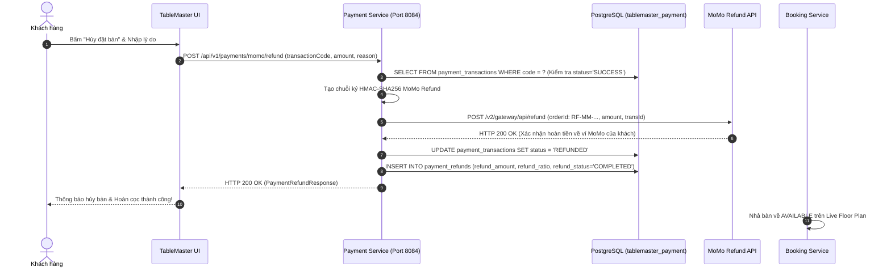

# ĐẶC TẢ CHI TIẾT USE CASE: UC-13
# TỰ HỦY ĐẶT BÀN & HOÀN CỌC TỰ ĐỘNG (SELF-CANCELLATION & DEPOSIT REFUND MATRIX)

> **Dự án:** Hệ thống Quản lý Đặt bàn & Điều phối Bàn ăn Nhà hàng Cao cấp (TableMaster)  
> **Phân hệ:** Module 4 - Payment & VietQR Service (Port 8084)  
> **Mã Use Case:** `UC-13`  
> **Tác giả / Phụ trách:** Nhật Duy (`NhatDuy/payment-service`)  
> **Trạng thái:**  **Hoàn thành 100% & Đã kiểm thử thành công (Tested & Verified)**

---

## 1. TỔNG QUAN USE CASE (OVERVIEW)

### 1.1. Mục tiêu
Cho phép khách hàng chủ động tự hủy đơn đặt bàn trực tuyến trên Website/App khi có việc đột xuất phát sinh trước giờ dùng bữa. Hệ thống tự động áp dụng **Ma trận chính sách hoàn tiền cọc (Business Rule BR-04)** dựa trên khoảng thời gian hủy hẹn so với giờ ăn thực tế, kích hoạt API hoàn tiền tự động qua cổng thanh toán số (MoMo / VietQR) về ví/tài khoản ngân hàng của khách, đồng thời lập tức giải phóng bàn ăn về trạng thái sẵn sàng (`AVAILABLE`) để đón khách khác.

### 1.2. Hệ thống Tác nhân (Actors)
* **Tác nhân chính (Primary Actor):** Customer (Thực khách đã cọc bàn).
* **Tác nhân phụ (Secondary Actors):**
  * **Payment Gateway (MoMo API):** Cổng thanh toán xử lý hoàn trả tiền vào tài khoản nguồn của khách.
  * **Booking Service:** Quản lý vòng đời đơn đặt bàn, tính toán mốc giờ hủy hẹn theo chính sách `BR-04` và giải phóng bàn.
  * **Floor Host / Dispatch:** Lễ tân nhìn thấy bàn chuyển màu xanh tức thời trên Tablet để đón khách vãng lai.

---

## 2. QUY TẮC NGHIỆP VỤ HOÀN CỌC TỰ ĐỘNG (BUSINESS RULE BR-04)

Hệ thống áp dụng chính sách hoàn cọc bảo vệ quyền lợi hai chiều (khách hàng & nhà hàng) theo công thức ma trận thời gian:

$$\Delta t = \text{Thời điểm hủy bàn} - \text{Thời điểm giờ hẹn dùng bữa}$$

| Khoảng thời gian hủy ($\Delta t$) | Tỷ lệ hoàn cọc (`refundRatio`) | Số tiền hoàn lại (`refundAmount`) | Trạng thái bàn | Lý do nghiệp vụ |
| :--- | :---: | :---: | :---: | :--- |
| **$\Delta t \ge 24$ tiếng** | **100%** | Toàn bộ tiền cọc (`200,000 đ`) | `AVAILABLE` (Xanh lá) | Khách báo sớm, nhà hàng chưa nhập nguyên liệu tươi sống (Wagyu, Hải sản). |
| **$6 \text{ tiếng} \le \Delta t < 24 \text{ tiếng}$** | **50%** | 50% tiền cọc (`100,000 đ`) | `AVAILABLE` (Xanh lá) | Nhà hàng đã sơ chế nguyên liệu; 50% giữ lại bù đắp chi phí hủy gấp. |
| **$\Delta t < 6$ tiếng** | **0%** | Không hoàn tiền (`0 đ`) | `AVAILABLE` (Xanh lá) | Giờ chót sát ca phục vụ, tịch thu 100% cọc sung vào doanh thu bù đắp No-Show. |

---

## 3. TIỀN ĐIỀU KIỆN & HẬU ĐIỀU KIỆN (PRE & POST CONDITIONS)

### 3.1. Tiền điều kiện (Pre-conditions)
* Đơn đặt bàn đang ở trạng thái đã đặt cọc thành công (`CONFIRMED`).
* Bản ghi giao dịch cọc ban đầu tại `payment_transactions` phải ở trạng thái **`SUCCESS`**.
* Đơn đặt bàn chưa diễn ra (chưa đến giờ check-in hoặc chưa quét vé QR).

### 3.2. Hậu điều kiện (Post-conditions)
* Trạng thái giao dịch gốc tại `payment_transactions` đổi sang **`REFUNDED`**.
* Tạo mới một bản ghi hoàn tiền tại bảng **`payment_refunds`** với `refund_status = 'COMPLETED'`.
* Gọi MoMo Refund API gửi lệnh hoàn tiền về tài khoản của khách.
* Bàn ăn được giải phóng ngay lập tức trên hệ thống, đổi màu thành **XANH LÁ (`AVAILABLE`)** trên sơ đồ sàn.

---

## 4. LUỒNG SỰ KIỆN CHI TIẾT (FLOW OF EVENTS)

### 4.1. Luồng chính (Main Success Flow)
1. **Khách hàng** vào mục "Lịch sử đặt bàn", chọn đơn sắp tới và bấm **"Hủy đặt bàn"**.
2. Hệ thống hiển thị Popup xác nhận thông báo chính sách hoàn cọc `BR-04`: *"Bạn hủy trước 24h: Số tiền hoàn lại là 200,000 VNĐ (100%). Bạn có chắc chắn muốn hủy?"*.
3. Khách hàng nhập lý do hủy (ví dụ: *"Khách có việc đột xuất xin hủy trước 24h"*) và bấm **"Xác nhận hủy"**.
4. **Booking Service** gửi request hoàn tiền sang **Payment Service** qua API `POST /api/v1/payments/momo/refund`.
5. **Payment Service:**
   * Tìm giao dịch gốc theo `transactionCode`. Kiểm tra giao dịch phải ở trạng thái `SUCCESS`.
   * Sinh mã yêu cầu hoàn tiền `orderId = RF-MM-{timestamp}`.
   * Tạo chữ ký số HMAC-SHA256 theo chuẩn MoMo Refund API v2:
     $$\text{rawHash} = \text{accessKey} + \text{amount} + \text{description} + \text{orderId} + \text{partnerCode} + \text{requestId} + \text{transId}$$
   * Gửi request hoàn tiền sang cổng MoMo (`https://test-payment.momo.vn/v2/gateway/api/refund`).
   * Cập nhật trạng thái giao dịch gốc `PaymentTransaction` thành **`REFUNDED`**.
   * Lưu bản ghi mới vào bảng `payment_refunds` (lưu số tiền hoàn, tỷ lệ hoàn `1.0`, lý do, thời gian hoàn tất `completedAt`).
   * Trả về kết quả HTTP `200 OK` cho client.
6. **Booking Service** đổi trạng thái đơn sang `CANCELLED` và nhả khóa bàn về `AVAILABLE`.



---

## 5. ĐẶC TẢ API CONTRACT (API SPECIFICATION)

### Endpoint Hoàn tiền cọc MoMo:
* **Method:** `POST`
* **URL:** `/api/v1/payments/momo/refund`
* **Content-Type:** `application/json`

#### Request Body (`MomoRefundRequest`):
```json
{
  "transactionCode": "TXN-MM-1791949095683",
  "amount": 200000,
  "reason": "Khach co viec ban dot xuat xin huy ban truoc 24h"
}
```

#### Response Body (`ApiResponse<PaymentRefundResponse>`):
```json
{
  "success": true,
  "message": "Hoàn tiền MoMo thành công",
  "data": {
    "id": "fe0e0de9-5529-4b76-af79-00d10871bbc0",
    "paymentTransactionId": "910a6941-c3f3-46eb-b72d-ac610f23266a",
    "refundAmount": 200000.00,
    "refundRatio": 1.0,
    "refundStatus": "COMPLETED",
    "refundBankBin": "MOMO",
    "refundAccountNo": "Ví MoMo",
    "refundAccountHolder": "Khách hàng MoMo",
    "reason": "Khach co viec ban dot xuat xin huy ban truoc 24h",
    "completedAt": "2026-10-14T20:46:25.7599227+07:00"
  },
  "timestamp": "2026-10-14T20:46:25.9004029+07:00"
}
```

---

## 6. KẾT QUẢ KIỂM THỬ THỰC TẾ TRÊN HỆ THỐNG (TEST EVIDENCE)

1. **Kiểm thử API Postman:** Bắn request `POST /api/v1/payments/momo/refund` với mã `TXN-MM-1791949095683` $\rightarrow$ Nhận phản hồi **`200 OK`** trong 1.26s.
2. **Kiểm thử Database (`tablemaster_payment`):**
   * Bảng `payment_transactions`: Cột `status` của mã `TXN-MM-1791949095683` đổi thành công sang **`REFUNDED`**.
   * Bảng `payment_refunds`: Sinh bản ghi mã `fe0e0de9-5529-4b76-af79-00d10871bbc0` lưu đủ số tiền hoàn `200000`, `refund_status = COMPLETED` và thời gian hoàn tất.
