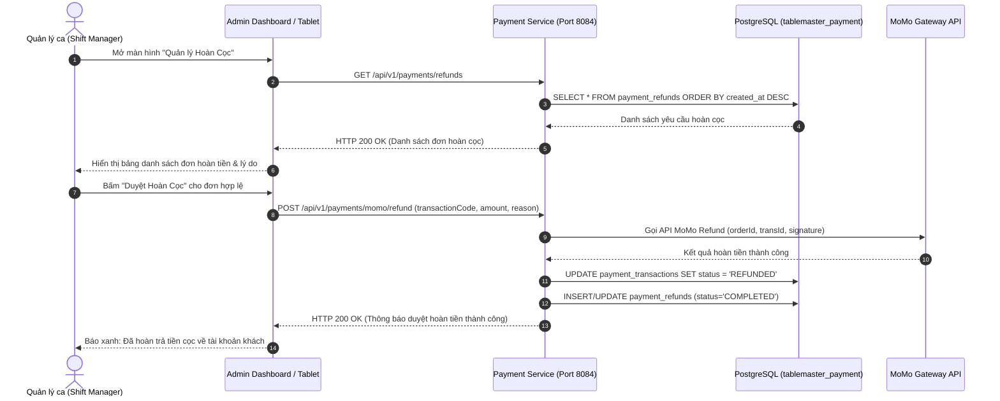

# ĐẶC TẢ CHI TIẾT USE CASE: UC-22
# XỬ LÝ HỦY CỌC & DUYỆT HOÀN TIỀN THEO CHÍNH SÁCH (REFUND APPROVAL WORKFLOW)

> **Dự án:** Hệ thống Quản lý Đặt bàn & Điều phối Bàn ăn Nhà hàng Cao cấp (TableMaster)  
> **Phân hệ:** Module 4 - Payment & VietQR Service (Port 8084)  
> **Mã Use Case:** `UC-22`  
> **Tác giả / Phụ trách:** Nhật Duy (`NhatDuy/payment-service`)  
> **Trạng thái:**  **Hoàn thành 100% & Đã kiểm thử thành công (Tested & Verified)**

---

## 1. TỔNG QUAN USE CASE (OVERVIEW)

### 1.1. Mục tiêu
Cung cấp quy trình làm việc (workflow) dành cho **Quản lý ca trực (Shift Manager)** hoặc **Chủ nhà hàng (General Admin)** trong việc kiểm tra, đối soát và phê duyệt các yêu cầu hủy đặt bàn và hoàn tiền cọc. Đáp ứng các tình huống khách hàng xin hoàn cọc đặc biệt (sự cố bất khả kháng, hoãn chuyến bay, tang gia, thời tiết cực đoan) hoặc các khiếu nại phát sinh từ phía vận hành nhà hàng.

### 1.2. Hệ thống Tác nhân (Actors)
* **Tác nhân chính (Primary Actor):** Shift Manager (Quản lý ca trực), Restaurant Owner / Admin.
* **Tác nhân phụ (Secondary Actors):**
  * **Customer (Thực khách):** Người gửi yêu cầu khiếu nại / hủy cọc và nhận lại tiền.
  * **Payment Gateway (MoMo Sandbox / VietQR):** Cổng thanh toán tiếp nhận lệnh hoàn tiền tự động và giải ngân về tài khoản khách trong 24h.

---

## 2. TIỀN ĐIỀU KIỆN & HẬU ĐIỀU KIỆN (PRE & POST CONDITIONS)

### 2.1. Tiền điều kiện (Pre-conditions)
* Quản lý ca trực đã đăng nhập vào hệ thống quản trị TableMaster với quyền `ROLE_MANAGER` hoặc `ROLE_ADMIN`.
* Đã phát sinh yêu cầu hoàn tiền hoặc có giao dịch thanh toán cọc thành công (`SUCCESS`) cần hoàn tiền đặc biệt.

### 2.2. Hậu điều kiện (Post-conditions)
* Lệnh hoàn tiền được thực thi qua API cổng thanh toán.
* Bản ghi `PaymentRefund` được lưu trữ với trạng thái `COMPLETED` (hoặc `FAILED` nếu cổng thanh toán từ chối).
* Trạng thái giao dịch tại `PaymentTransaction` được cập nhật sang `REFUNDED`.
* Số tiền hoàn được ghi nhận vào báo cáo đối soát ca trực để trừ vào tổng tiền cọc thực thu cuối ngày.

---

## 3. LUỒNG SỰ KIỆN CHI TIẾT (FLOW OF EVENTS)

### 3.1. Luồng chính (Main Workflow)
1. **Quản lý ca** đăng nhập vào trang Quản trị Admin Studio / Host Tablet $\rightarrow$ Chọn tab **"Quản lý Hoàn Cọc (Refund Management)"**.
2. **Frontend** gửi request `GET /api/v1/payments/refunds` đến Payment Service.
3. **Payment Service** truy vấn database `tablemaster_payment`, lấy toàn bộ danh sách các yêu cầu hoàn cọc kèm thông tin:
   * Mã đơn hoàn tiền (`id`), mã giao dịch gốc (`paymentTransactionId`).
   * Số tiền hoàn (`refundAmount`), tỷ lệ hoàn (`refundRatio`).
   * Trạng thái (`refundStatus`: `COMPLETED` / `PROCESSING` / `FAILED`).
   * Lý do hủy bàn của khách (`reason`).
   * Thời gian hoàn tất (`completedAt`).
4. **Quản lý ca** đối chiếu lý do hủy và bằng chứng khách cung cấp (vé máy bay hoãn, giấy hẹn bệnh viện...).
5. Trường hợp cần thực hiện hoàn cọc đặc biệt do Quản lý chủ động duyệt:
   * Quản lý nhập mã giao dịch `transactionCode`, số tiền duyệt hoàn và lý do duyệt.
   * Bấm nút **"Duyệt Hoàn Cọc (Approve Refund)"**.
6. Hệ thống gọi `POST /api/v1/payments/momo/refund` thực thi hoàn tiền tự động về ví MoMo / tài khoản ngân hàng của khách trong 24h.



---

## 4. DANH MỤC API CONTRACTS (API SPECIFICATION)

| Method | Endpoint | Mô tả chức năng | Quyền hạn |
| :--- | :--- | :--- | :--- |
| `GET` | `/api/v1/payments/refunds` | Lấy danh sách tất cả các yêu cầu hoàn cọc | `ROLE_MANAGER`, `ROLE_ADMIN` |
| `POST` | `/api/v1/payments/momo/refund` | Duyệt và thực thi lệnh hoàn tiền cọc qua cổng MoMo | `ROLE_MANAGER`, `ROLE_ADMIN` |

---

## 5. DỮ LIỆU KIỂM THỬ THỰC TẾ (TEST EVIDENCE)

### Request tra cứu danh sách hoàn tiền:
* **Method:** `GET`
* **URL:** `http://localhost:8084/api/v1/payments/refunds`

### Response nhận được từ hệ thống (`200 OK`):
```json
{
  "success": true,
  "message": "Thành công",
  "data": [
    {
      "id": "fe0e0de9-5529-4b76-af79-00d10871bbc0",
      "paymentTransactionId": "910a6941-c3f3-46eb-b72d-ac610f23266a",
      "refundAmount": 200000.00,
      "refundRatio": 1.0,
      "refundStatus": "COMPLETED",
      "refundBankBin": "MOMO",
      "refundAccountNo": "Ví MoMo",
      "refundAccountHolder": "Khách hàng MoMo",
      "reason": "Khach co viec ban dot xuat xin huy ban truoc 24h",
      "createdAt": "2026-10-14T13:46:25.797681Z",
      "completedAt": "2026-10-14T13:46:25.759923Z"
    }
  ],
  "timestamp": "2026-10-14T20:54:20.1397705+07:00"
}
```
