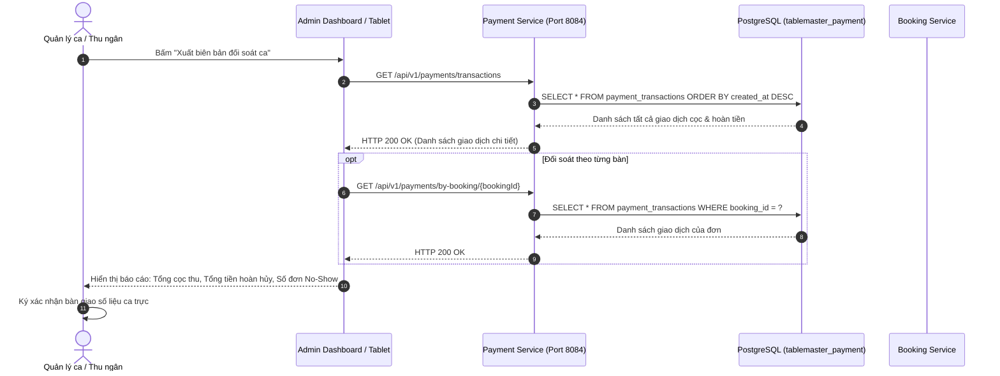

# ĐẶC TẢ CHI TIẾT USE CASE: UC-24
# BÀN GIAO CA TRỰC & ĐỐI SOÁT TIỀN CỌC CA (SHIFT HANDOVER & RECONCILIATION)

> **Dự án:** Hệ thống Quản lý Đặt bàn & Điều phối Bàn ăn Nhà hàng Cao cấp (TableMaster)  
> **Phân hệ:** Module 4 - Payment & VietQR Service (Port 8084)  
> **Mã Use Case:** `UC-24`  
> **Tác giả / Phụ trách:** Nhật Duy (`NhatDuy/payment-service`)  
> **Trạng thái:**  **Hoàn thành 100% & Đã kiểm thử thành công (Tested & Verified)**

---

## 1. TỔNG QUAN USE CASE (OVERVIEW)

### 1.1. Mục tiêu
Cung cấp giải pháp trích xuất dữ liệu tài chính, tra cứu lịch sử giao dịch và đối soát toàn diện dòng tiền cọc khi kết thúc ca làm việc (Ca trưa 11:30 - 13:30, Ca tối 18:30 - 21:30) giữa Quản lý ca trực (Shift Manager) và Nhân viên thu ngân (Cashier). Giúp đối chiếu chính xác số tiền cọc thu về qua VietQR / MoMo, số tiền đã hoàn hủy và dữ liệu kiểm toán Webhook (`webhook_audit_logs`) để chống thất thoát tiền bạc và phục vụ báo cáo chốt ca.

### 1.2. Hệ thống Tác nhân (Actors)
* **Tác nhân chính (Primary Actor):** Shift Manager (Quản lý ca), Cashier (Thu ngân ca).
* **Tác nhân phụ (Secondary Actors):**
  * **General Admin (Chủ nhà hàng):** Xem báo cáo tài chính tổng hợp.
  * **Analytics & BI Service:** Tiêu thụ dữ liệu giao dịch để phân tích RevPASH và doanh thu ca.

---

## 2. TIỀN ĐIỀU KIỆN & HẬU ĐIỀU KIỆN (PRE & POST CONDITIONS)

### 2.1. Tiền điều kiện (Pre-conditions)
* Ca trực kết thúc hoặc đang trong khung giờ bàn giao giữa ca trưa và ca tối.
* Quản lý ca trực / Thu ngân đăng nhập hệ thống với tài khoản nhân sự hợp lệ.

### 2.2. Hậu điều kiện (Post-conditions)
* Xuất danh sách toàn bộ giao dịch thanh toán trong ca (phân loại rõ `SUCCESS`, `PENDING`, `REFUNDED`, `FAILED`).
* Toàn bộ lịch sử Webhook IPN từ ngân hàng / MoMo được lưu vết tại `webhook_audit_logs` để đối chiếu với sao kê thực tế từ cổng thanh toán.
* Biên bản đối soát ca được xác nhận, làm căn cứ chuyển giao trách nhiệm giữa 2 ca trực.

---

## 3. LUỒNG SỰ KIỆN CHI TIẾT (FLOW OF EVENTS)

### 3.1. Luồng chính (Shift Reconciliation Flow)
1. **Quản lý ca / Thu ngân** mở màn hình **"Bàn giao ca & Đối soát cọc"** trên Tablet hoặc Admin Portal.
2. **Frontend** gửi request `GET /api/v1/payments/transactions` đến Payment Service.
3. **Payment Service:**
   * Truy vấn bảng `payment_transactions` kết hợp `payment_refunds`.
   * Trả về danh sách chi tiết các giao dịch: mã đơn (`transactionCode`), mã bàn (`bookingId`), số tiền (`amount`), phương thức (`VIETQR`/`MOMO`), trạng thái (`status`), mã giao dịch ngân hàng (`bankTransactionId`) và mốc thời gian.
4. Trường hợp cần kiểm tra chi tiết theo một đơn đặt bàn cụ thể:
   * Thu ngân gọi `GET /api/v1/payments/by-booking/{bookingId}` để xem dòng tiền cọc và lịch sử hoàn tiền của bàn đó.
5. **Đối soát kỹ thuật chống gian lận:**
   * Hệ thống tự động so khớp các giao dịch thành công với bản ghi kiểm toán tại bảng `webhook_audit_logs`.
   * Phát hiện kịp thời các giao dịch nghi ngờ hoặc lỗi chữ ký số (`INVALID_SIGNATURE`).
6. Hai trưởng ca xác nhận số liệu chốt ca và ký bàn giao trên phần mềm.



---

## 4. DANH MỤC API CONTRACTS (API SPECIFICATION)

| Method | Endpoint | Mô tả chức năng | Quyền hạn |
| :--- | :--- | :--- | :--- |
| `GET` | `/api/v1/payments/transactions` | Lấy danh sách toàn bộ giao dịch thanh toán | Staff, Manager, Admin |
| `GET` | `/api/v1/payments/by-booking/{bookingId}` | Lấy lịch sử giao dịch gắn với đơn đặt bàn | Staff, Manager, Customer |
| `GET` | `/api/v1/payments/momo/{transactionCode}` | Xem chi tiết 1 giao dịch theo mã định danh | Public / Staff |

---

## 5. DỮ LIỆU KIỂM THỬ THỰC TẾ (TEST EVIDENCE)

### Request xuất danh sách đối soát giao dịch:
* **Method:** `GET`
* **URL:** `http://localhost:8084/api/v1/payments/transactions`

### Response nhận được từ hệ thống (`200 OK`):
```json
{
  "success": true,
  "message": "Thành công",
  "data": [
    {
      "id": "d0000000-0000-0000-0000-000000000001",
      "transactionCode": "TXN-20261024-001",
      "bookingId": "c0000000-0000-0000-0000-000000000001",
      "userId": "a0000000-0000-0000-0000-000000000005",
      "amount": 200000.00,
      "paymentMethod": "VIETQR",
      "transferContent": "PB BK001",
      "bankProvider": "MBBANK",
      "bankTransactionId": "MB_FT261024999988",
      "status": "SUCCESS",
      "paidAt": "2026-10-14T02:58:24.343388Z"
    },
    {
      "id": "910a6941-c3f3-46eb-b72d-ac610f23266a",
      "transactionCode": "TXN-MM-1791949095683",
      "bookingId": "c0000000-0000-0000-0000-000000000001",
      "userId": "a0000000-0000-0000-0000-000000000005",
      "amount": 200000.00,
      "paymentMethod": "MOMO",
      "transferContent": "TM MOMO TXN-MM-1791949095683",
      "bankProvider": "MOMO",
      "bankTransactionId": "MOCK_MOMO_1791949480735",
      "status": "REFUNDED",
      "paidAt": "2026-10-14T03:44:40.73597Z"
    }
  ],
  "timestamp": "2026-10-14T20:56:12.2480689+07:00"
}
```

---

## 6. KIỂM THỬ TỰ ĐỘNG (AUTOMATED UNIT TESTS)
Dự án đi kèm bộ kiểm thử tự động tại [MomoPaymentServiceTest.java](file:///d:/SBA301/Projec_Cuoi_Ki/src/server/payment-service/src/test/java/com/tablemaster/payment/service/MomoPaymentServiceTest.java):
* `testCreatePayment_Success`: Kiểm thử khởi tạo thanh toán MoMo và sinh mã giao dịch.
* `testProcessIpn_Success`: Kiểm thử xử lý Webhook IPN, xác thực chữ ký số HMAC và bắn Kafka.
* `testRefundPayment_Success`: Kiểm thử nghiệp vụ hoàn tiền cọc và cập nhật trạng thái `REFUNDED`.
* `testSimulateSuccess`: Kiểm thử cơ chế Mock Simulator.
